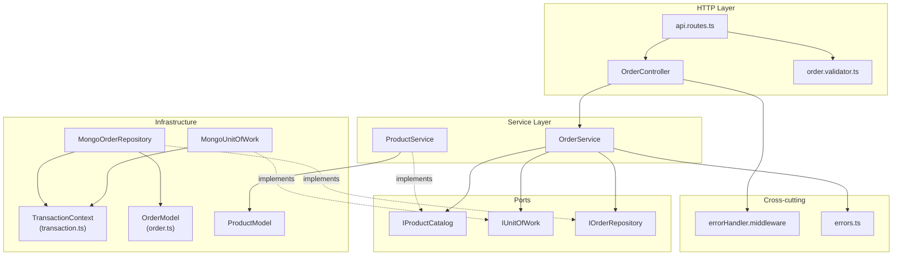

# [Documentation] Orders — documento técnico

## Qué pide la spec

La spec define el contrato REST del backend de pedidos de GREEN-H2 [ancla:endpoint POST /api/orders] [ancla:endpoint GET /api/orders] [ancla:endpoint GET /api/orders/:id] [ancla:endpoint POST /api/orders/:id/confirm]. Su propósito es permitir a un cliente autenticado crear un pedido a partir del catálogo disponible, confirmarlo en un segundo paso explícito y consultar sus pedidos con su último estado. Es el backend de GREEN-ORD-UX-001 (pantallas `/orders/new` y `/orders/:id/confirm`) y pertenece al agrupador GREEN-AGG-001. El repositorio partía vacío: la spec crea el backend desde cero.

El alcance cubre las historias de usuario [ancla:user_story HU-02], [ancla:user_story HU-03] y [ancla:user_story HU-04], que corresponden respectivamente a componer un pedido, confirmarlo y consultarlo. Quedan explícitamente fuera del alcance: pagos, envío, cancelación de pedidos, gestión del catálogo y emisión de tokens (la identidad la provee un proveedor externo).

El contrato gira en torno a la entidad [spec:entidad Order] —con los campos `_id`, `code`, `customerId`, `status`, `items`, `total`, `confirmedAt`, `createdAt` y `updatedAt`— y se apoya en [spec:entidad Product] para leer precios y disponibilidad en el momento de crear o confirmar.

Las reglas esenciales son:

- **Sin caché:** el listado y el detalle leen siempre de la base de datos en cada petición [spec:business_rule RN-01].
- **Aislamiento por cliente:** un cliente solo ve y opera sobre sus propios pedidos; sobre un pedido ajeno se responde `403 ORDER_FORBIDDEN` [spec:business_rule RN-02].
- **Creación no reserva stock:** la comprobación de disponibilidad al crear es bloqueante pero no aparta nada; el descuento real ocurre solo al confirmar [spec:business_rule RN-03].
- **Confirmación atómica e idempotente:** el descuento de disponibilidad se hace en una transacción; si alguna línea no alcanza, no se descuenta nada; confirmar un pedido ya confirmado devuelve `200` sin volver a descontar [spec:business_rule RN-04].
- **Precios calculados por el servidor:** el cliente nunca envía precios; el total se calcula con el precio del catálogo en el momento de crear [spec:business_rule RN-05].
- **Autenticación obligatoria:** sin token válido, cualquier endpoint responde `401 UNAUTHORIZED` [spec:business_rule RN-06].

## El trabajo y su historia

| work item | qué | tipo | estado | asignado a |
|---|---|---|---|---|
| WI-ORD-API-001 | [Backend] Orders — implementar endpoints | Backend | Cancelado | sin asignar |
| WI-ORD-API-002 | [Documentation] Orders — documento técnico | Documentación | Cancelado | sin asignar |
| WI-ORD-API-003 | [Backend] Products — implementar endpoints | Backend | Cancelado | Jorge Developer |
| WI-ORD-API-004 | [Documentation] Products — documento técnico | Documentación | Cancelado | sin asignar |
| WI-ORD-API-005 | [Backend] Orders — implementar endpoints | Backend | Cerrado | Jorge Developer |
| WI-ORD-API-006 | [Documentation] Orders — documento técnico | Documentación | Asignado | Jorge Developer |
| WI-ORD-API-007 | [Backend] Products — implementar endpoints | Backend | Cerrado | Jorge Developer |
| WI-ORD-API-008 | [Documentation] Products — documento técnico | Documentación | Retrabajo | Jorge Developer |

| fecha y hora (UTC) | work item | qué pasó | quién | motivo |
|---|---|---|---|---|
| 2026-10-12 20:05 | WI-ORD-API-001 | nace en «Generado» | Administrador Global | nacimiento del work item |
| 2026-10-12 20:05 | WI-ORD-API-002 | nace en «Generado» | Administrador Global | nacimiento del work item |
| 2026-10-12 20:05 | WI-ORD-API-003 | nace en «Generado» | Administrador Global | nacimiento del work item |
| 2026-10-12 20:05 | WI-ORD-API-004 | nace en «Generado» | Administrador Global | nacimiento del work item |
| 2026-10-12 20:07 | WI-ORD-API-003 | «Generado» → «Contexto Listo» | Administrador Global | context pack preparado |
| 2026-10-12 20:07 | WI-ORD-API-003 | «Contexto Listo» → «Aprobado» | Administrador Global | Pack revisado (v3, 10.245 tokens): contratos, modelo de datos, contexto técnico, constitución y convenciones incluidos. Ola 7 · H3. |
| 2026-10-12 20:07 | WI-ORD-API-003 | «Aprobado» → «Asignado» | Administrador Global | asignación de work item |
| 2026-10-12 20:07 | WI-ORD-API-003 | «Asignado» → «En Progreso» | Administrador Global | Run autónomo 71f7f431-e151-48a8-90d0-f8bdad9293f7 (agente developer) |
| 2026-10-12 20:22 | WI-ORD-API-003 | «En Progreso» → «Bloqueado» | Administrador Global | El run 71f7f431-e151-48a8-90d0-f8bdad9293f7 del agente developer murió sin terminar: No se publica: el work item no cumple sus puertas — gate_sin_cumplir: confirmar un pedido y comprobar que GET /api/orders y GET /api/orders/:id lo devuelven confirmed en la siguiente petición — el informe no la declara cumplida (RN-01) · gate_sin_cumplir: GET y POST confirm sobre un pedido de otro cliente responden 403 ORDER_FORBIDDEN — el informe no la declara cumplida (RN-02) |
| 2026-10-12 23:06 | WI-ORD-API-004 | «Generado» → «Contexto Listo» | Administrador Global | context pack preparado |
| 2026-10-12 23:06 | WI-ORD-API-002 | «Generado» → «Contexto Listo» | Administrador Global | context pack preparado |
| 2026-10-12 23:06 | WI-ORD-API-001 | «Generado» → «Contexto Listo» | Administrador Global | context pack preparado |
| 2026-10-12 23:08 | WI-ORD-API-001 | «Contexto Listo» → «Cancelado» | Administrador Global | Generado antes de arreglar el reparto de entidades por recurso: llevaba «Migración de esquema — Product, Order» y la entidad ajena en su pack. Se regenera desde el agrupador con el descomponedor corregido (H0 de plan_ux_llenar_bien_la_spec). |
| 2026-10-12 23:08 | WI-ORD-API-002 | «Contexto Listo» → «Cancelado» | Administrador Global | Generado antes de arreglar el reparto de entidades por recurso: llevaba «Migración de esquema — Product, Order» y la entidad ajena en su pack. Se regenera desde el agrupador con el descomponedor corregido (H0 de plan_ux_llenar_bien_la_spec). |
| 2026-10-12 23:08 | WI-ORD-API-003 | «Bloqueado» → «Cancelado» | Administrador Global | Generado antes de arreglar el reparto de entidades por recurso: llevaba «Migración de esquema — Product, Order» y la entidad ajena en su pack. Se regenera desde el agrupador con el descomponedor corregido (H0 de plan_ux_llenar_bien_la_spec). |
| 2026-10-12 23:08 | WI-ORD-API-004 | «Contexto Listo» → «Cancelado» | Administrador Global | Generado antes de arreglar el reparto de entidades por recurso: llevaba «Migración de esquema — Product, Order» y la entidad ajena en su pack. Se regenera desde el agrupador con el descomponedor corregido (H0 de plan_ux_llenar_bien_la_spec). |
| 2026-10-12 23:08 | WI-ORD-API-005 | nace en «Generado» | Administrador Global | nacimiento del work item |
| 2026-10-12 23:08 | WI-ORD-API-006 | nace en «Generado» | Administrador Global | nacimiento del work item |
| 2026-10-12 23:08 | WI-ORD-API-007 | nace en «Generado» | Administrador Global | nacimiento del work item |
| 2026-10-12 23:08 | WI-ORD-API-008 | nace en «Generado» | Administrador Global | nacimiento del work item |
| 2026-10-12 23:09 | WI-ORD-API-007 | «Generado» → «Contexto Listo» | Administrador Global | context pack preparado |
| 2026-10-12 23:11 | WI-ORD-API-007 | «Contexto Listo» → «Aprobado» | Administrador Global | — |
| 2026-10-12 23:12 | WI-ORD-API-007 | «Aprobado» → «Asignado» | Administrador Global | asignación de work item |
| 2026-10-12 23:12 | WI-ORD-API-007 | «Asignado» → «En Progreso» | Administrador Global | Run autónomo c31137c4-5217-4056-8565-ca6e597c7d86 (agente developer) |
| 2026-10-12 23:28 | WI-ORD-API-007 | «En Progreso» → «Bloqueado» | Administrador Global | El run c31137c4-5217-4056-8565-ca6e597c7d86 del agente developer murió sin terminar: Alguien canceló el run: el bucle se paró antes de pedir el turno siguiente |
| 2026-10-13 01:15 | WI-ORD-API-007 | «Bloqueado» → «En Progreso» | Administrador Global | Run autónomo db551f0c-fa44-42ce-b55f-f2cb46fc0479 (agente developer) |
| 2026-10-13 01:23 | WI-ORD-API-007 | PR #1 abierto | git | WI-ORD-API-007 · implementación autónoma |
| 2026-10-13 01:57 | WI-ORD-API-007 | «En Progreso» → «MR Abierto · en revisión» | Administrador Global | sugerencia de git aceptada |
| 2026-10-13 02:03 | WI-ORD-API-007 | PR #1 mergeado | git | WI-ORD-API-007 · implementación autónoma |
| 2026-10-13 03:04 | WI-ORD-API-007 | «MR Abierto · en revisión» → «Validado» | Administrador Global | — |
| 2026-10-13 03:05 | WI-ORD-API-007 | «Validado» → «Mergeado» | Administrador Global | sugerencia de git aceptada |
| 2026-10-13 03:05 | WI-ORD-API-007 | «Mergeado» → «Cerrado» | Administrador Global | — |
| 2026-10-13 03:24 | WI-ORD-API-008 | PR #2 abierto | git | WI-ORD-API-008 · documento técnico |
| 2026-10-13 11:38 | WI-ORD-API-008 | «Generado» → «Contexto Listo» | Administrador Global | context pack preparado |
| 2026-10-13 11:38 | WI-ORD-API-008 | «Contexto Listo» → «Aprobado» | Administrador Global | — |
| 2026-10-13 11:39 | WI-ORD-API-008 | «Aprobado» → «Asignado» | Administrador Global | asignación de work item |
| 2026-10-13 11:40 | WI-ORD-API-008 | «Asignado» → «En Progreso» | Administrador Global | Documento compuesto por el Technical Writer |
| 2026-10-13 12:37 | WI-ORD-API-005 | «Generado» → «Contexto Listo» | Administrador Global | context pack preparado |
| 2026-10-13 12:41 | WI-ORD-API-005 | «Contexto Listo» → «Aprobado» | Administrador Global | — |
| 2026-10-13 12:41 | WI-ORD-API-005 | «Aprobado» → «Asignado» | Administrador Global | asignación de work item |
| 2026-10-13 12:42 | WI-ORD-API-005 | «Asignado» → «En Progreso» | Administrador Global | Run autónomo 4e9d9848-26dc-4675-b2bd-981bdbb85fdf (agente developer) |
| 2026-10-13 12:54 | WI-ORD-API-005 | PR #3 abierto | git | WI-ORD-API-005 · implementación autónoma |
| 2026-10-13 13:04 | WI-ORD-API-008 | PR #2 mergeado | git | WI-ORD-API-008 · documento técnico |
| 2026-10-13 19:11 | WI-ORD-API-006 | «Generado» → «Contexto Listo» | Administrador Global | context pack preparado |
| 2026-10-13 19:21 | WI-ORD-API-005 | «En Progreso» → «MR Abierto · en revisión» | Administrador Global | sugerencia de git aceptada |
| 2026-10-13 19:23 | WI-ORD-API-005 | «MR Abierto · en revisión» → «Retrabajo» | Administrador Global | PR jcobo2020/proyectoGreen#3 no mergeable. La confirmación no comprueba el estado del pedido dentro de la transacción (puede descontar dos veces) y convierte todo WriteConflict en 409. OrderService lee ProductModel. La transacción va sin readConcern, writeConcern ni maxCommitTimeMS. Los servicios se crean en el router y no en createApp(). TransactionContext no es opaco. Falta el evento stock_insufficient. Faltan las pruebas de 500, de E11000 y de la doble confirmación concurrente. Rehacer contra |
| 2026-10-13 19:24 | WI-ORD-API-008 | «En Progreso» → «MR Abierto · en revisión» | Administrador Global | — |
| 2026-10-13 19:24 | WI-ORD-API-008 | «MR Abierto · en revisión» → «Retrabajo» | Administrador Global | PR jcobo2020/proyectoGreen#3 no mergeable. La confirmación no comprueba el estado del pedido dentro de la transacción (puede descontar dos veces) y convierte todo WriteConflict en 409. OrderService lee ProductModel. La transacción va sin readConcern, writeConcern ni maxCommitTimeMS. Los servicios se crean en el router y no en createApp(). TransactionContext no es opaco. Falta el evento stock_insufficient. Faltan las pruebas de 500, de E11000 y de la doble confirmación concurrente. Rehacer contra |
| 2026-10-13 19:27 | WI-ORD-API-005 | «Retrabajo» → «En Progreso» | Administrador Global | Run autónomo 4ffc0128-c5c6-4c52-9487-dae4865388b1 (agente developer) |
| 2026-10-13 19:27 | WI-ORD-API-005 | «En Progreso» → «Bloqueado» | Administrador Global | AEP_REPO_AVANZO: La rama main está en f1711e6c7093 y el pack describe e5a5753ef4fb: el repositorio avanzó desde el snapshot. Cambiaron 1 fichero(s): docs/WI-ORD-API-008/README.md. No se sabe si tocan el trabajo: sus anclas no tienen fichero en el snapshot (p. ej. un endpoint que aún no existe). Hacen falta DOS pasos, en este orden: (1) toma un snapshot del proyecto, para que el commit nuevo exista en el control plane; (2) vuelve a preparar el contexto del work item («Preparar contexto» en su ficha), que es lo único que reescribe el commit base del pack. Con el snapshot solo NO basta: el pack conserva el suyo hasta que se recompila. Después, relanza el agente desde aquí mismo. |
| 2026-10-13 19:29 | WI-ORD-API-005 | «Bloqueado» → «En Progreso» | Administrador Global | Run autónomo 88fb5f11-a21e-4a83-b109-208d4f429e44 (agente developer) |
| 2026-10-13 19:44 | WI-ORD-API-005 | «En Progreso» → «Bloqueado» | Administrador Global | Se superó el techo de dinero de ESTE run (`llmBudget.maxCostPerRunUsd`). Este bucle gastó 2.01 USD. Es llmBudget.maxCostPerRunUsd, con override por proyecto en Parámetros → Presupuesto LLM. |
| 2026-10-13 19:55 | WI-ORD-API-005 | «Bloqueado» → «En Progreso» | Administrador Global | Run autónomo 5f717520-a7bb-44d6-b020-91d06f37e764 (agente developer) |
| 2026-10-13 23:10 | WI-ORD-API-005 | «En Progreso» → «MR Abierto · en revisión» | Administrador Global | sugerencia de git aceptada |
| 2026-10-13 23:11 | WI-ORD-API-005 | «MR Abierto · en revisión» → «Retrabajo» | Administrador Global | PR #3 no mergeable (revisión del run 5f717520): los tests «500» comprueban 404/400; faltan las pruebas de 500 en los 4 endpoints y la de E11000 (1 + 3 reintentos, 500 al cuarto fallo); falta el evento stock_insufficient; OrderService llama a unwrapSession (solo la infraestructura); IUnitOfWork cuenta llamadas a withTransaction, no intentos de fn; GET /:id y confirm no rechazan query desconocida; el router conserva un else que instancia servicios; el informe dice met:true con desviaciones falsas. |
| 2026-10-13 23:12 | WI-ORD-API-005 | «Retrabajo» → «En Progreso» | Administrador Global | Run autónomo 5584ea21-65e5-4fcd-a000-58a390048276 (agente developer) |
| 2026-10-13 23:24 | WI-ORD-API-005 | «En Progreso» → «Bloqueado» | Administrador Global | Se para antes de cruzar el techo del run: quedan 0.1244 USD y el último turno costó 0.2280. Pedir otro lo rebasaría, y un turno no se puede devolver. Este bucle gastó 1.88 USD. Es llmBudget.maxCostPerRunUsd, con override por proyecto en Parámetros → Presupuesto LLM. |
| 2026-10-13 23:29 | WI-ORD-API-005 | «Bloqueado» → «En Progreso» | Administrador Global | Run autónomo 7ed6ef66-ad2f-4512-8014-a818c0a4128f (agente developer) |
| 2026-10-13 23:31 | WI-ORD-API-005 | «En Progreso» → «Bloqueado» | Administrador Global | El run 7ed6ef66-ad2f-4512-8014-a818c0a4128f del agente developer murió sin terminar: Alguien canceló el run: el bucle se paró antes de pedir el turno siguiente |
| 2026-10-14 00:05 | WI-ORD-API-005 | «Bloqueado» → «En Progreso» | Administrador Global | Run autónomo bf0ffb39-cf4a-4369-b2d1-394900b8cc01 (agente developer) |
| 2026-10-14 01:29 | WI-ORD-API-005 | «En Progreso» → «MR Abierto · en revisión» | Administrador Global | sugerencia de git aceptada |
| 2026-10-14 01:29 | WI-ORD-API-005 | «MR Abierto · en revisión» → «Retrabajo» | Administrador Global | Revisión del run bf0ffb39: E11000 hace 3 intentos y deben ser 4 (1+3 reintentos); la prueba «cuatro colisiones» afirma 3 y falta 3 colisiones+éxito→201. OrderService sigue aplicando la sesión con withTx: persistencia a un adaptador de infraestructura o clarificationRequest. Faltan pruebas de MongoUnitOfWork, del 500 por caída de la transacción y del evento stock_insufficient. POST no rechaza query desconocida; items:[null] da 500. migration.log pisa el de WI-007. Informe met:true falso. |
| 2026-10-14 01:29 | WI-ORD-API-005 | «Retrabajo» → «En Progreso» | Administrador Global | Run autónomo 13a5c8f4-32b1-45ac-af7b-8ba99b8c604c (agente developer) |
| 2026-10-14 01:41 | WI-ORD-API-005 | «En Progreso» → «Bloqueado» | Administrador Global | Se para antes de cruzar el techo del run: quedan 0.0375 USD y el último turno costó 0.0384. Pedir otro lo rebasaría, y un turno no se puede devolver. Este bucle gastó 0.21 USD. Es llmBudget.maxCostPerRunUsd, con override por proyecto en Parámetros → Presupuesto LLM. |
| 2026-10-14 02:19 | WI-ORD-API-005 | «Bloqueado» → «En Progreso» | Administrador Global | Run autónomo 02440b15-f5a5-499d-8fbf-79876e0c34c0 (agente developer) |
| 2026-10-14 03:18 | WI-ORD-API-005 | «En Progreso» → «MR Abierto · en revisión» | Administrador Global | sugerencia de git aceptada |
| 2026-10-14 03:18 | WI-ORD-API-005 | «MR Abierto · en revisión» → «Retrabajo» | Administrador Global | Revisión del run 02440b15: OrderService no puede usar withTx ni OrderModel; la persistencia de pedidos va a un repositorio de infraestructura que recibe el TransactionContext (aclaración respondida: se exige el adaptador). Faltan, como pide §4: el 500 de cada endpoint forzando la caída de la transacción (no un servicio falso) y las unitarias de OrderService con dobles de sus puertos (total, código y cada rama de confirm); borra las que no afirman nada. Informe met:true falso. |
| 2026-10-14 03:18 | WI-ORD-API-005 | «Retrabajo» → «En Progreso» | Administrador Global | Run autónomo f658378c-d9b2-45e0-8709-b0f8916eb1d2 (agente developer) |
| 2026-10-14 03:18 | WI-ORD-API-005 | «En Progreso» → «Bloqueado» | Administrador Global | Presupuesto mensual del proyecto excedido: $20.04 de $20.00 — ajustable en Configuración → llm_budget Este bucle gastó 0.08 USD. Es llmBudget.maxMonthlyCostPerProjectUsd (el gasto de TODO el proyecto en el mes, no solo de este run), con override por proyecto en Parámetros → Presupuesto LLM. |
| 2026-10-14 03:19 | WI-ORD-API-005 | «Bloqueado» → «En Progreso» | Administrador Global | Run autónomo 391fc401-9a2c-4dab-91d3-122e8d75fc9d (agente developer) |
| 2026-10-14 03:49 | WI-ORD-API-005 | «En Progreso» → «MR Abierto · en revisión» | Administrador Global | sugerencia de git aceptada |
| 2026-10-14 03:50 | WI-ORD-API-005 | «MR Abierto · en revisión» → «Retrabajo» | Administrador Global | Revisión del run 391fc401: el 500 de confirm se provoca antes de abrir la transacción (falla findById en la comprobación previa). Falta una prueba HTTP con el fallo DENTRO de la transacción tras una escritura, que afirme 500 INTERNAL_ERROR, el pedido en pending_confirmation y el stock intacto. Borra lib/withSession.ts (sin uso). GET /orders: ?pageSize=0x10 salta el máximo y ?page=0x1 da 500 (Number frente a parseInt). Informe: una sola cifra de cobertura y met acorde. |
| 2026-10-14 03:50 | WI-ORD-API-005 | «Retrabajo» → «En Progreso» | Administrador Global | Run autónomo b7507420-bd98-42e0-9cf0-2620ff46cbf7 (agente developer) |
| 2026-10-14 04:50 | WI-ORD-API-005 | PR #3 mergeado | git | WI-ORD-API-005 · implementación autónoma |
| 2026-10-14 05:18 | WI-ORD-API-005 | «En Progreso» → «MR Abierto · en revisión» | Administrador Global | — |
| 2026-10-14 05:18 | WI-ORD-API-005 | «MR Abierto · en revisión» → «Validado» | Administrador Global | — |
| 2026-10-14 05:18 | WI-ORD-API-005 | «Validado» → «Mergeado» | Administrador Global | sugerencia de git aceptada |
| 2026-10-14 05:19 | WI-ORD-API-005 | «Mergeado» → «Cerrado» | Administrador Global | — |
| 2026-10-14 05:19 | WI-ORD-API-006 | «Contexto Listo» → «Aprobado» | Administrador Global | — |
| 2026-10-14 05:20 | WI-ORD-API-006 | «Aprobado» → «Asignado» | Administrador Global | asignación de work item |

La historia de este paquete arrancó el 12 de octubre de 2026 con la generación simultánea de cuatro work items: [wi:WI-ORD-API-001] (backend de pedidos), [wi:WI-ORD-API-002] (documentación de pedidos), [wi:WI-ORD-API-003] (backend de productos) y [wi:WI-ORD-API-004] (documentación de productos). Los cuatro nacieron en estado «Generado» [estado:WI-ORD-API-001] [estado:WI-ORD-API-002] [estado:WI-ORD-API-003] [estado:WI-ORD-API-004].

El primer intento de implementar el backend de productos ([wi:WI-ORD-API-003]) llegó a «En Progreso» pero quedó «Bloqueado» porque el informe de finalización no acreditó el cumplimiento de [spec:business_rule RN-01] ni de [spec:business_rule RN-02] [estado:WI-ORD-API-003]. Poco después, el 12 de octubre a las 23:08 UTC, el Administrador Global canceló los cuatro work items iniciales al detectar un defecto en el descomponedor: los packs llevaban entidades ajenas y una migración de esquema mezclada. Se regeneró el conjunto completo con el descomponedor corregido, naciendo así [wi:WI-ORD-API-005], [wi:WI-ORD-API-006], [wi:WI-ORD-API-007] y [wi:WI-ORD-API-008] [estado:WI-ORD-API-005] [estado:WI-ORD-API-006].

El backend de productos ([wi:WI-ORD-API-007]) se cerró con relativa fluidez: un primer run se canceló externamente [estado:WI-ORD-API-007], un segundo abrió [git:PR #1] el 13 de octubre a la 01:23 UTC, se mergeó a las 02:03 UTC y quedó cerrado a las 03:05 UTC [estado:WI-ORD-API-007].

El backend de pedidos ([wi:WI-ORD-API-005]) tuvo un recorrido considerablemente más largo. Pasó por seis ciclos de retrabajo entre el 13 de octubre y el 14 de octubre, acumulando múltiples runs autónomos bloqueados por presupuesto o cancelados externamente [estado:WI-ORD-API-005]. Los motivos de retrabajo más recurrentes fueron: ausencia de pruebas de `500` reales dentro de la transacción, `OrderService` accediendo directamente a `OrderModel` en lugar de un repositorio de infraestructura, falta del evento `stock_insufficient`, conversión incorrecta de `WriteConflict` en `409`, y desbordamientos de notación hexadecimal en parámetros de query. El PR [git:PR #3] se mergeó finalmente el 14 de octubre a las 04:50 UTC, y el work item quedó cerrado a las 05:19 UTC [estado:WI-ORD-API-005].

El documento técnico hermano de productos ([wi:WI-ORD-API-008]) atravesó su propio ciclo: [git:PR #2] se abrió el 13 de octubre a las 03:24 UTC y se mergeó a las 13:04 UTC, pero el work item entró en retrabajo vinculado a los mismos defectos del backend de pedidos y se encuentra en estado «Retrabajo» en el momento de redactar este documento [estado:WI-ORD-API-008].

El work item actual, WI-ORD-API-006, nació el 12 de octubre de 2026 en estado «Generado» [estado:WI-ORD-API-006], alcanzó «Contexto Listo» el 13 de octubre a las 19:11 UTC, y pasó a «Asignado» el 14 de octubre a las 05:20 UTC, inmediatamente después del cierre de [wi:WI-ORD-API-005] [estado:WI-ORD-API-006]. La cronología muestra que el work item de documentación se mantuvo deliberadamente en espera hasta que el backend quedó validado y mergeado.

## Lo que se tocó

### WI-ORD-API-005 · Backend · «Cerrado»
- Informe de finalización [informe:WI-ORD-API-005], 2026-10-14 03:56 UTC, commit 6de62f7: 7 de 7 criterios cubiertos.
  - Lo que dijo al entregarlo: Run autónomo b7507420-bd98-42e0-9cf0-2620ff46cbf7 (agente developer): Todo está en orden. Confirmo el resumen de lo que hice. Resumen de cambios: Correcciones del revisor aplicadas: 1. `api/src/lib/withSession.ts` — BORRADO El revisor señaló que este fichero estaba sin uso. Efectivamente ningún fichero lo importaba (se usaba `unwrapSession` directamente en `MongoOrderRepository`). Eliminado. 2. `api/src/validators/order.validator.ts` — Corregido `Number` → `parseInt` estricto El bug: `Number('0x10')` devuelve 16 (saltaba el máximo de 50) y `Number('0x1')` devuelve 1 (valor válido en…
  - Criterios y sus pruebas:
    - AC-01 (cubierto): Test '201 · crea pedido en estado pending_confirmation con código y total correctos' (orders.spec.ts): crea en estado pending_confirmation con código ORD-AAAAMMDD-XXXXXX y total correcto, responde 201. Test de 500 real con repositorio roto → errorHandler → 500 INTERNAL_ERROR.
    - AC-08 (cubierto): Tests en 'AC-08 · POST /api/orders — validación de entrada': items vacío, >50 líneas, quantity fuera de 1-99, productId no ObjectId, campos desconocidos (price, total, status), duplicados, items:[null] → 400 VALIDATION_ERROR con details. POST con query desconocida → 400.
    - AC-05 (cubierto): Tests en 'AC-05 · RN-01 · GET /api/orders': devuelve solo pedidos del cliente autenticado, ordenados por createdAt desc, con el último estado; RN-01 verificado confirmando y comprobando que el listado refleja 'confirmed'. Test de 500 real con repositorio roto.
    - AC-02 (cubierto): Tests en 'AC-02 · GET /api/orders/:id': 200 caso feliz, 400 INVALID_ORDER_ID, 400 query desconocida, 404 ORDER_NOT_FOUND, 403 ORDER_FORBIDDEN para pedido de otro cliente, RN-01 detalle tras confirmación, 500 real con repositorio roto.
    - AC-03 (cubierto): Tests en 'AC-03 · POST /api/orders/:id/confirm': 200 confirma y descuenta stock, 400 INVALID_ORDER_ID, 400 query desconocida, 404 ORDER_NOT_FOUND, 403 ORDER_FORBIDDEN, 409 INSUFFICIENT_STOCK, cuerpo ignorado, 500 real con repositorio roto, 500 con fallo DENTRO de la transacción (findByIdInTx falla tras confirmInTx exitoso; pedido sigue pending_confirmation y stock intacto). Evento stock_insufficient verificado.
    - AC-04 (cubierto): Test 'AC-04 · Idempotencia': confirmar un pedido ya confirmado devuelve 200 sin volver a descontar (stock queda igual tras segunda confirmación). Unitaria: rama idempotente de OrderService.confirm() con dobles.
    - AC-07 (cubierto): Tests en 'RN-06 · AC-07': los cuatro endpoints sin Authorization responden 401 UNAUTHORIZED; también token sin sub, sin exp → 401.
  - Decisiones:
    - desviación: El fichero migration.log fue creado por WI-007 con su propia evidencia. Escribir en él desde este WI destruye la trazabilidad de WI-007. Se usa un nombre de fichero específico de este WI; el ref de evidencia se actualiza en consecuencia.
    - desviación: La spec (§4) declara explícitamente: 'Excepción declarada a la plantilla: no hay attachAuthenticatedUser ni requireAdmin, porque no hay colección de usuarios ni roles (la identidad es externa)'. La autorización por dueño la hace OrderService (RN-02).
    - desviación: Para poder probar correctamente el límite MAX_ATTEMPTS sin depender del comportamiento del driver real con errores sintéticos, se inyecta una sesión mock. No cambia el comportamiento en producción.
    - desviación: Los tests de 500 deben provocar realmente un fallo en la capa de infraestructura (repositorio) sin modificar el composition root de producción. En producción deps es siempre undefined.
    - desviación: La revisión anterior exige que la persistencia de pedidos vaya a un adaptador de infraestructura que recibe el TransactionContext. Se introduce IOrderRepository en lib/ports.ts y MongoOrderRepository en lib/MongoOrderRepository.ts como implementación. OrderService no importa OrderModel.
  - Evidencias:
    - test_results `workflow_artifacts/843d73d2-e443-4b75-a328-af03757bb021` (corroborada): Salida real del comando, ejecutado en el contenedor efímero
    - test_results `workflow_artifacts/ae91f0d8-d739-40c0-b2a1-829619f664a1` (corroborada): Salida real del comando, ejecutado en el contenedor efímero
    - coverage_report `workflow_artifacts/843d73d2-e443-4b75-a328-af03757bb021` (corroborada): Informe de cobertura dentro de la salida de las pruebas, en el contenedor efímero
    - test_results `.sdd/evidence/test-results.txt`: 139 tests passing en 5 suites. Incluye tests unitarios de OrderService con dobles de IProductCatalog, IUnitOfWork e IOrderRepository, tests de integración de todos los endpoints, 500 con fallo dentro de la transacción, concurrencia, rechazo de notación hexadecimal en query params.
    - migration_log `.sdd/evidence/migration-WI-ORD-API-005.log` (corroborada): Generado por migration.spec.ts: colecciones products y orders creadas con índices (products: sku único, {active,name,sku}; orders: code único, {customerId,createdAt:-1})
    - coverage_report `api/coverage/lcov-report/index.html`: Cobertura 97,66% líneas / 97,54% statements sobre los ficheros tocados (exigida ≥80%). coverage-summary.json generado en api/coverage/. services/OrderService.ts: 98,97% líneas, 100% funciones, 100% branches.
    - api_docs `api/src/controllers/*.ts` (corroborada): —

### Ficheros del PR #3, mergeado el 2026-10-14 04:50 UTC: 20 ficheros, +5027 −72
| fichero | cambio | + | − |
|---|---|---|---|
| `api/src/__tests__/orders.spec.ts` | añadido | 1204 | 0 |
| `.sdd/evidence/test-results.txt` | modificado | 1093 | 43 |
| `api/src/__tests__/orderService.unit.spec.ts` | añadido | 713 | 0 |
| `api/src/controllers/OrderController.ts` | añadido | 450 | 0 |
| `api/src/services/OrderService.ts` | añadido | 338 | 0 |
| `api/src/__tests__/mongoUnitOfWork.spec.ts` | añadido | 241 | 0 |
| `api/src/validators/order.validator.ts` | añadido | 164 | 0 |
| `api/src/lib/MongoOrderRepository.ts` | añadido | 141 | 0 |
| `.sdd/completion-report-WI-ORD-API-005.json` | añadido | 131 | 0 |
| `api/src/lib/ports.ts` | añadido | 99 | 0 |
| `api/src/services/ProductService.ts` | modificado | 88 | 8 |
| `api/src/lib/MongoUnitOfWork.ts` | añadido | 75 | 0 |
| `api/src/models/order.ts` | añadido | 59 | 0 |
| `api/src/routes/api.routes.ts` | modificado | 52 | 6 |
| `api/src/lib/errors.ts` | modificado | 57 | 0 |
| `api/src/__tests__/migration.spec.ts` | modificado | 43 | 8 |
| `api/src/middlewares/errorHandler.middleware.ts` | modificado | 26 | 5 |
| `api/src/app.ts` | modificado | 19 | 2 |
| `api/src/lib/transaction.ts` | añadido | 18 | 0 |
| `.sdd/evidence/migration-WI-ORD-API-005.log` | añadido | 16 | 0 |

El único work item del package que entregó código en este ciclo fue [wi:WI-ORD-API-005] [informe:WI-ORD-API-005]. El PR [git:PR #3], mergeado el 14 de octubre de 2026 a las 04:50 UTC, incorporó 20 ficheros con un balance de +5 027 y −72 líneas.

Los cambios más relevantes son:

**Capa de dominio y puertos.** Se introdujo `api/src/lib/ports.ts` con las interfaces `IProductCatalog`, `IUnitOfWork` e `IOrderRepository` [informe:WI-ORD-API-005]. Esta separación permite que `OrderService` opere exclusivamente contra contratos y nunca importe modelos de Mongoose directamente; es la corrección exigida en los sucesivos retrabajos [estado:WI-ORD-API-005].

**Servicio de negocio.** `api/src/services/OrderService.ts` (+338 líneas) implementa la creación y la confirmación de pedidos [informe:WI-ORD-API-005]. Calcula el total con los precios del catálogo en el momento de crear [spec:business_rule RN-05], comprueba disponibilidad antes de crear [spec:business_rule RN-03] y delega la confirmación atómica en `IUnitOfWork` [spec:business_rule RN-04]. La autorización por dueño se aplica dentro del servicio [spec:business_rule RN-02], siguiendo la excepción declarada a la plantilla que elimina `attachAuthenticatedUser` y `requireAdmin` por ausencia de colección de usuarios [informe:WI-ORD-API-005].

**Repositorio de infraestructura.** `api/src/lib/MongoOrderRepository.ts` (+141 líneas) implementa `IOrderRepository` y es el único lugar que importa `OrderModel` [informe:WI-ORD-API-005]. Recibe un `TransactionContext` opaco definido en `api/src/lib/transaction.ts` (+18 líneas), que encapsula la sesión de Mongoose sin exponerla al servicio.

**Unidad de trabajo transaccional.** `api/src/lib/MongoUnitOfWork.ts` (+75 líneas) implementa `IUnitOfWork` con `session.withTransaction` configurado con `readConcern: snapshot`, `writeConcern: majority` y `maxCommitTimeMS: 5000` [informe:WI-ORD-API-005]. Cuenta los intentos reales del callback y, si el tercer reintento por `TransientTransactionError` también falla, lanza `InternalError` sin la etiqueta transitoria para que el driver no vuelva a reintentar.

**Modelo de datos.** `api/src/models/order.ts` (+59 líneas) define el esquema Mongoose de [ancla:entity Order] [informe:WI-ORD-API-005].

**Controlador y validador.** `api/src/controllers/OrderController.ts` (+450 líneas) y `api/src/validators/order.validator.ts` (+164 líneas) cubren los cuatro endpoints de pedidos [ancla:endpoint POST /api/orders] [ancla:endpoint GET /api/orders] [ancla:endpoint GET /api/orders/:id] [ancla:endpoint POST /api/orders/:id/confirm]. El validador rechaza campos desconocidos tanto en el body como en la query de todos los endpoints, y corrige el bug de notación hexadecimal usando `parseInt` en lugar de `Number` para los parámetros de paginación [informe:WI-ORD-API-005].

**Rutas y composición.** `api/src/routes/api.routes.ts` fue modificado (+52, −6) para instanciar los servicios en `createApp()` y no en el router, corrección exigida durante los retrabajos [estado:WI-ORD-API-005]. `api/src/app.ts` recibió ajustes menores (+19, −2).

**Infraestructura transversal.** `api/src/lib/errors.ts` (+57 líneas) amplió el catálogo de errores. `api/src/middlewares/errorHandler.middleware.ts` (+26, −5) y `api/src/services/ProductService.ts` (+88, −8) recibieron ajustes de integración [informe:WI-ORD-API-005].

**Pruebas.** Se añadieron tres suites: `api/src/__tests__/orders.spec.ts` (+1 204 líneas) de integración de todos los endpoints, `api/src/__tests__/orderService.unit.spec.ts` (+713 líneas) con unitarias de `OrderService` usando dobles de sus puertos, y `api/src/__tests__/mongoUnitOfWork.spec.ts` (+241 líneas). La suite de migración existente fue modificada (+43, −8) para registrar sus resultados en `.sdd/evidence/migration-WI-ORD-API-005.log`, separado del log de [wi:WI-ORD-API-007] para preservar su trazabilidad [informe:WI-ORD-API-005].

El fichero `api/src/lib/withSession.ts`, creado en un run anterior, fue eliminado al detectarse que ningún fichero lo importaba [informe:WI-ORD-API-005].

## Cómo está construido

El sistema sigue una arquitectura en capas con inversión de dependencias. El diagrama siguiente, derivado del grafo real del repositorio, muestra las relaciones entre los componentes del backend de pedidos:

El flujo de una petición de creación de pedido [spec:endpoint POST /api/orders] sigue estos pasos: el router valida la entrada con `order.validator.ts`, el controlador extrae el `customerId` del claim `sub` del token y llama a `OrderService.create()`. El servicio consulta el catálogo a través de `IProductCatalog` para obtener precios y disponibilidad, comprueba stock línea por línea [spec:business_rule RN-03], calcula el total [spec:business_rule RN-05] y persiste el pedido en estado `pending_confirmation` a través de `IOrderRepository`. En ningún punto escribe disponibilidad: esa escritura está reservada exclusivamente a la confirmación.

El flujo de confirmación [spec:endpoint POST /api/orders/:id/confirm] es más complejo. `OrderService.confirm()` lo ejecuta en su totalidad dentro de `IUnitOfWork.withTransaction()`, que ejecuta `MongoUnitOfWork` usando `session.withTransaction`. Dentro de la transacción, en cada intento:

1. Se emite un `updateOne` condicional con filtro `{_id, customerId, status: pending_confirmation}` para pasar el pedido a `confirmed` con `confirmedAt`. Si no casa ningún documento, se inspecciona el estado actual: si ya está `confirmed`, se sale sin descontar y se responde `200` (idempotencia [spec:business_rule RN-04]); cualquier otro caso lanza `InternalError`.
2. Se leen en una sola consulta todos los productos del pedido.
3. Se validan todas las líneas antes de escribir: un producto inactivo cuenta como no disponible; si alguna línea no alcanza, se aborta con `409 INSUFFICIENT_STOCK` con los detalles de todas las líneas fallidas [spec:business_rule RN-03] [spec:business_rule RN-04].
4. Se emite un `updateOne` condicional por línea con `$inc` negativo y filtro `available ≥ quantity`, en el orden de las líneas.
5. Se hace commit.

Un `WriteConflict` nunca se traduce a `409`: activa el reintento del callback entero. Tras tres reintentos fallidos por error transitorio, `MongoUnitOfWork` lanza `InternalError` sin etiqueta transitoria, lo que resulta en `500 INTERNAL_ERROR` [spec:error INTERNAL_ERROR]. En cualquier aborto, ningún descuento ni ningún cambio de estado persisten.

La autenticación se resuelve en el middleware JWT antes de llegar al controlador: exige firma HS256 con `JWT_SECRET` (y `JWT_SECRET_PREVIOUS` durante rotaciones), claim `exp` con hasta 30 segundos de tolerancia de reloj, y claim `sub` no vacío; sin cualquiera de ellos, `401 UNAUTHORIZED` [spec:business_rule RN-06]. El `customerId` es siempre el claim `sub` del token y nunca un campo del body [spec:business_rule RN-02].

Los logs son JSON estructurado por petición con método, ruta, status, duración y `requestId` (cabecera `X-Request-Id` o generado). Los eventos de negocio `order_created`, `order_confirmed` y `stock_insufficient` incluyen `orderId` y `customerId`. El token y los datos personales no aparecen en los logs.

## Reglas de negocio

| Regla | Descripción | Impacto |
|---|---|---|
| RN-01 | Listado y detalle leen siempre de la base de datos, sin caché. | [spec:endpoint GET /api/orders] y [spec:endpoint GET /api/orders/:id] reflejan el estado más reciente en cada petición. |
| RN-02 | Un cliente solo ve y opera sus propios pedidos; sobre un pedido ajeno, `403 ORDER_FORBIDDEN`. | La autorización por dueño la aplica `OrderService`, no un middleware, por ausencia de colección de usuarios. |
| RN-03 | Al crear, la comprobación de disponibilidad es bloqueante pero no reserva stock. Cantidad válida: entero 1–99, producto activo y existente. | `409 INSUFFICIENT_STOCK` con details por línea si alguna no alcanza. Crear solo lee disponibilidad. |
| RN-04 | Al confirmar, el descuento es atómico. Si alguna línea no alcanza, no se descuenta nada. Confirmar un pedido ya confirmado es idempotente: devuelve `200` sin descontar. | La transacción MongoDB con `readConcern: snapshot` y `writeConcern: majority` garantiza la atomicidad. |
| RN-05 | Los precios y el total los calcula el servidor con el precio del catálogo en el momento de crear. El cliente no envía precios. | Campos `price` y `total` en el body se rechazan como campos desconocidos (`400 VALIDATION_ERROR`). |
| RN-06 | Sin token válido, cualquier endpoint responde `401 UNAUTHORIZED`. | JWT HS256, claim `exp` obligatorio con 30 s de tolerancia, claim `sub` no vacío. |

El catálogo de errores completo de la spec es: [spec:error VALIDATION_ERROR] (400), [spec:error INVALID_ORDER_ID] (400), [spec:error UNAUTHORIZED] (401), [spec:error ORDER_FORBIDDEN] (403), [spec:error ORDER_NOT_FOUND] (404), [spec:error PRODUCT_NOT_FOUND] (404), [spec:error INSUFFICIENT_STOCK] (409) e [spec:error INTERNAL_ERROR] (500).

## Cómo verificarlo

El informe de finalización de [wi:WI-ORD-API-005] declara 7 de 7 criterios cubiertos, con 139 tests pasando en 5 suites [informe:WI-ORD-API-005]. La cobertura de líneas sobre los ficheros tocados alcanza el 97,66% (exigida ≥ 80%); `services/OrderService.ts` tiene 98,97% de líneas, 100% de funciones y 100% de branches [informe:WI-ORD-API-005].

La correspondencia entre criterios y pruebas es la siguiente:

**[spec:acceptance_criteria AC-01]** — El test `'201 · crea pedido en estado pending_confirmation con código y total correctos'` en `orders.spec.ts` verifica que la respuesta es `201` con estado `pending_confirmation`, código con formato `ORD-AAAAMMDD-XXXXXX` y total correcto. Incluye el caso de `500` real con repositorio roto [informe:WI-ORD-API-005].

**[spec:acceptance_criteria AC-02]** — El bloque `'AC-02 · GET /api/orders/:id'` en `orders.spec.ts` cubre: `200` caso feliz, `400 INVALID_ORDER_ID`, `400` por query desconocida, `404 ORDER_NOT_FOUND`, `403 ORDER_FORBIDDEN` para pedido de otro cliente, verificación de RN-01 consultando el detalle tras confirmación, y `500` real con repositorio roto [informe:WI-ORD-API-005].

**[spec:acceptance_criteria AC-03]** — El bloque `'AC-03 · POST /api/orders/:id/confirm'` cubre: `200` con descuento de stock, `400 INVALID_ORDER_ID`, `400` por query desconocida, `404 ORDER_NOT_FOUND`, `403 ORDER_FORBIDDEN`, `409 INSUFFICIENT_STOCK`, cuerpo ignorado, `500` real con repositorio roto, `500` con fallo dentro de la transacción (el pedido permanece `pending_confirmation` y el stock queda intacto), y verificación del evento `stock_insufficient` [informe:WI-ORD-API-005].

**[spec:acceptance_criteria AC-04]** — El test `'AC-04 · Idempotencia'` confirma que la segunda confirmación devuelve `200` y la disponibilidad baja una sola vez. La unitaria de `OrderService.confirm()` con dobles valida la rama idempotente [informe:WI-ORD-API-005].

**[spec:acceptance_criteria AC-05]** — El bloque `'AC-05 · RN-01 · GET /api/orders'` verifica que el listado devuelve solo los pedidos del cliente autenticado, ordenados por `createdAt` descendente, con el último estado; incluye la verificación de [spec:business_rule RN-01] confirmando un pedido y comprobando que el listado refleja `confirmed` en la petición siguiente, y `500` real con repositorio roto [informe:WI-ORD-API-005].

**[spec:acceptance_criteria AC-07]** — El bloque `'RN-06 · AC-07'` verifica que los cuatro endpoints sin cabecera `Authorization` responden `401 UNAUTHORIZED`, y también que un JWT sin `sub` o sin `exp` da `401` [informe:WI-ORD-API-005].

**[spec:acceptance_criteria AC-08]** — El bloque `'AC-08 · POST /api/orders — validación de entrada'` cubre: `items` vacío, más de 50 líneas, cantidad fuera de 1–99, `productId` no ObjectId, campos desconocidos (`price`, `total`, `status`), duplicados, `items:[null]`, y query desconocida en POST [informe:WI-ORD-API-005].

**[spec:acceptance_criteria AC-06]** — Este criterio corresponde al endpoint [spec:endpoint GET /api/products] y está cubierto por [wi:WI-ORD-API-007]; no forma parte del alcance de este work item.

Las pruebas de concurrencia incluyen: dos confirmaciones simultáneas de pedidos distintos sobre el último stock, que dan una `200` y una `409` con `available === 0` y el perdedor en `pending_confirmation`; y dos confirmaciones simultáneas del mismo pedido, que dan `200` y `200` con un solo descuento [informe:WI-ORD-API-005]. Las pruebas de `MongoUnitOfWork` verifican el límite de `MAX_ATTEMPTS` usando una sesión mock inyectada, sin modificar el comportamiento en producción [informe:WI-ORD-API-005].

La migración verificada en `.sdd/evidence/migration-WI-ORD-API-005.log` acredita la creación de las colecciones `products` y `orders` con sus índices: `products.sku` único, `products {active, name, sku}` para el catálogo, `orders.code` único y `orders {customerId, createdAt: -1}` para el listado [informe:WI-ORD-API-005].

## Notas para el mantenedor

**Historial de cancelaciones previas.** Los work items [wi:WI-ORD-API-001], [wi:WI-ORD-API-002], [wi:WI-ORD-API-003] y [wi:WI-ORD-API-004] fueron cancelados por un defecto en el descomponedor que asignaba entidades ajenas a los packs [estado:WI-ORD-API-001] [estado:WI-ORD-API-002] [estado:WI-ORD-API-003] [estado:WI-ORD-API-004]. El código entregado por el run de [wi:WI-ORD-API-003] que llegó a «En Progreso» no superó las puertas de [spec:business_rule RN-01] y [spec:business_rule RN-02] y no se mergeó. El código vigente en main proviene exclusivamente de [wi:WI-ORD-API-005] y [wi:WI-ORD-API-007].

**Separación de infraestructura exigida.** El requisito de que `OrderService` no importe `OrderModel` directamente fue el motivo de retrabajo más costoso del proyecto [estado:WI-ORD-API-005]. La interfaz `IOrderRepository` en `ports.ts` y su implementación en `MongoOrderRepository.ts` son el resultado de ese proceso. Cualquier cambio que lleve `OrderModel` de vuelta al servicio viola la arquitectura acordada.

**`TransactionContext` es opaco.** El tipo definido en `transaction.ts` encapsula la sesión de Mongoose. La infraestructura (`MongoOrderRepository`, `MongoUnitOfWork`) lo usa internamente; el servicio solo lo pasa como argumento opaco. No añadir métodos de sesión a la interfaz del contexto.

**Reintentos y presupuesto LLM.** La cronología refleja que el work item [wi:WI-ORD-API-005] acumuló múltiples bloqueos por presupuesto de LLM por run y mensual [estado:WI-ORD-API-005]. Esto no tiene impacto en el código producido, pero explica la densidad de la cronología y la fragmentación de los runs.

**Log de migración separado.** El informe de [wi:WI-ORD-API-005] declara expresamente que se usó `.sdd/evidence/migration-WI-ORD-API-005.log` en lugar de `migration.log` para no sobreescribir la evidencia de [wi:WI-ORD-API-007] [informe:WI-ORD-API-005]. Cualquier script que consolide logs de migración debe leer ambos ficheros.

**[wi:WI-ORD-API-008] en retrabajo.** El documento técnico de productos está en estado «Retrabajo» en el momento de redactar este documento [estado:WI-ORD-API-008]. Su contenido no debe considerarse estable hasta que quede cerrado.

**Notación hexadecimal en query params.** El bug por el que `Number('0x10')` saltaba el máximo de `pageSize` fue corregido usando `parseInt` en `order.validator.ts` [informe:WI-ORD-API-005]. Si se añaden nuevos parámetros numéricos en otros validadores, debe aplicarse el mismo criterio.

**Excepción a la plantilla de autenticación.** La plantilla de la capa prescribe `attachAuthenticatedUser` y `requireAdmin`. La spec declara explícitamente que no aplican porque no hay colección de usuarios ni roles: la identidad es externa y la autorización por dueño la gestiona `OrderService` internamente [informe:WI-ORD-API-005]. Esta excepción debe mantenerse documentada si se adopta la plantilla en otros recursos del mismo proyecto.