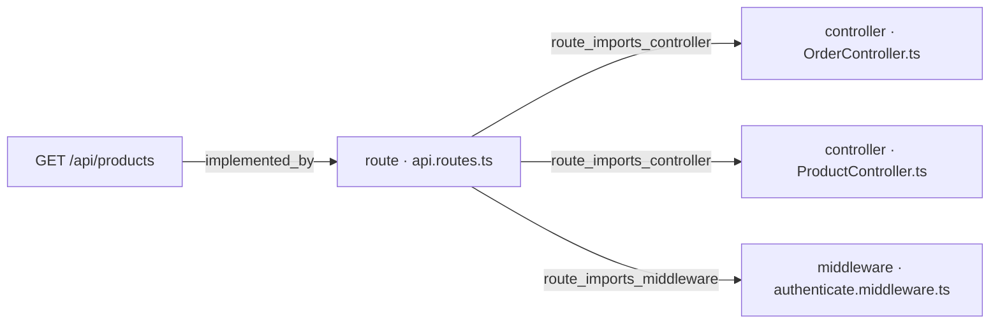
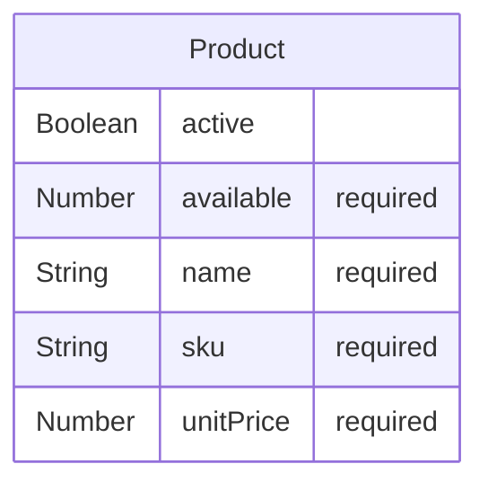

# [Documentation] Products — documento técnico

## Qué pide la spec

[ancla:endpoint GET /api/products] es el primer punto de contacto del usuario con el backend de pedidos de GREEN-H2: antes de componer un pedido en la pantalla `/orders/new`, la interfaz necesita conocer qué productos están disponibles y a qué precio. [spec:endpoint GET /api/products] define ese contrato: devolver el catálogo de productos activos con su precio y su disponibilidad, protegido por JWT. Cubre [spec:acceptance_criteria AC-06] y [spec:acceptance_criteria AC-07], y da soporte a [ancla:user_story HU-01].

La spec prohíbe que el cliente envíe precios ([spec:business_rule RN-05]): es el servidor quien los sirve desde el catálogo. La disponibilidad que devuelve este endpoint es informativa; la comprobación bloqueante ocurre al crear y confirmar pedidos ([spec:business_rule RN-03] y [spec:business_rule RN-04]), que corresponden a otros work items. Sin token válido, el endpoint responde 401 UNAUTHORIZED ([spec:business_rule RN-06]).

La spec también exige que se rechacen los parámetros de query desconocidos con 400 VALIDATION_ERROR en todos los endpoints, GET /api/products incluido (restricción `security` de la spec).

Fuera del alcance de este work item quedan los endpoints de pedidos ([spec:endpoint POST /api/orders], [spec:endpoint GET /api/orders], [spec:endpoint GET /api/orders/:id], [spec:endpoint POST /api/orders/:id/confirm]), documentados en [wi:WI-ORD-API-006].

## El trabajo y su historia

| work item | qué | tipo | estado | asignado a |
|---|---|---|---|---|
| WI-ORD-API-001 | [Backend] Orders — implementar endpoints | Backend | Cancelado | sin asignar |
| WI-ORD-API-002 | [Documentation] Orders — documento técnico | Documentación | Cancelado | sin asignar |
| WI-ORD-API-003 | [Backend] Products — implementar endpoints | Backend | Cancelado | Jorge Developer |
| WI-ORD-API-004 | [Documentation] Products — documento técnico | Documentación | Cancelado | sin asignar |
| WI-ORD-API-005 | [Backend] Orders — implementar endpoints | Backend | Cerrado | Jorge Developer |
| WI-ORD-API-006 | [Documentation] Orders — documento técnico | Documentación | Cerrado | Jorge Developer |
| WI-ORD-API-007 | [Backend] Products — implementar endpoints | Backend | Cerrado | Jorge Developer |
| WI-ORD-API-008 | [Documentation] Products — documento técnico | Documentación | Retrabajo | Jorge Developer |
| WI-ORD-API-009 | [Backend] Products — implementar endpoints | Backend | Cancelado | sin asignar |
| WI-ORD-API-010 | [Backend] Products — implementar endpoints · evolución a la v9 | Backend | Validado | Jorge Developer |

| fecha y hora (UTC) | work item | qué pasó | quién | motivo |
|---|---|---|---|---|
| 2026-10-12 20:05 | WI-ORD-API-001 | nace en «Generado» | Administrador Global | nacimiento del work item |
| 2026-10-12 20:05 | WI-ORD-API-002 | nace en «Generado» | Administrador Global | nacimiento del work item |
| 2026-10-12 20:05 | WI-ORD-API-003 | nace en «Generado» | Administrador Global | nacimiento del work item |
| 2026-10-12 20:05 | WI-ORD-API-004 | nace en «Generado» | Administrador Global | nacimiento del work item |
| 2026-10-12 20:07 | WI-ORD-API-003 | «Generado» → «Contexto Listo» | Administrador Global | context pack preparado |
| 2026-10-12 20:07 | WI-ORD-API-003 | «Contexto Listo» → «Aprobado» | Administrador Global | Pack revisado (v3, 10.245 tokens): contratos, modelo de datos, contexto técnico, constitución y convenciones incluidos. Ola 7 · H3. |
| 2026-10-12 20:07 | WI-ORD-API-003 | «Aprobado» → «Asignado» | Administrador Global | asignación de work item |
| 2026-10-12 20:07 | WI-ORD-API-003 | «Asignado» → «En Progreso» | Administrador Global | Run autónomo 71f7f431-e151-48a8-90d0-f8bdad9293f7 (agente developer) |
| 2026-10-12 20:22 | WI-ORD-API-003 | «En Progreso» → «Bloqueado» | Administrador Global | El run 71f7f431-e151-48a8-90d0-f8bdad9293f7 del agente developer murió sin terminar: No se publica: el work item no cumple sus puertas — gate_sin_cumplir: confirmar un pedido y comprobar que GET /api/orders y GET /api/orders/:id lo devuelven confirmed en la siguiente petición — el informe no la declara cumplida (RN-01) · gate_sin_cumplir: GET y POST confirm sobre un pedido de otro cliente responden 403 ORDER_FORBIDDEN — el informe no la declara cumplida (RN-02) |
| 2026-10-12 23:06 | WI-ORD-API-004 | «Generado» → «Contexto Listo» | Administrador Global | context pack preparado |
| 2026-10-12 23:06 | WI-ORD-API-002 | «Generado» → «Contexto Listo» | Administrador Global | context pack preparado |
| 2026-10-12 23:06 | WI-ORD-API-001 | «Generado» → «Contexto Listo» | Administrador Global | context pack preparado |
| 2026-10-12 23:08 | WI-ORD-API-001 | «Contexto Listo» → «Cancelado» | Administrador Global | Generado antes de arreglar el reparto de entidades por recurso: llevaba «Migración de esquema — Product, Order» y la entidad ajena en su pack. Se regenera desde el agrupador con el descomponedor corregido (H0 de plan_ux_llenar_bien_la_spec). |
| 2026-10-12 23:08 | WI-ORD-API-002 | «Contexto Listo» → «Cancelado» | Administrador Global | Generado antes de arreglar el reparto de entidades por recurso: llevaba «Migración de esquema — Product, Order» y la entidad ajena en su pack. Se regenera desde el agrupador con el descomponedor corregido (H0 de plan_ux_llenar_bien_la_spec). |
| 2026-10-12 23:08 | WI-ORD-API-003 | «Bloqueado» → «Cancelado» | Administrador Global | Generado antes de arreglar el reparto de entidades por recurso: llevaba «Migración de esquema — Product, Order» y la entidad ajena en su pack. Se regenera desde el agrupador con el descomponedor corregido (H0 de plan_ux_llenar_bien_la_spec). |
| 2026-10-12 23:08 | WI-ORD-API-004 | «Contexto Listo» → «Cancelado» | Administrador Global | Generado antes de arreglar el reparto de entidades por recurso: llevaba «Migración de esquema — Product, Order» y la entidad ajena en su pack. Se regenera desde el agrupador con el descomponedor corregido (H0 de plan_ux_llenar_bien_la_spec). |
| 2026-10-12 23:08 | WI-ORD-API-005 | nace en «Generado» | Administrador Global | nacimiento del work item |
| 2026-10-12 23:08 | WI-ORD-API-006 | nace en «Generado» | Administrador Global | nacimiento del work item |
| 2026-10-12 23:08 | WI-ORD-API-007 | nace en «Generado» | Administrador Global | nacimiento del work item |
| 2026-10-12 23:08 | WI-ORD-API-008 | nace en «Generado» | Administrador Global | nacimiento del work item |
| 2026-10-12 23:09 | WI-ORD-API-007 | «Generado» → «Contexto Listo» | Administrador Global | context pack preparado |
| 2026-10-12 23:11 | WI-ORD-API-007 | «Contexto Listo» → «Aprobado» | Administrador Global | — |
| 2026-10-12 23:12 | WI-ORD-API-007 | «Aprobado» → «Asignado» | Administrador Global | asignación de work item |
| 2026-10-12 23:12 | WI-ORD-API-007 | «Asignado» → «En Progreso» | Administrador Global | Run autónomo c31137c4-5217-4056-8565-ca6e597c7d86 (agente developer) |
| 2026-10-12 23:28 | WI-ORD-API-007 | «En Progreso» → «Bloqueado» | Administrador Global | El run c31137c4-5217-4056-8565-ca6e597c7d86 del agente developer murió sin terminar: Alguien canceló el run: el bucle se paró antes de pedir el turno siguiente |
| 2026-10-13 01:15 | WI-ORD-API-007 | «Bloqueado» → «En Progreso» | Administrador Global | Run autónomo db551f0c-fa44-42ce-b55f-f2cb46fc0479 (agente developer) |
| 2026-10-13 01:23 | WI-ORD-API-007 | PR #1 abierto | git | WI-ORD-API-007 · implementación autónoma |
| 2026-10-13 01:57 | WI-ORD-API-007 | «En Progreso» → «MR Abierto · en revisión» | Administrador Global | sugerencia de git aceptada |
| 2026-10-13 02:03 | WI-ORD-API-007 | PR #1 mergeado | git | WI-ORD-API-007 · implementación autónoma |
| 2026-10-13 03:04 | WI-ORD-API-007 | «MR Abierto · en revisión» → «Validado» | Administrador Global | — |
| 2026-10-13 03:05 | WI-ORD-API-007 | «Validado» → «Mergeado» | Administrador Global | sugerencia de git aceptada |
| 2026-10-13 03:05 | WI-ORD-API-007 | «Mergeado» → «Cerrado» | Administrador Global | — |
| 2026-10-13 03:24 | WI-ORD-API-008 | PR #2 abierto | git | WI-ORD-API-008 · documento técnico |
| 2026-10-13 11:38 | WI-ORD-API-008 | «Generado» → «Contexto Listo» | Administrador Global | context pack preparado |
| 2026-10-13 11:38 | WI-ORD-API-008 | «Contexto Listo» → «Aprobado» | Administrador Global | — |
| 2026-10-13 11:39 | WI-ORD-API-008 | «Aprobado» → «Asignado» | Administrador Global | asignación de work item |
| 2026-10-13 11:40 | WI-ORD-API-008 | «Asignado» → «En Progreso» | Administrador Global | Documento compuesto por el Technical Writer |
| 2026-10-13 12:37 | WI-ORD-API-005 | «Generado» → «Contexto Listo» | Administrador Global | context pack preparado |
| 2026-10-13 12:41 | WI-ORD-API-005 | «Contexto Listo» → «Aprobado» | Administrador Global | — |
| 2026-10-13 12:41 | WI-ORD-API-005 | «Aprobado» → «Asignado» | Administrador Global | asignación de work item |
| 2026-10-13 12:42 | WI-ORD-API-005 | «Asignado» → «En Progreso» | Administrador Global | Run autónomo 4e9d9848-26dc-4675-b2bd-981bdbb85fdf (agente developer) |
| 2026-10-13 12:54 | WI-ORD-API-005, WI-ORD-API-009 | PR #3 abierto | git | WI-ORD-API-005 · implementación autónoma |
| 2026-10-13 13:04 | WI-ORD-API-008 | PR #2 mergeado | git | WI-ORD-API-008 · documento técnico |
| 2026-10-13 19:11 | WI-ORD-API-006 | «Generado» → «Contexto Listo» | Administrador Global | context pack preparado |
| 2026-10-13 19:21 | WI-ORD-API-005 | «En Progreso» → «MR Abierto · en revisión» | Administrador Global | sugerencia de git aceptada |
| 2026-10-13 19:23 | WI-ORD-API-005 | «MR Abierto · en revisión» → «Retrabajo» | Administrador Global | PR jcobo2020/proyectoGreen#3 no mergeable. La confirmación no comprueba el estado del pedido dentro de la transacción (puede descontar dos veces) y convierte todo WriteConflict en 409. OrderService lee ProductModel. La transacción va sin readConcern, writeConcern ni maxCommitTimeMS. Los servicios se crean en el router y no en createApp(). TransactionContext no es opaco. Falta el evento stock_insufficient. Faltan las pruebas de 500, de E11000 y de la doble confirmación concurrente. Rehacer contra |
| 2026-10-13 19:24 | WI-ORD-API-008 | «En Progreso» → «MR Abierto · en revisión» | Administrador Global | — |
| 2026-10-13 19:24 | WI-ORD-API-008 | «MR Abierto · en revisión» → «Retrabajo» | Administrador Global | PR jcobo2020/proyectoGreen#3 no mergeable. La confirmación no comprueba el estado del pedido dentro de la transacción (puede descontar dos veces) y convierte todo WriteConflict en 409. OrderService lee ProductModel. La transacción va sin readConcern, writeConcern ni maxCommitTimeMS. Los servicios se crean en el router y no en createApp(). TransactionContext no es opaco. Falta el evento stock_insufficient. Faltan las pruebas de 500, de E11000 y de la doble confirmación concurrente. Rehacer contra |
| 2026-10-13 19:27 | WI-ORD-API-005 | «Retrabajo» → «En Progreso» | Administrador Global | Run autónomo 4ffc0128-c5c6-4c52-9487-dae4865388b1 (agente developer) |
| 2026-10-13 19:27 | WI-ORD-API-005 | «En Progreso» → «Bloqueado» | Administrador Global | AEP_REPO_AVANZO: La rama main está en f1711e6c7093 y el pack describe e5a5753ef4fb: el repositorio avanzó desde el snapshot. Cambiaron 1 fichero(s): docs/WI-ORD-API-008/README.md. No se sabe si tocan el trabajo: sus anclas no tienen fichero en el snapshot (p. ej. un endpoint que aún no existe). Hacen falta DOS pasos, en este orden: (1) toma un snapshot del proyecto, para que el commit nuevo exista en el control plane; (2) vuelve a preparar el contexto del work item («Preparar contexto» en su ficha), que es lo único que reescribe el commit base del pack. Con el snapshot solo NO basta: el pack conserva el suyo hasta que se recompila. Después, relanza el agente desde aquí mismo. |
| 2026-10-13 19:29 | WI-ORD-API-005 | «Bloqueado» → «En Progreso» | Administrador Global | Run autónomo 88fb5f11-a21e-4a83-b109-208d4f429e44 (agente developer) |
| 2026-10-13 19:44 | WI-ORD-API-005 | «En Progreso» → «Bloqueado» | Administrador Global | Se superó el techo de dinero de ESTE run (`llmBudget.maxCostPerRunUsd`). Este bucle gastó 2.01 USD. Es llmBudget.maxCostPerRunUsd, con override por proyecto en Parámetros → Presupuesto LLM. |
| 2026-10-13 19:55 | WI-ORD-API-005 | «Bloqueado» → «En Progreso» | Administrador Global | Run autónomo 5f717520-a7bb-44d6-b020-91d06f37e764 (agente developer) |
| 2026-10-13 23:10 | WI-ORD-API-005 | «En Progreso» → «MR Abierto · en revisión» | Administrador Global | sugerencia de git aceptada |
| 2026-10-13 23:11 | WI-ORD-API-005 | «MR Abierto · en revisión» → «Retrabajo» | Administrador Global | PR #3 no mergeable (revisión del run 5f717520): los tests «500» comprueban 404/400; faltan las pruebas de 500 en los 4 endpoints y la de E11000 (1 + 3 reintentos, 500 al cuarto fallo); falta el evento stock_insufficient; OrderService llama a unwrapSession (solo la infraestructura); IUnitOfWork cuenta llamadas a withTransaction, no intentos de fn; GET /:id y confirm no rechazan query desconocida; el router conserva un else que instancia servicios; el informe dice met:true con desviaciones falsas. |
| 2026-10-13 23:12 | WI-ORD-API-005 | «Retrabajo» → «En Progreso» | Administrador Global | Run autónomo 5584ea21-65e5-4fcd-a000-58a390048276 (agente developer) |
| 2026-10-13 23:24 | WI-ORD-API-005 | «En Progreso» → «Bloqueado» | Administrador Global | Se para antes de cruzar el techo del run: quedan 0.1244 USD y el último turno costó 0.2280. Pedir otro lo rebasaría, y un turno no se puede devolver. Este bucle gastó 1.88 USD. Es llmBudget.maxCostPerRunUsd, con override por proyecto en Parámetros → Presupuesto LLM. |
| 2026-10-13 23:29 | WI-ORD-API-005 | «Bloqueado» → «En Progreso» | Administrador Global | Run autónomo 7ed6ef66-ad2f-4512-8014-a818c0a4128f (agente developer) |
| 2026-10-13 23:31 | WI-ORD-API-005 | «En Progreso» → «Bloqueado» | Administrador Global | El run 7ed6ef66-ad2f-4512-8014-a818c0a4128f del agente developer murió sin terminar: Alguien canceló el run: el bucle se paró antes de pedir el turno siguiente |
| 2026-10-14 00:05 | WI-ORD-API-005 | «Bloqueado» → «En Progreso» | Administrador Global | Run autónomo bf0ffb39-cf4a-4369-b2d1-394900b8cc01 (agente developer) |
| 2026-10-14 01:29 | WI-ORD-API-005 | «En Progreso» → «MR Abierto · en revisión» | Administrador Global | sugerencia de git aceptada |
| 2026-10-14 01:29 | WI-ORD-API-005 | «MR Abierto · en revisión» → «Retrabajo» | Administrador Global | Revisión del run bf0ffb39: E11000 hace 3 intentos y deben ser 4 (1+3 reintentos); la prueba «cuatro colisiones» afirma 3 y falta 3 colisiones+éxito→201. OrderService sigue aplicando la sesión con withTx: persistencia a un adaptador de infraestructura o clarificationRequest. Faltan pruebas de MongoUnitOfWork, del 500 por caída de la transacción y del evento stock_insufficient. POST no rechaza query desconocida; items:[null] da 500. migration.log pisa el de WI-007. Informe met:true falso. |
| 2026-10-14 01:29 | WI-ORD-API-005 | «Retrabajo» → «En Progreso» | Administrador Global | Run autónomo 13a5c8f4-32b1-45ac-af7b-8ba99b8c604c (agente developer) |
| 2026-10-14 01:41 | WI-ORD-API-005 | «En Progreso» → «Bloqueado» | Administrador Global | Se para antes de cruzar el techo del run: quedan 0.0375 USD y el último turno costó 0.0384. Pedir otro lo rebasaría, y un turno no se puede devolver. Este bucle gastó 0.21 USD. Es llmBudget.maxCostPerRunUsd, con override por proyecto en Parámetros → Presupuesto LLM. |
| 2026-10-14 02:19 | WI-ORD-API-005 | «Bloqueado» → «En Progreso» | Administrador Global | Run autónomo 02440b15-f5a5-499d-8fbf-79876e0c34c0 (agente developer) |
| 2026-10-14 03:18 | WI-ORD-API-005 | «En Progreso» → «MR Abierto · en revisión» | Administrador Global | sugerencia de git aceptada |
| 2026-10-14 03:18 | WI-ORD-API-005 | «MR Abierto · en revisión» → «Retrabajo» | Administrador Global | Revisión del run 02440b15: OrderService no puede usar withTx ni OrderModel; la persistencia de pedidos va a un repositorio de infraestructura que recibe el TransactionContext (aclaración respondida: se exige el adaptador). Faltan, como pide §4: el 500 de cada endpoint forzando la caída de la transacción (no un servicio falso) y las unitarias de OrderService con dobles de sus puertos (total, código y cada rama de confirm); borra las que no afirman nada. Informe met:true falso. |
| 2026-10-14 03:18 | WI-ORD-API-005 | «Retrabajo» → «En Progreso» | Administrador Global | Run autónomo f658378c-d9b2-45e0-8709-b0f8916eb1d2 (agente developer) |
| 2026-10-14 03:18 | WI-ORD-API-005 | «En Progreso» → «Bloqueado» | Administrador Global | Presupuesto mensual del proyecto excedido: $20.04 de $20.00 — ajustable en Configuración → llm_budget Este bucle gastó 0.08 USD. Es llmBudget.maxMonthlyCostPerProjectUsd (el gasto de TODO el proyecto en el mes, no solo de este run), con override por proyecto en Parámetros → Presupuesto LLM. |
| 2026-10-14 03:19 | WI-ORD-API-005 | «Bloqueado» → «En Progreso» | Administrador Global | Run autónomo 391fc401-9a2c-4dab-91d3-122e8d75fc9d (agente developer) |
| 2026-10-14 03:49 | WI-ORD-API-005 | «En Progreso» → «MR Abierto · en revisión» | Administrador Global | sugerencia de git aceptada |
| 2026-10-14 03:50 | WI-ORD-API-005 | «MR Abierto · en revisión» → «Retrabajo» | Administrador Global | Revisión del run 391fc401: el 500 de confirm se provoca antes de abrir la transacción (falla findById en la comprobación previa). Falta una prueba HTTP con el fallo DENTRO de la transacción tras una escritura, que afirme 500 INTERNAL_ERROR, el pedido en pending_confirmation y el stock intacto. Borra lib/withSession.ts (sin uso). GET /orders: ?pageSize=0x10 salta el máximo y ?page=0x1 da 500 (Number frente a parseInt). Informe: una sola cifra de cobertura y met acorde. |
| 2026-10-14 03:50 | WI-ORD-API-005 | «Retrabajo» → «En Progreso» | Administrador Global | Run autónomo b7507420-bd98-42e0-9cf0-2620ff46cbf7 (agente developer) |
| 2026-10-14 04:50 | WI-ORD-API-005, WI-ORD-API-009 | PR #3 mergeado | git | WI-ORD-API-005 · implementación autónoma |
| 2026-10-14 05:18 | WI-ORD-API-005 | «En Progreso» → «MR Abierto · en revisión» | Administrador Global | — |
| 2026-10-14 05:18 | WI-ORD-API-005 | «MR Abierto · en revisión» → «Validado» | Administrador Global | — |
| 2026-10-14 05:18 | WI-ORD-API-005 | «Validado» → «Mergeado» | Administrador Global | sugerencia de git aceptada |
| 2026-10-14 05:19 | WI-ORD-API-005 | «Mergeado» → «Cerrado» | Administrador Global | — |
| 2026-10-14 05:19 | WI-ORD-API-006 | «Contexto Listo» → «Aprobado» | Administrador Global | — |
| 2026-10-14 05:20 | WI-ORD-API-006 | «Aprobado» → «Asignado» | Administrador Global | asignación de work item |
| 2026-10-14 05:22 | WI-ORD-API-006 | PR #4 abierto | git | WI-ORD-API-006 · documento técnico |
| 2026-10-14 05:22 | WI-ORD-API-006 | «Asignado» → «En Progreso» | Administrador Global | Documento compuesto por el Technical Writer |
| 2026-10-14 11:23 | WI-ORD-API-006 | PR #4 mergeado | git | WI-ORD-API-006 · documento técnico |
| 2026-10-14 12:03 | WI-ORD-API-009 | nace en «Generado» | Administrador Global | nacimiento del work item |
| 2026-10-14 12:05 | WI-ORD-API-009 | «Generado» → «Cancelado» | Administrador Global | Nació con el paquete WP-ORD-API-001 (el de Orders, rama ya mergeada) por un defecto de numeración de paquetes que este mismo hito arregla (LOS-PAQUETES-REPITEN-CODIGO-Y-RAMA-001). Se vuelve a crear desde la spec con un paquete nuevo. |
| 2026-10-14 12:05 | WI-ORD-API-010 | nace en «Generado» | Administrador Global | nacimiento del work item |
| 2026-10-14 12:25 | WI-ORD-API-006 | «En Progreso» → «MR Abierto · en revisión» | Administrador Global | — |
| 2026-10-14 12:30 | WI-ORD-API-006 | «MR Abierto · en revisión» → «Validado» | Administrador Global | Validado con excepción de las puertas: PR jcobo2020/proyectoGreen#4 revisado y mergeado por Jorge; sus afirmaciones se contrastaron con el código de main (IProductCatalog, transacción snapshot/majority, JWT, parseInt, log de migración). El Technical Writer no entrega informe de finalización, por eso la puerta no puede cumplirse sola. |
| 2026-10-14 12:37 | WI-ORD-API-006 | «Validado» → «Mergeado» | Administrador Global | Validado con excepción de las puertas: El PR jcobo2020/proyectoGreen#4 ya está mergeado en GitHub (lo confirma la sugerencia de git de esta ficha). La puerta no puede cumplirse porque el Technical Writer no entrega informe de finalización |
| 2026-10-14 12:38 | WI-ORD-API-006 | «Mergeado» → «Cerrado» | Administrador Global | — |
| 2026-10-14 12:40 | WI-ORD-API-010 | «Generado» → «Contexto Listo» | Administrador Global | context pack preparado |
| 2026-10-14 12:40 | WI-ORD-API-010 | «Contexto Listo» → «Aprobado» | Administrador Global | — |
| 2026-10-14 12:40 | WI-ORD-API-010 | «Aprobado» → «Asignado» | Administrador Global | asignación de work item |
| 2026-10-14 12:41 | WI-ORD-API-010 | «Asignado» → «En Progreso» | Administrador Global | Run autónomo e434c28e-146f-4ee5-95be-7bf684905903 (agente developer) |
| 2026-10-14 12:41 | WI-ORD-API-010 | «En Progreso» → «Bloqueado» | Administrador Global | AEP_REPO_AVANZO: La rama main está en 039b606de5e4 y el pack describe f1711e6c7093: el repositorio avanzó desde el snapshot. Cambiaron 21 fichero(s): .sdd/completion-report-WI-ORD-API-005.json, .sdd/evidence/migration-WI-ORD-API-005.log, .sdd/evidence/test-results.txt, api/src/__tests__/migration.spec.ts, api/src/__tests__/mongoUnitOfWork.spec.ts, api/src/__tests__/orderService.unit.spec.ts, api/src/__tests__/orders.spec.ts, api/src/app.ts, api/src/controllers/OrderController.ts, api/src/lib/MongoOrderRepository.ts y 11 más. 1 toca(n) el alcance de este work item: api/src/routes/api.routes.ts. Revisa el cambio antes de relanzar. Hacen falta DOS pasos, en este orden: (1) toma un snapshot del proyecto, para que el commit nuevo exista en el control plane; (2) vuelve a preparar el contexto del work item («Preparar contexto» en su ficha), que es lo único que reescribe el commit base del pack. Con el snapshot solo NO basta: el pack conserva el suyo hasta que se recompila. Después, relanza el agente desde aquí mismo. |
| 2026-10-14 12:42 | WI-ORD-API-010 | «Bloqueado» → «En Progreso» | Administrador Global | Run autónomo fd8761c8-d336-481f-b18c-7f483cab0656 (agente developer) |
| 2026-10-14 12:56 | WI-ORD-API-010 | PR #5 abierto | git | WI-ORD-API-010 · implementación autónoma |
| 2026-10-14 13:00 | WI-ORD-API-010 | «En Progreso» → «MR Abierto · en revisión» | Administrador Global | sugerencia de git aceptada: PR jcobo2020/proyectoGreen#5 abierto |
| 2026-10-14 13:16 | WI-ORD-API-010 | PR #5 mergeado | git | WI-ORD-API-010 · implementación autónoma |
| 2026-10-14 13:31 | WI-ORD-API-010 | «MR Abierto · en revisión» → «Validado» | Administrador Global | Puertas cumplidas y revisión independiente del PR jcobo2020/proyectoGreen#5: el validador rechaza query desconocida con 400 VALIDATION_ERROR y dos pruebas lo provocan. La objeción restante del revisor es del informe (cobertura de services/, que el WI no toca). |
| 2026-10-14 13:35 | WI-ORD-API-008 | PR #6 abierto | git | WI-ORD-API-008 · documento técnico |
| 2026-10-14 13:35 | WI-ORD-API-008 | «Retrabajo» → «En Progreso» | Administrador Global | Documento compuesto por el Technical Writer |
| 2026-10-14 13:37 | WI-ORD-API-008 | «En Progreso» → «MR Abierto · en revisión» | Administrador Global | sugerencia de git aceptada: PR jcobo2020/proyectoGreen#6 abierto |
| 2026-10-14 13:37 | WI-ORD-API-008 | «MR Abierto · en revisión» → «Retrabajo» | Administrador Global | - El documento dice que el PR #5 de WI-ORD-API-010 modificó api/src/routes/api.routes.ts. Es falso: el PR #5 solo tocó api/src/validators/product.validator.ts y api/src/__tests__/products.spec.ts. Los cambios de api.routes.ts que aparecen en la cronología (el motivo de AEP_REPO_AVANZO) son del merge del PR #3 de WI-ORD-API-005. - El documento atribuye el rechazo de parámetros de query desconocidos al informe de WI-ORD-API-007. Lo añadió WI-ORD-API-010 (PR #5), por la v9 de la spec. |

El package arrancó con cuatro work items generados a la vez el 2026-10-12 ([estado:WI-ORD-API-001], [estado:WI-ORD-API-002], [estado:WI-ORD-API-003], [estado:WI-ORD-API-004]). Los cuatro se cancelaron ese mismo día porque el descomponedor mezclaba entidades de recursos distintos en el mismo pack [estado:WI-ORD-API-003]. El 2026-10-12 23:08 se regeneró el package con el descomponedor corregido, naciendo [wi:WI-ORD-API-007] (backend de Products), [wi:WI-ORD-API-008] (este documento) y [wi:WI-ORD-API-005] (backend de Orders).

[wi:WI-ORD-API-007] sufrió una interrupción temprana por cancelación del run [estado:WI-ORD-API-007] antes de retomarse y completarse: el PR #1 se abrió el 2026-10-13 01:23 y se mergeó el 2026-10-13 02:03 [git:PR #1]. El work item pasó a «Cerrado» el 2026-10-13 03:05 [estado:WI-ORD-API-007].

El documento técnico (este work item, WI-ORD-API-008) tuvo una primera entrega con el PR #2 abierto el 2026-10-13 03:24 y mergeado el 2026-10-13 13:04 [git:PR #2]. Sin embargo, el work item entró en «Retrabajo» el 2026-10-13 19:24 por problemas del PR #3 de [wi:WI-ORD-API-005] que hacían el documento incompatible con el estado real del código [estado:WI-ORD-API-008].

Mientras tanto, [wi:WI-ORD-API-005] pasó por múltiples rondas de retrabajo a lo largo del 2026-10-13 y el 2026-10-14, con bloqueos por límite de presupuesto y cancelaciones de run [estado:WI-ORD-API-005], hasta que su PR #3 se mergeó el 2026-10-14 04:50 y el work item cerró el 2026-10-14 05:19.

Una vez estabilizado el backend de Orders, nació [wi:WI-ORD-API-010] para aplicar la evolución a la v9 de la spec sobre el endpoint GET /api/products. Su PR #5 se abrió el 2026-10-14 12:56 y se mergeó el 2026-10-14 13:16 [git:PR #5], y el work item quedó en «Validado» [estado:WI-ORD-API-010].

La segunda entrega de este documento abrió el PR #6 el 2026-10-14 13:35 [git:PR #6]. Ese PR también pasó a «Retrabajo» [estado:WI-ORD-API-008] por los dos errores corregidos en esta versión (véase «Notas para el mantenedor»). El work item permanece en estado «Retrabajo» a la fecha del doc-pack.

[wi:WI-ORD-API-009] nació con el paquete de Orders por un defecto de numeración y se canceló el mismo día [estado:WI-ORD-API-009].

## Lo que se tocó

### WI-ORD-API-007 · Backend · «Cerrado»
- Informe de finalización [informe:WI-ORD-API-007], 2026-10-13 01:23 UTC, commit 9d2c4e8: 1 de 1 criterios cubiertos.
  - Lo que dijo al entregarlo: Run autónomo db551f0c-fa44-42ce-b55f-f2cb46fc0479 (agente developer): El build TypeScript pasa sin errores. Todo está en verde. Resumen de implementación — WI-ORD-API-007: Qué se implementó: Endpoint `GET /api/products` — catálogo de productos activos con precio y disponibilidad, paginado y ordenado por `name`/`sku`. Proyecto completamente greenfield (solo existía `README.md`). Se construyó la estructura completa del backend siguiendo la plantilla del stack: Ficheros creados:
  - Criterios y sus pruebas:
    - AC-06 (cubierto): GET /api/products devuelve los productos activos con precio y disponibilidad. Verificado con tests de integración que comprueban: lista vacía, solo activos, orden por name/sku, paginación, formato de unitPrice (2 decimales) y campo available ≥ 0.
  - Decisiones:
    - desviación: La spec (§4) declara explícitamente: 'Excepción declarada a la plantilla: no hay attachAuthenticatedUser ni requireAdmin, porque no hay colección de usuarios ni roles (la identidad es externa)'. La spec manda sobre la plantilla según §4-bis.
    - desviación: Necesario para que los tests (que fijan las variables de entorno antes de crear la app) funcionen correctamente sin reiniciar el módulo. La seguridad no se ve afectada: en producción las variables se cargan antes del arranque del servidor.
  - Evidencias:
    - test_results `workflow_artifacts/092a1d4d-6634-48ef-8cbd-78c26fa2fda7` (corroborada): Salida real del comando, ejecutado en el contenedor efímero
    - test_results `workflow_artifacts/84352be5-ef30-4488-9ca2-555a8e845a94` (corroborada): Salida real del comando, ejecutado en el contenedor efímero
    - coverage_report `workflow_artifacts/092a1d4d-6634-48ef-8cbd-78c26fa2fda7` (corroborada): Informe de cobertura dentro de la salida de las pruebas, en el contenedor efímero
    - test_results `.sdd/evidence/test-results.txt` (corroborada): 30 tests passing: 29 en products.spec.ts (integración + unitarios) y 1 en migration.spec.ts
    - migration_log `.sdd/evidence/migration.log` (corroborada): Log generado por migration.spec.ts: colección products creada con índices sku (único) y {active, name, sku} compuesto. Verificado en MongoDB in-memory.
    - coverage_report `api/coverage/lcov-report/index.html`: Cobertura medida en la corrida: 90.51% de líneas en los 11 ficheros tocados (exigida ≥ 80%). Resumen en api/coverage/coverage-summary.json.
    - api_docs `api/src/controllers/*.ts` (corroborada): —
- Contratos del código: [codigo:GET /api/products], [codigo:model:Product]

### Ficheros del PR #1, mergeado el 2026-10-13 02:03 UTC: 25 ficheros, +7911 −0
| fichero | cambio | + | − |
|---|---|---|---|
| `api/package-lock.json` | añadido | 6499 | 0 |
| `api/src/__tests__/products.spec.ts` | añadido | 489 | 0 |
| `api/src/__tests__/migration.spec.ts` | añadido | 103 | 0 |
| `api/src/controllers/ProductController.ts` | añadido | 89 | 0 |
| `api/src/middlewares/authenticate.middleware.ts` | añadido | 75 | 0 |
| `api/src/config/swagger.ts` | añadido | 72 | 0 |
| `.sdd/completion-report-WI-ORD-API-007.json` | añadido | 60 | 0 |
| `api/src/services/ProductService.ts` | añadido | 54 | 0 |
| `api/src/models/product.ts` | añadido | 50 | 0 |
| `.sdd/evidence/test-results.txt` | añadido | 48 | 0 |
| `api/src/lib/errors.ts` | añadido | 48 | 0 |
| `api/src/middlewares/errorHandler.middleware.ts` | añadido | 43 | 0 |
| `api/package.json` | añadido | 37 | 0 |
| `api/src/validators/product.validator.ts` | añadido | 31 | 0 |
| `api/src/app.ts` | añadido | 29 | 0 |
| `api/jest.config.js` | añadido | 28 | 0 |
| `api/src/middlewares/requestLogger.middleware.ts` | añadido | 27 | 0 |
| `api/src/config/env.ts` | añadido | 26 | 0 |
| `api/src/routes/api.routes.ts` | añadido | 24 | 0 |
| `api/tsconfig.json` | añadido | 19 | 0 |
| `api/src/server.ts` | añadido | 18 | 0 |
| `.sdd/evidence/migration.log` | añadido | 11 | 0 |
| `api/.env.example` | añadido | 11 | 0 |
| `api/src/config/connectDB.ts` | añadido | 11 | 0 |
| `api/src/lib/obfuscate.ts` | añadido | 9 | 0 |

### WI-ORD-API-007 — construcción desde cero (PR #1)

[informe:WI-ORD-API-007] describe un proyecto completamente greenfield: solo existía `README.md`. El PR #1 añadió 25 ficheros con 7 911 líneas netas [git:PR #1].

El núcleo funcional del endpoint se distribuyó así:

- `api/src/models/product.ts` — define [codigo:model:Product], el modelo Mongoose de [spec:entidad Product] con los campos `_id`, `sku`, `name`, `unitPrice`, `available` y `active`.
- `api/src/services/ProductService.ts` — lógica de negocio: consulta solo productos con `active: true` y los devuelve ordenados.
- `api/src/controllers/ProductController.ts` — adaptador HTTP: traduce la petición, llama al servicio y serializa la respuesta.
- `api/src/validators/product.validator.ts` — valida los parámetros de entrada del endpoint [codigo:GET /api/products].
- `api/src/routes/api.routes.ts` — registra la ruta GET /api/products e inyecta el middleware de autenticación [arista:GET /api/products→route · api.routes.ts].
- `api/src/middlewares/authenticate.middleware.ts` — verifica el JWT conforme a [spec:business_rule RN-06].
- `api/src/middlewares/errorHandler.middleware.ts` y `api/src/lib/errors.ts` — catálogo de errores y su serialización.
- `api/src/app.ts`, `api/src/server.ts`, `api/src/config/` — infraestructura de arranque, conexión a MongoDB y Swagger.
- `api/src/__tests__/products.spec.ts` y `api/src/__tests__/migration.spec.ts` — suite de integración y prueba de migración de índices.
- `.sdd/evidence/migration.log` — confirma la creación de los índices `sku` (único) y `{active, name, sku}` (compuesto) en MongoDB in-memory [informe:WI-ORD-API-007].

[informe:WI-ORD-API-007] declaró una desviación respecto a la plantilla: el middleware `attachAuthenticatedUser` no se incluyó porque la spec lo exime explícitamente al ser la identidad externa.

### WI-ORD-API-010 — evolución a la v9 (PR #5)

[wi:WI-ORD-API-010] añadió el rechazo de parámetros de query desconocidos exigido por la v9 de la spec. El PR #5 tocó exclusivamente dos ficheros [git:PR #5]:

- `api/src/validators/product.validator.ts` — se amplió para detectar y rechazar parámetros de query no declarados (400 VALIDATION_ERROR).
- `api/src/__tests__/products.spec.ts` — se añadieron dos pruebas que verifican ese rechazo.

El fichero `api/src/routes/api.routes.ts` **no fue modificado por el PR #5**; los cambios en ese fichero que aparecen en la cronología como motivo del bloqueo `AEP_REPO_AVANZO` de [wi:WI-ORD-API-010] proceden del merge del PR #3 de [wi:WI-ORD-API-005] [estado:WI-ORD-API-010].

## Cómo está construido

El diagrama de arquitectura derivado del grafo muestra cómo fluye una petición a [ancla:endpoint GET /api/products]:

La ruta [arista:GET /api/products→route · api.routes.ts] recibe la petición. Antes de llegar al controlador, el middleware de autenticación [arista:route · api.routes.ts→middleware · authenticate.middleware.ts] valida el JWT: algoritmo HS256, firma con `JWT_SECRET` (y `JWT_SECRET_PREVIOUS` durante una rotación), claim `exp` obligatorio con 30 s de tolerancia de reloj y claim `sub` no vacío; sin cualquiera de ellos devuelve [spec:error UNAUTHORIZED]. A continuación, el validador comprueba los parámetros de query; si detecta alguno desconocido responde [spec:error VALIDATION_ERROR]. Si la entrada es válida, el controlador [arista:route · api.routes.ts→controller · ProductController.ts] delega en `ProductService`, que consulta MongoDB filtrando `active: true`.

El diagrama incluye también una arista hacia `OrderController.ts` [arista:route · api.routes.ts→controller · OrderController.ts]: esto refleja que `api.routes.ts` es el fichero de rutas compartido del backend, que registra todos los endpoints de la API; los endpoints de pedidos son competencia de [wi:WI-ORD-API-005] y [wi:WI-ORD-API-006].

El modelo de datos real expuesto por el ORM es el siguiente:

Los campos coinciden con [spec:entidad Product]. El índice `sku` es único; el índice compuesto `{active, name, sku}` sirve a la consulta del catálogo ordenada por nombre [informe:WI-ORD-API-007].

## Reglas de negocio

Las reglas que gobiernan este endpoint son las siguientes:

- **Autenticación obligatoria** ([spec:business_rule RN-06]): sin token válido, la petición recibe 401 UNAUTHORIZED antes de llegar al controlador.
- **Precios desde el catálogo** ([spec:business_rule RN-05]): el endpoint sirve `unitPrice` tal como está en la base de datos; el cliente nunca envía ni altera precios.
- **Lectura sin caché** ([spec:business_rule RN-01]): la disponibilidad y el precio se leen de la base en cada petición, sin cachés interpuestas.
- **Rechazo de parámetros desconocidos**: todo parámetro de query no declarado en el contrato provoca [spec:error VALIDATION_ERROR] (400), añadido por [wi:WI-ORD-API-010] en la v9 de la spec.
- **Solo productos activos**: el filtro `active: true` excluye del catálogo los productos retirados; un producto inactivo no aparece en el listado (y, si se pide en un pedido, se trata como no disponible conforme a [spec:business_rule RN-03]).

Las reglas [spec:business_rule RN-02], [spec:business_rule RN-03] y [spec:business_rule RN-04] no aplican a este endpoint: pertenecen al ciclo de vida de los pedidos, documentado en [wi:WI-ORD-API-006].

## Cómo verificarlo

[informe:WI-ORD-API-007] declaró 1 de 1 criterio cubierto y una cobertura del 90,51 % de líneas en los ficheros tocados, por encima del mínimo del 80 % exigido por la spec.

La suite `api/src/__tests__/products.spec.ts` (29 pruebas de integración y unitarias) cubre [spec:acceptance_criteria AC-06] verificando:

- Lista vacía cuando no hay productos activos.
- Solo se devuelven los productos con `active: true`.
- Orden por `name` / `sku`.
- Paginación correcta.
- Formato de `unitPrice` con dos decimales.
- Campo `available` ≥ 0.

[spec:acceptance_criteria AC-07] se verifica con las pruebas de 401: un JWT sin `sub` o sin `exp` devuelve UNAUTHORIZED.

[wi:WI-ORD-API-010] añadió dos pruebas adicionales en `api/src/__tests__/products.spec.ts` que provocan un parámetro de query desconocido y afirman que la respuesta es 400 VALIDATION_ERROR [estado:WI-ORD-API-010].

`api/src/__tests__/migration.spec.ts` (1 prueba) verifica que los índices `sku` (único) y `{active, name, sku}` (compuesto) existen en la colección `products` [informe:WI-ORD-API-007].

Los criterios [spec:acceptance_criteria AC-01], [spec:acceptance_criteria AC-02], [spec:acceptance_criteria AC-03], [spec:acceptance_criteria AC-04], [spec:acceptance_criteria AC-05] y [spec:acceptance_criteria AC-08] corresponden a los endpoints de pedidos y se verifican en [wi:WI-ORD-API-006].

## Notas para el mantenedor

**Correcciones de ronda 2 (`DEV2-1` y `DEV2-2`):** este documento fue devuelto por dos errores factuales que esta versión corrige:

- `DEV2-1`: el PR #5 de [wi:WI-ORD-API-010] **no modificó** `api/src/routes/api.routes.ts`. Solo tocó `api/src/validators/product.validator.ts` y `api/src/__tests__/products.spec.ts` [git:PR #5]. La mención de `api.routes.ts` en la cronología [estado:WI-ORD-API-010] corresponde al fichero que cambió en el repo entre el snapshot del pack y el relanzamiento del agente, consecuencia del merge del PR #3 de [wi:WI-ORD-API-005] [estado:WI-ORD-API-005].
- `DEV2-2`: el rechazo de parámetros de query desconocidos **no lo implementó** [wi:WI-ORD-API-007]; lo añadió [wi:WI-ORD-API-010] (PR #5) al aplicar la v9 de la spec [estado:WI-ORD-API-010].

**Estado del work item:** WI-ORD-API-008 sigue en «Retrabajo» a la fecha del doc-pack [estado:WI-ORD-API-008]. El doc-pack no incluye información sobre si existirá una ronda de revisión adicional tras esta entrega.

**Work items cancelados:** [wi:WI-ORD-API-001], [wi:WI-ORD-API-002], [wi:WI-ORD-API-003] y [wi:WI-ORD-API-004] se cancelaron por un defecto del descomponedor que mezclaba entidades de recursos distintos [estado:WI-ORD-API-003]; [wi:WI-ORD-API-009] se canceló por un defecto de numeración de paquetes [estado:WI-ORD-API-009]. No hay código suyo en main.

**Subgrafo truncado:** el diagrama de arquitectura muestra la arista hacia `OrderController.ts` porque `api.routes.ts` centraliza todas las rutas. El doc-pack no proyecta al grafo las aristas internas de ProductService ni su relación con el modelo; la cadena `ProductController → ProductService → Product (model)` se infiere del informe [informe:WI-ORD-API-007] pero no tiene aristas explícitas en el vocabulario de citas de este pack.

**Secretos y observabilidad:** ningún secreto debe estar en el repositorio; `MONGODB_URI`, `JWT_SECRET` y `JWT_SECRET_PREVIOUS` se cargan solo por entorno, con `.env.example` sin valores reales [git:PR #1]. Los logs no llevan el token ni datos personales; el `customerId` (claim `sub`) es un identificador opaco que sí puede registrarse.