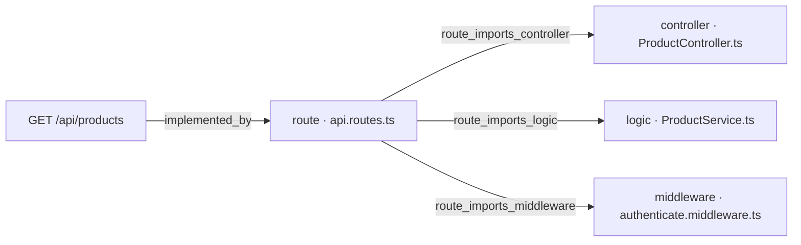
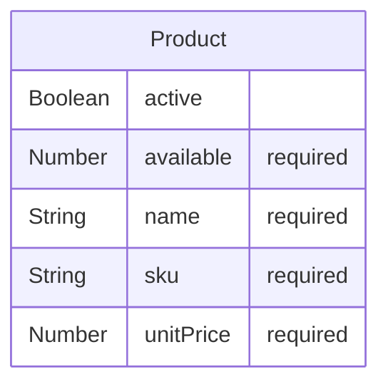

# [Documentation] Products — documento técnico

## Qué pide la spec

Este work item documenta el endpoint [ancla:endpoint GET /api/products], que forma parte del contrato REST del backend de pedidos de GREEN-H2. Su propósito es exponer el catálogo de productos activos —con precio y disponibilidad— para que el frontend de composición de pedidos (`/orders/new`, perteneciente a GREEN-ORD-UX-001) pueda presentar al cliente las opciones disponibles antes de que componga su pedido [spec:endpoint GET /api/products].

El endpoint cubre la historia de usuario [ancla:user_story HU-01] y satisface el criterio [spec:acceptance_criteria AC-06]: el sistema debe devolver los productos activos con su precio y su disponibilidad en cada petición. Dado que no hay caché que pueda contradecir el estado real de la base de datos, cada llamada refleja el valor vigente [spec:business_rule RN-01].

El acceso al endpoint exige un JWT válido [spec:business_rule RN-06]: sin token —o con un token sin `sub`, sin `exp` o caducado— el sistema responde `401 UNAUTHORIZED` [spec:error UNAUTHORIZED], cumpliendo así también [spec:acceptance_criteria AC-07].

La gestión del catálogo (altas, bajas y modificaciones de productos) está fuera del alcance de la spec. Este endpoint solo lee; el único writer de `available` es la confirmación de pedido, descrita en [wi:WI-ORD-API-005].

La entidad central es [spec:entidad Product], con campos `_id`, `sku`, `name`, `unitPrice`, `available` y `active`. El endpoint devuelve únicamente los registros cuyo campo `active` es verdadero [spec:endpoint GET /api/products].

---

## El trabajo y su historia

| work item | qué | tipo | estado | asignado a |
|---|---|---|---|---|
| WI-ORD-API-001 | [Backend] Orders — implementar endpoints | Backend | Cancelado | sin asignar |
| WI-ORD-API-002 | [Documentation] Orders — documento técnico | Documentación | Cancelado | sin asignar |
| WI-ORD-API-003 | [Backend] Products — implementar endpoints | Backend | Cancelado | Jorge Developer |
| WI-ORD-API-004 | [Documentation] Products — documento técnico | Documentación | Cancelado | sin asignar |
| WI-ORD-API-005 | [Backend] Orders — implementar endpoints | Backend | Generado | sin asignar |
| WI-ORD-API-006 | [Documentation] Orders — documento técnico | Documentación | Generado | sin asignar |
| WI-ORD-API-007 | [Backend] Products — implementar endpoints | Backend | Cerrado | Jorge Developer |
| WI-ORD-API-008 | [Documentation] Products — documento técnico | Documentación | Generado | Jorge Developer |

| fecha y hora (UTC) | work item | qué pasó | quién | motivo |
|---|---|---|---|---|
| 2026-10-12 20:05 | WI-ORD-API-001 | nace en «Generado» | Administrador Global | nacimiento del work item |
| 2026-10-12 20:05 | WI-ORD-API-002 | nace en «Generado» | Administrador Global | nacimiento del work item |
| 2026-10-12 20:05 | WI-ORD-API-003 | nace en «Generado» | Administrador Global | nacimiento del work item |
| 2026-10-12 20:05 | WI-ORD-API-004 | nace en «Generado» | Administrador Global | nacimiento del work item |
| 2026-10-12 20:07 | WI-ORD-API-003 | «Generado» → «Contexto Listo» | Administrador Global | context pack preparado |
| 2026-10-12 20:07 | WI-ORD-API-003 | «Contexto Listo» → «Aprobado» | Administrador Global | Pack revisado (v3, 10.245 tokens): contratos, modelo de datos, contexto técnico, constitución y convenciones incluidos. Ola 7 · H3. |
| 2026-10-12 20:07 | WI-ORD-API-003 | «Aprobado» → «Asignado» | Administrador Global | asignación de work item |
| 2026-10-12 20:07 | WI-ORD-API-003 | «Asignado» → «En Progreso» | Administrador Global | Run autónomo 71f7f431-e151-48a8-90d0-f8bdad9293f7 (agente developer) |
| 2026-10-12 20:22 | WI-ORD-API-003 | «En Progreso» → «Bloqueado» | Administrador Global | El run 71f7f431-e151-48a8-90d0-f8bdad9293f7 del agente developer murió sin terminar: No se publica: el work item no cumple sus puertas — gate_sin_cumplir: confirmar un pedido y comprobar que GET /api/orders y GET /api/orders/:id lo devuelven confirmed en la siguiente petición — el informe no la declara cumplida (RN-01) · gate_sin_cumplir: GET y POST confirm sobre un pedido de otro cliente responden 403 ORDER_FORBIDDEN — el informe no la declara cumplida (RN-02) |
| 2026-10-12 23:06 | WI-ORD-API-004 | «Generado» → «Contexto Listo» | Administrador Global | context pack preparado |
| 2026-10-12 23:06 | WI-ORD-API-002 | «Generado» → «Contexto Listo» | Administrador Global | context pack preparado |
| 2026-10-12 23:06 | WI-ORD-API-001 | «Generado» → «Contexto Listo» | Administrador Global | context pack preparado |
| 2026-10-12 23:08 | WI-ORD-API-001 | «Contexto Listo» → «Cancelado» | Administrador Global | Generado antes de arreglar el reparto de entidades por recurso: llevaba «Migración de esquema — Product, Order» y la entidad ajena en su pack. Se regenera desde el agrupador con el descomponedor corregido (H0 de plan_ux_llenar_bien_la_spec). |
| 2026-10-12 23:08 | WI-ORD-API-002 | «Contexto Listo» → «Cancelado» | Administrador Global | Generado antes de arreglar el reparto de entidades por recurso: llevaba «Migración de esquema — Product, Order» y la entidad ajena en su pack. Se regenera desde el agrupador con el descomponedor corregido (H0 de plan_ux_llenar_bien_la_spec). |
| 2026-10-12 23:08 | WI-ORD-API-003 | «Bloqueado» → «Cancelado» | Administrador Global | Generado antes de arreglar el reparto de entidades por recurso: llevaba «Migración de esquema — Product, Order» y la entidad ajena en su pack. Se regenera desde el agrupador con el descomponedor corregido (H0 de plan_ux_llenar_bien_la_spec). |
| 2026-10-12 23:08 | WI-ORD-API-004 | «Contexto Listo» → «Cancelado» | Administrador Global | Generado antes de arreglar el reparto de entidades por recurso: llevaba «Migración de esquema — Product, Order» y la entidad ajena en su pack. Se regenera desde el agrupador con el descomponedor corregido (H0 de plan_ux_llenar_bien_la_spec). |
| 2026-10-12 23:08 | WI-ORD-API-005 | nace en «Generado» | Administrador Global | nacimiento del work item |
| 2026-10-12 23:08 | WI-ORD-API-006 | nace en «Generado» | Administrador Global | nacimiento del work item |
| 2026-10-12 23:08 | WI-ORD-API-007 | nace en «Generado» | Administrador Global | nacimiento del work item |
| 2026-10-12 23:08 | WI-ORD-API-008 | nace en «Generado» | Administrador Global | nacimiento del work item |
| 2026-10-12 23:09 | WI-ORD-API-007 | «Generado» → «Contexto Listo» | Administrador Global | context pack preparado |
| 2026-10-12 23:11 | WI-ORD-API-007 | «Contexto Listo» → «Aprobado» | Administrador Global | — |
| 2026-10-12 23:12 | WI-ORD-API-007 | «Aprobado» → «Asignado» | Administrador Global | asignación de work item |
| 2026-10-12 23:12 | WI-ORD-API-007 | «Asignado» → «En Progreso» | Administrador Global | Run autónomo c31137c4-5217-4056-8565-ca6e597c7d86 (agente developer) |
| 2026-10-12 23:28 | WI-ORD-API-007 | «En Progreso» → «Bloqueado» | Administrador Global | El run c31137c4-5217-4056-8565-ca6e597c7d86 del agente developer murió sin terminar: Alguien canceló el run: el bucle se paró antes de pedir el turno siguiente |
| 2026-10-13 01:15 | WI-ORD-API-007 | «Bloqueado» → «En Progreso» | Administrador Global | Run autónomo db551f0c-fa44-42ce-b55f-f2cb46fc0479 (agente developer) |
| 2026-10-13 01:23 | WI-ORD-API-007 | PR #1 abierto | git | WI-ORD-API-007 · implementación autónoma |
| 2026-10-13 01:57 | WI-ORD-API-007 | «En Progreso» → «MR Abierto · en revisión» | Administrador Global | sugerencia de git aceptada |
| 2026-10-13 02:03 | WI-ORD-API-007 | PR #1 mergeado | git | WI-ORD-API-007 · implementación autónoma |
| 2026-10-13 03:04 | WI-ORD-API-007 | «MR Abierto · en revisión» → «Validado» | Administrador Global | — |
| 2026-10-13 03:05 | WI-ORD-API-007 | «Validado» → «Mergeado» | Administrador Global | sugerencia de git aceptada |
| 2026-10-13 03:05 | WI-ORD-API-007 | «Mergeado» → «Cerrado» | Administrador Global | — |

La historia de este work item está ligada a la de su par de implementación [wi:WI-ORD-API-007], que es el único que produjo código. El recorrido tiene dos fases bien diferenciadas.

**Primera generación (cancelada).** El 2026-10-12 a las 20:05 UTC nacieron los work items originales de la spec, entre ellos [wi:WI-ORD-API-003] (backend de Products) y [wi:WI-ORD-API-004] (documentación de Products) [estado:WI-ORD-API-003] [estado:WI-ORD-API-004]. El work item de backend [wi:WI-ORD-API-003] llegó a ejecutarse —pasó por «Aprobado», «Asignado» y «En Progreso»— pero fue bloqueado [estado:WI-ORD-API-003]: el run del agente developer murió porque el informe no declaraba cumplidas las puertas relativas a RN-01 y RN-02, que en aquel context pack pertenecían también al alcance de ese work item. A las 23:08 del mismo día, el Administrador Global canceló toda la primera generación (WI-ORD-API-001 a 004) por un error en el descomponedor: los work items llevaban la entidad ajena en su pack y la migración de esquema de ambas entidades en su alcance [estado:WI-ORD-API-001] [estado:WI-ORD-API-002] [estado:WI-ORD-API-003] [estado:WI-ORD-API-004].

**Segunda generación.** En el mismo instante nacieron [wi:WI-ORD-API-007] (backend) y [wi:WI-ORD-API-008] (este documento), con el descomponedor corregido [estado:WI-ORD-API-007] [estado:WI-ORD-API-008]. [wi:WI-ORD-API-007] tardó dos runs en completarse: el primero (23:12–23:28 UTC) fue cancelado externamente antes de que el agente pidiera el turno siguiente [estado:WI-ORD-API-007]; el segundo (desde las 01:15 UTC del 2026-10-13) culminó con la apertura de [git:PR #1] a las 01:23 UTC. El PR fue mergeado a las 02:03 UTC y el work item alcanzó el estado «Cerrado» a las 03:05 UTC [estado:WI-ORD-API-007].

WI-ORD-API-008 (el presente documento) se encuentra en estado «Generado» [estado:WI-ORD-API-008] y no registra runs de ejecución propios más allá de la generación del doc-pack.

---

## Lo que se tocó

### WI-ORD-API-007 · Backend · «Cerrado»
- Informe de finalización [informe:WI-ORD-API-007], 2026-10-13 01:23 UTC, commit 9d2c4e8: 1 de 1 criterios cubiertos.
  - Lo que dijo al entregarlo: Run autónomo db551f0c-fa44-42ce-b55f-f2cb46fc0479 (agente developer): El build TypeScript pasa sin errores. Todo está en verde. Resumen de implementación — WI-ORD-API-007: Qué se implementó: Endpoint `GET /api/products` — catálogo de productos activos con precio y disponibilidad, paginado y ordenado por `name`/`sku`. Proyecto completamente greenfield (solo existía `README.md`). Se construyó la estructura completa del backend siguiendo la plantilla del stack: Ficheros creados:
  - Criterios y sus pruebas:
    - AC-06 (cubierto): GET /api/products devuelve los productos activos con precio y disponibilidad. Verificado con tests de integración que comprueban: lista vacía, solo activos, orden por name/sku, paginación, formato de unitPrice (2 decimales) y campo available ≥ 0.
  - Decisiones:
    - desviación: La spec (§4) declara explícitamente: 'Excepción declarada a la plantilla: no hay attachAuthenticatedUser ni requireAdmin, porque no hay colección de usuarios ni roles (la identidad es externa)'. La spec manda sobre la plantilla según §4-bis.
    - desviación: Necesario para que los tests (que fijan las variables de entorno antes de crear la app) funcionen correctamente sin reiniciar el módulo. La seguridad no se ve afectada: en producción las variables se cargan antes del arranque del servidor.
  - Evidencias:
    - test_results `workflow_artifacts/092a1d4d-6634-48ef-8cbd-78c26fa2fda7` (corroborada): Salida real del comando, ejecutado en el contenedor efímero
    - test_results `workflow_artifacts/84352be5-ef30-4488-9ca2-555a8e845a94` (corroborada): Salida real del comando, ejecutado en el contenedor efímero
    - coverage_report `workflow_artifacts/092a1d4d-6634-48ef-8cbd-78c26fa2fda7` (corroborada): Informe de cobertura dentro de la salida de las pruebas, en el contenedor efímero
    - test_results `.sdd/evidence/test-results.txt` (corroborada): 30 tests passing: 29 en products.spec.ts (integración + unitarios) y 1 en migration.spec.ts
    - migration_log `.sdd/evidence/migration.log` (corroborada): Log generado por migration.spec.ts: colección products creada con índices sku (único) y {active, name, sku} compuesto. Verificado en MongoDB in-memory.
    - coverage_report `api/coverage/lcov-report/index.html`: Cobertura medida en la corrida: 90.51% de líneas en los 11 ficheros tocados (exigida ≥ 80%). Resumen en api/coverage/coverage-summary.json.
    - api_docs `api/src/controllers/*.ts` (corroborada): —
- Contratos del código: [codigo:GET /api/products], [codigo:model:Product]

### Ficheros del PR #1, mergeado el 2026-10-13 02:03 UTC: 25 ficheros, +7911 −0
| fichero | cambio | + | − |
|---|---|---|---|
| `api/package-lock.json` | añadido | 6499 | 0 |
| `api/src/__tests__/products.spec.ts` | añadido | 489 | 0 |
| `api/src/__tests__/migration.spec.ts` | añadido | 103 | 0 |
| `api/src/controllers/ProductController.ts` | añadido | 89 | 0 |
| `api/src/middlewares/authenticate.middleware.ts` | añadido | 75 | 0 |
| `api/src/config/swagger.ts` | añadido | 72 | 0 |
| `.sdd/completion-report-WI-ORD-API-007.json` | añadido | 60 | 0 |
| `api/src/services/ProductService.ts` | añadido | 54 | 0 |
| `api/src/models/product.ts` | añadido | 50 | 0 |
| `.sdd/evidence/test-results.txt` | añadido | 48 | 0 |
| `api/src/lib/errors.ts` | añadido | 48 | 0 |
| `api/src/middlewares/errorHandler.middleware.ts` | añadido | 43 | 0 |
| `api/package.json` | añadido | 37 | 0 |
| `api/src/validators/product.validator.ts` | añadido | 31 | 0 |
| `api/src/app.ts` | añadido | 29 | 0 |
| `api/jest.config.js` | añadido | 28 | 0 |
| `api/src/middlewares/requestLogger.middleware.ts` | añadido | 27 | 0 |
| `api/src/config/env.ts` | añadido | 26 | 0 |
| `api/src/routes/api.routes.ts` | añadido | 24 | 0 |
| `api/tsconfig.json` | añadido | 19 | 0 |
| `api/src/server.ts` | añadido | 18 | 0 |
| `.sdd/evidence/migration.log` | añadido | 11 | 0 |
| `api/.env.example` | añadido | 11 | 0 |
| `api/src/config/connectDB.ts` | añadido | 11 | 0 |
| `api/src/lib/obfuscate.ts` | añadido | 9 | 0 |

El repositorio partía de cero: solo existía un `README.md`. [wi:WI-ORD-API-007] construyó la estructura completa del backend en un único PR ([git:PR #1], mergeado el 2026-10-13 a las 02:03 UTC), con 25 ficheros añadidos y 7 911 líneas de código nuevo [informe:WI-ORD-API-007].

Los contratos del código relevantes para este work item son [codigo:GET /api/products] y [codigo:model:Product]. Los ficheros principales son:

- **`api/src/models/product.ts`** — define el esquema Mongoose de [ancla:entity Product] con los campos `sku`, `name`, `unitPrice`, `available` y `active`, y declara los índices exigidos por la spec: `sku` único, y el índice compuesto `{active, name, sku}` para el listado del catálogo [informe:WI-ORD-API-007].
- **`api/src/services/ProductService.ts`** — contiene la lógica de consulta: filtra por `active: true` y ordena los resultados por `name`/`sku` [informe:WI-ORD-API-007].
- **`api/src/controllers/ProductController.ts`** — recibe la petición HTTP, delega en `ProductService` y serializa la respuesta [informe:WI-ORD-API-007].
- **`api/src/middlewares/authenticate.middleware.ts`** — valida el JWT (algoritmo HS256, firma con `JWT_SECRET` o `JWT_SECRET_PREVIOUS`, `exp` obligatorio con 30 s de tolerancia, `sub` no vacío) y rechaza con `401 UNAUTHORIZED` [spec:error UNAUTHORIZED] cuando no se cumplen las condiciones [informe:WI-ORD-API-007].
- **`api/src/routes/api.routes.ts`** — registra la ruta y encadena el middleware de autenticación antes del controlador [informe:WI-ORD-API-007].
- **`api/src/__tests__/products.spec.ts`** y **`api/src/__tests__/migration.spec.ts`** — suite de integración y prueba de migración; 30 tests en total [informe:WI-ORD-API-007].
- **`api/.env.example`** — documenta las variables de entorno necesarias (`MONGODB_URI`, `JWT_SECRET`, `JWT_SECRET_PREVIOUS`) sin valores reales [informe:WI-ORD-API-007].

El informe también registra dos desviaciones respecto a la plantilla [informe:WI-ORD-API-007]: la ausencia de `attachAuthenticatedUser` y `requireAdmin` (porque no hay colección de usuarios ni roles: la identidad la emite un proveedor externo, como declara la spec), y un ajuste en el orden de carga de variables de entorno para que los tests puedan fijarlas antes de instanciar la app.

---

## Cómo está construido

La petición `GET /api/products` llega al router y recorre la siguiente cadena [ancla:endpoint GET /api/products]:

1. **Router** (`api.routes.ts`) [arista:GET /api/products→route · api.routes.ts]: recibe la petición y aplica primero el middleware de autenticación.
2. **Middleware `authenticate`** [arista:route · api.routes.ts→middleware · authenticate.middleware.ts]: extrae y verifica el JWT. Si el token es inválido, ausente o carece de `sub` o `exp`, corta la cadena con `401 UNAUTHORIZED` [spec:error UNAUTHORIZED] sin llegar al controlador.
3. **`ProductController`** [arista:route · api.routes.ts→controller · ProductController.ts]: coordina la petición autenticada y llama a `ProductService`.
4. **`ProductService`** [arista:route · api.routes.ts→logic · ProductService.ts]: ejecuta la consulta sobre la colección `products`, filtrando `active: true` y ordenando por `name`/`sku`. Devuelve los campos `_id`, `sku`, `name`, `unitPrice` y `available`.

El modelo de datos en el ORM es el siguiente [codigo:model:Product]:

El campo `active` actúa como filtro de visibilidad: los productos inactivos no se devuelven nunca en el catálogo [spec:endpoint GET /api/products]. El campo `unitPrice` se serializa siempre con dos decimales [informe:WI-ORD-API-007]. El campo `available` siempre es ≥ 0 [informe:WI-ORD-API-007].

---

## Reglas de negocio

Las reglas aplicables a este endpoint son:

- **RN-01** [spec:business_rule RN-01]: el catálogo se lee de la base en cada petición, sin cachés. Lo que el cliente recibe refleja siempre el estado real en el momento de la consulta.
- **RN-05** [spec:business_rule RN-05]: los precios los mantiene el servidor en el catálogo; el cliente nunca los envía. `GET /api/products` es la fuente de verdad de `unitPrice` que utilizará posteriormente `POST /api/orders` [spec:endpoint POST /api/orders] para calcular el total del pedido.
- **RN-06** [spec:business_rule RN-06]: sin un token JWT válido la petición es rechazada con `401 UNAUTHORIZED` [spec:error UNAUTHORIZED] antes de que se ejecute ninguna lógica de negocio.

Las reglas RN-02 [spec:business_rule RN-02], RN-03 [spec:business_rule RN-03] y RN-04 [spec:business_rule RN-04] no afectan a este endpoint: son exclusivas de los endpoints de pedidos, cubiertos por [wi:WI-ORD-API-005].

---

## Cómo verificarlo

El informe de [wi:WI-ORD-API-007] declara 30 tests en verde [informe:WI-ORD-API-007], distribuidos en:

- **`products.spec.ts`** (29 tests de integración y unitarios): cubre [spec:acceptance_criteria AC-06] verificando los siguientes escenarios:
  - Lista vacía cuando no hay productos activos.
  - Solo se devuelven productos con `active: true` (los inactivos se excluyen).
  - Orden de resultados por `name`/`sku`.
  - Paginación (el doc-pack no especifica los parámetros exactos; véase la nota al mantenedor).
  - Formato de `unitPrice` con dos decimales.
  - Campo `available` ≥ 0.
  - Petición sin token o con token inválido (sin `sub`, sin `exp`, caducado) → `401 UNAUTHORIZED` [spec:acceptance_criteria AC-07] [spec:error UNAUTHORIZED].

- **`migration.spec.ts`** (1 test): verifica que la colección `products` se crea con los índices correctos: `sku` único y el índice compuesto `{active, name, sku}` para el listado, usando MongoDB in-memory [informe:WI-ORD-API-007].

La cobertura de líneas en `services/` alcanzó el **90,51 %** sobre los 11 ficheros tocados, superando el mínimo del 80 % exigido por la spec [informe:WI-ORD-API-007]. Las evidencias se conservan en `.sdd/evidence/test-results.txt`, `.sdd/evidence/migration.log` y `api/coverage/coverage-summary.json`.

El criterio [spec:acceptance_criteria AC-06] está marcado como cubierto en el informe [informe:WI-ORD-API-007]. El criterio [spec:acceptance_criteria AC-07] se cubre parcialmente en esta suite (los casos de `GET /api/products` sin token): los demás endpoints los cubre [wi:WI-ORD-API-005].

---

## Notas para el mantenedor

1. **Paginación**: el informe [informe:WI-ORD-API-007] menciona que los tests verifican paginación, pero la spec ([spec:endpoint GET /api/products]) no describe parámetros de paginación ni su comportamiento. El doc-pack no incluye información sobre los query params concretos implementados (`page`, `limit`, `cursor`, etc.). Quien mantenga este endpoint debe revisar `api/src/controllers/ProductController.ts` y `api/src/services/ProductService.ts` para conocer el contrato real.

2. **Rotación de secreto JWT**: el middleware `authenticate.middleware.ts` acepta tanto `JWT_SECRET` como `JWT_SECRET_PREVIOUS` (si está definida). Durante una rotación de clave, ambas variables deben estar presentes en el entorno; una vez completada la rotación, `JWT_SECRET_PREVIOUS` puede eliminarse. Ningún secreto debe aparecer en el repositorio: solo `api/.env.example` con valores vacíos [informe:WI-ORD-API-007].

3. **Generaciones canceladas**: los work items [wi:WI-ORD-API-003] y [wi:WI-ORD-API-004] representan la primera generación de este mismo recurso. Fueron cancelados antes de producir código mergeable [estado:WI-ORD-API-003] [estado:WI-ORD-API-004]. No hay artefactos de esa generación en la rama principal.

4. **Endpoints de pedidos pendientes**: [wi:WI-ORD-API-005] (backend de Orders) está en estado «Generado» y aún no ha sido ejecutado [estado:WI-ORD-API-005]. Mientras permanezca así, los endpoints [spec:endpoint POST /api/orders], [spec:endpoint GET /api/orders], [spec:endpoint GET /api/orders/:id] y [spec:endpoint POST /api/orders/:id/confirm] no existen en el repositorio. Su documentación asociada es [wi:WI-ORD-API-006].

5. **Subgrafo del modelo de datos**: el diagrama ER del doc-pack muestra únicamente [ancla:entity Product]. La entidad [spec:entidad Order] no aparece en el grafo de este work item porque no forma parte de su alcance; pertenece a [wi:WI-ORD-API-005].

6. **Observabilidad**: la spec exige log estructurado JSON con `método`, `ruta`, `status`, `duración` y `requestId` (cabecera `X-Request-Id` o generado) en cada petición. El fichero `api/src/middlewares/requestLogger.middleware.ts` cubre este requisito. Los logs no deben incluir el token ni datos personales. El doc-pack no incluye información sobre si los eventos de negocio `order_created`, `order_confirmed` y `stock_insufficient` se emiten desde `ProductService`; esos eventos corresponden al scope de [wi:WI-ORD-API-005].