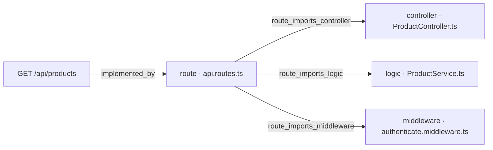
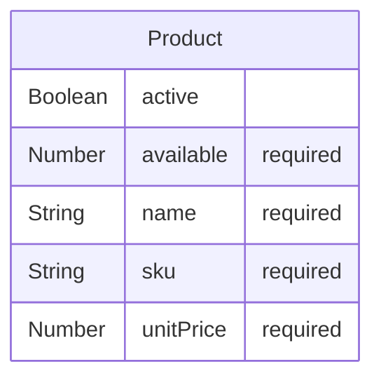

# WI-ORD-API-008 — [Documentation] Products

## Qué pide la spec

La spec define el contrato REST del backend de pedidos de GREEN-H2 [ancla:endpoint GET /api/products]. Su propósito es permitir a un cliente autenticado consultar el catálogo de productos activos —con precio y disponibilidad en tiempo real— para componer un pedido en la pantalla `/orders/new` del frontend GREEN-ORD-UX-001 [ancla:user_story HU-01]. El repositorio partía de cero: todo el backend se construye desde la plantilla de la capa.

El endpoint que ancla este work item es [spec:endpoint GET /api/products]: devuelve los productos activos con su precio y su disponibilidad, protegido por JWT. Dos reglas de negocio lo gobiernan directamente:

- [spec:business_rule RN-06]: cualquier petición sin token válido recibe `401 UNAUTHORIZED`, sin excepción.
- [spec:business_rule RN-01]: el listado refleja siempre el estado guardado en base de datos, sin cachés intermedias.

El criterio de aceptación que lo ejercita es [spec:acceptance_criteria AC-06]: cuando el cliente solicita `GET /api/products`, el sistema debe devolver los productos activos con su precio y disponibilidad. El criterio de autenticación que lo afecta transversalmente es [spec:acceptance_criteria AC-07]: cualquier endpoint sin token válido responde `401 UNAUTHORIZED`.

La entidad central es [spec:entidad Product], con los campos `_id`, `sku`, `name`, `unitPrice`, `available` y `active`. Solo los documentos con `active: true` son visibles al cliente; `available` nunca es negativo porque solo la confirmación escribe ese campo [spec:business_rule RN-03] [spec:business_rule RN-04].

El resto de endpoints de la spec —[spec:endpoint POST /api/orders], [spec:endpoint GET /api/orders], [spec:endpoint GET /api/orders/:id] y [spec:endpoint POST /api/orders/:id/confirm]— son competencia de [wi:WI-ORD-API-007] y [wi:WI-ORD-API-005]; este documento no los cubre.

## El trabajo y su historia

| work item | tipo | estado | asignado a |
|---|---|---|---|
| WI-ORD-API-001 | Backend | Cancelado | sin asignar |
| WI-ORD-API-002 | Documentación | Cancelado | sin asignar |
| WI-ORD-API-003 | Backend | Cancelado | Jorge Developer |
| WI-ORD-API-004 | Documentación | Cancelado | sin asignar |
| WI-ORD-API-005 | Backend | Generado | sin asignar |
| WI-ORD-API-006 | Documentación | Generado | sin asignar |
| WI-ORD-API-007 | Backend | Cerrado | Jorge Developer |
| WI-ORD-API-008 | Documentación | Generado | Jorge Developer |

| fecha y hora (UTC) | work item | qué pasó | quién | motivo |
|---|---|---|---|---|
| 2026-10-12 20:05 | WI-ORD-API-001 | nace en «Generado» | Administrador Global | nacimiento del work item |
| 2026-10-12 20:05 | WI-ORD-API-002 | nace en «Generado» | Administrador Global | nacimiento del work item |
| 2026-10-12 20:05 | WI-ORD-API-003 | nace en «Generado» | Administrador Global | nacimiento del work item |
| 2026-10-12 20:05 | WI-ORD-API-004 | nace en «Generado» | Administrador Global | nacimiento del work item |
| 2026-10-12 20:07 | WI-ORD-API-003 | «Generado» → «Contexto Listo» | Administrador Global | context pack preparado |
| 2026-10-12 20:07 | WI-ORD-API-003 | «Contexto Listo» → «Aprobado» | Administrador Global | Pack revisado (v3, 10.245 tokens): contratos, modelo de datos, contexto técnico, constitución y convenciones incluidos. Ola 7 · H3. |
| 2026-10-12 20:07 | WI-ORD-API-003 | «Aprobado» → «Asignado» | Administrador Global | asignación de work item |
| 2026-10-12 20:07 | WI-ORD-API-003 | «Asignado» → «En Progreso» | Administrador Global | Run autónomo 71f7f431-e151-48a8-90d0-f8bdad9293f7 (agente developer) |
| 2026-10-12 20:22 | WI-ORD-API-003 | «En Progreso» → «Bloqueado» | Administrador Global | El run 71f7f431-e151-48a8-90d0-f8bdad9293f7 del agente developer murió sin terminar: No se publica: el work item no cumple sus puertas — gate_sin_cumplir: confirmar un pedido y comprobar que GET /api/orders y GET /api/orders/:id lo devuelven confirmed en la siguiente petición — el informe no la declara cumplida (RN-01) · gate_sin_cumplir: GET y POST confirm sobre un pedido de otro cliente responden 403 ORDER_FORBIDDEN — el informe no la declara cumplida (RN-02) |
| 2026-10-12 23:06 | WI-ORD-API-004 | «Generado» → «Contexto Listo» | Administrador Global | context pack preparado |
| 2026-10-12 23:06 | WI-ORD-API-002 | «Generado» → «Contexto Listo» | Administrador Global | context pack preparado |
| 2026-10-12 23:06 | WI-ORD-API-001 | «Generado» → «Contexto Listo» | Administrador Global | context pack preparado |
| 2026-10-12 23:08 | WI-ORD-API-001 | «Contexto Listo» → «Cancelado» | Administrador Global | Generado antes de arreglar el reparto de entidades por recurso: llevaba «Migración de esquema — Product, Order» y la entidad ajena en su pack. Se regenera desde el agrupador con el descomponedor corregido (H0 de plan_ux_llenar_bien_la_spec). |
| 2026-10-12 23:08 | WI-ORD-API-002 | «Contexto Listo» → «Cancelado» | Administrador Global | Generado antes de arreglar el reparto de entidades por recurso: llevaba «Migración de esquema — Product, Order» y la entidad ajena en su pack. Se regenera desde el agrupador con el descomponedor corregido (H0 de plan_ux_llenar_bien_la_spec). |
| 2026-10-12 23:08 | WI-ORD-API-003 | «Bloqueado» → «Cancelado» | Administrador Global | Generado antes de arreglar el reparto de entidades por recurso: llevaba «Migración de esquema — Product, Order» y la entidad ajena en su pack. Se regenera desde el agrupador con el descomponedor corregido (H0 de plan_ux_llenar_bien_la_spec). |
| 2026-10-12 23:08 | WI-ORD-API-004 | «Contexto Listo» → «Cancelado» | Administrador Global | Generado antes de arreglar el reparto de entidades por recurso: llevaba «Migración de esquema — Product, Order» y la entidad ajena en su pack. Se regenera desde el agrupador con el descomponedor corregido (H0 de plan_ux_llenar_bien_la_spec). |
| 2026-10-12 23:08 | WI-ORD-API-005 | nace en «Generado» | Administrador Global | nacimiento del work item |
| 2026-10-12 23:08 | WI-ORD-API-006 | nace en «Generado» | Administrador Global | nacimiento del work item |
| 2026-10-12 23:08 | WI-ORD-API-007 | nace en «Generado» | Administrador Global | nacimiento del work item |
| 2026-10-12 23:08 | WI-ORD-API-008 | nace en «Generado» | Administrador Global | nacimiento del work item |
| 2026-10-12 23:09 | WI-ORD-API-007 | «Generado» → «Contexto Listo» | Administrador Global | context pack preparado |
| 2026-10-12 23:11 | WI-ORD-API-007 | «Contexto Listo» → «Aprobado» | Administrador Global | — |
| 2026-10-12 23:12 | WI-ORD-API-007 | «Aprobado» → «Asignado» | Administrador Global | asignación de work item |
| 2026-10-12 23:12 | WI-ORD-API-007 | «Asignado» → «En Progreso» | Administrador Global | Run autónomo c31137c4-5217-4056-8565-ca6e597c7d86 (agente developer) |
| 2026-10-12 23:28 | WI-ORD-API-007 | «En Progreso» → «Bloqueado» | Administrador Global | El run c31137c4-5217-4056-8565-ca6e597c7d86 del agente developer murió sin terminar: Alguien canceló el run: el bucle se paró antes de pedir el turno siguiente |
| 2026-10-13 01:15 | WI-ORD-API-007 | «Bloqueado» → «En Progreso» | Administrador Global | Run autónomo db551f0c-fa44-42ce-b55f-f2cb46fc0479 (agente developer) |
| 2026-10-13 01:23 | WI-ORD-API-003, WI-ORD-API-007 | PR #1 abierto | git | WI-ORD-API-007 · implementación autónoma |
| 2026-10-13 01:57 | WI-ORD-API-007 | «En Progreso» → «MR Abierto · en revisión» | Administrador Global | sugerencia de git aceptada |
| 2026-10-13 02:03 | WI-ORD-API-003, WI-ORD-API-007 | PR #1 mergeado | git | WI-ORD-API-007 · implementación autónoma |
| 2026-10-13 03:04 | WI-ORD-API-007 | «MR Abierto · en revisión» → «Validado» | Administrador Global | — |
| 2026-10-13 03:05 | WI-ORD-API-007 | «Validado» → «Mergeado» | Administrador Global | sugerencia de git aceptada |
| 2026-10-13 03:05 | WI-ORD-API-007 | «Mergeado» → «Cerrado» | Administrador Global | — |

La historia de este package arranca el 12 de octubre de 2026 con el nacimiento simultáneo de cuatro work items ([estado:WI-ORD-API-001], [estado:WI-ORD-API-002], [estado:WI-ORD-API-003], [estado:WI-ORD-API-004]). El primero en avanzar fue [wi:WI-ORD-API-003]: alcanzó «En Progreso» en minutos, pero su run autónomo murió a las 20:22 UTC bloqueado por dos puertas de calidad incumplidas —la verificación de RN-01 tras confirmar un pedido y la verificación de RN-02 sobre pedidos ajenos— [estado:WI-ORD-API-003].

A las 23:08 UTC del mismo día el Administrador Global canceló los cuatro work items originales con el mismo motivo: habían sido generados antes de corregir el descomponedor del agrupador, que asignaba incorrectamente la entidad ajena y la migración de esquema [estado:WI-ORD-API-001] [estado:WI-ORD-API-002] [estado:WI-ORD-API-003] [estado:WI-ORD-API-004]. En ese mismo instante nacieron los cuatro sustitutos: [estado:WI-ORD-API-005], [estado:WI-ORD-API-006], [estado:WI-ORD-API-007] y [estado:WI-ORD-API-008].

[wi:WI-ORD-API-007] es el work item backend que implementa el código objeto de este documento. Su propio primer run fue cancelado externamente a las 23:28 UTC («el bucle se paró antes de pedir el turno siguiente») [estado:WI-ORD-API-007]. Un segundo run arrancó el 13 de octubre a las 01:15 UTC y abrió [git:PR #1] a las 01:23 UTC. Tras pasar por revisión, el PR fue mergeado a las 02:03 UTC [git:PR #1]. El work item alcanzó «Cerrado» a las 03:05 UTC [estado:WI-ORD-API-007].

El work item que nos ocupa, WI-ORD-API-008, nació en «Generado» el 12 de octubre a las 23:08 UTC y permanece en ese estado [estado:WI-ORD-API-008]. Los work items [wi:WI-ORD-API-005] y [wi:WI-ORD-API-006] están igualmente en «Generado» y sin asignar; su contenido no es objeto de este documento.

## Lo que se tocó

### WI-ORD-API-007 · Backend · «Cerrado»
- Informe de finalización [informe:WI-ORD-API-007], 2026-10-13 01:23 UTC, commit 9d2c4e8: 1 de 1 criterios cubiertos.
  - Lo que dijo al entregarlo: Run autónomo db551f0c-fa44-42ce-b55f-f2cb46fc0479 (agente developer): El build TypeScript pasa sin errores. Todo está en verde. --- ## Resumen de implementación — WI-ORD-API-007 ### Qué se implementó **Endpoint `GET /api/products`** — catálogo de productos activos con precio y disponibilidad, paginado y ordenado por `name`/`sku`. Proyecto completamente greenfield (solo existía `README.md`). Se construyó la estructura completa del backend siguiendo la plantilla del stack: ### Ficheros creados | Fichero | Propósito | |---|---| | `api/package.json` + `tsconfig.json` + `jest.config.js` | Configuración del proyecto | | `api/.env.example` | Variables de entorno documentadas sin valores reales | | `api/src/config/env.ts` | Lectura de variables de entorno | | `api/src/config/connectDB.ts` | Conexión centralizada a MongoDB | | `api/src/config/swagger.ts` | Configuración de swagger-jsdoc | | `api/src/lib/errors.ts` | `AppError`, `ValidationError`, `UnauthorizedError`, `InternalError` | | `api/src/lib/obfuscate.ts` | Util `obfuscateValue()` centralizado | | `api/src/models/product.ts` | Modelo Mongoose `Product` con índices `sku` (único) y `{active, name, sku}` | | `api/src/services/ProductService.ts` | `listActive()`, `toPublicProduct()`, tipo `PublicProduct` | | `api/src/validators/product.validator.ts` | Validación de `page` y `pageSize` con respuesta `VALIDATION_ERROR` | | `api/src/middlewares/authenticate.middleware.ts` | JWT HS256, `sub`+`exp` obligatorios, tolerancia de reloj 30 s, rotación con `JWT_SECRET_PREVIOUS`, rechaza `alg:none` | | `
  - Criterios y sus pruebas:
    - AC-06 (cubierto): GET /api/products devuelve los productos activos con precio y disponibilidad. Verificado con tests de integración que comprueban: lista vacía, solo activos, orden por name/sku, paginación, formato de unitPrice (2 decimales) y campo available ≥ 0.
  - Decisiones:
    - desviación: La spec (§4) declara explícitamente: 'Excepción declarada a la plantilla: no hay attachAuthenticatedUser ni requireAdmin, porque no hay colección de usuarios ni roles (la identidad es externa)'. La spec manda sobre la plantilla según §4-bis.
    - desviación: Necesario para que los tests (que fijan las variables de entorno antes de crear la app) funcionen correctamente sin reiniciar el módulo. La seguridad no se ve afectada: en producción las variables se cargan antes del arranque del servidor.
  - Evidencias:
    - test_results `workflow_artifacts/092a1d4d-6634-48ef-8cbd-78c26fa2fda7` (corroborada): Salida real del comando, ejecutado en el contenedor efímero
    - test_results `workflow_artifacts/84352be5-ef30-4488-9ca2-555a8e845a94` (corroborada): Salida real del comando, ejecutado en el contenedor efímero
    - coverage_report `workflow_artifacts/092a1d4d-6634-48ef-8cbd-78c26fa2fda7` (corroborada): Informe de cobertura dentro de la salida de las pruebas, en el contenedor efímero
    - test_results `.sdd/evidence/test-results.txt` (corroborada): 30 tests passing: 29 en products.spec.ts (integración + unitarios) y 1 en migration.spec.ts
    - migration_log `.sdd/evidence/migration.log` (corroborada): Log generado por migration.spec.ts: colección products creada con índices sku (único) y {active, name, sku} compuesto. Verificado en MongoDB in-memory.
    - coverage_report `api/coverage/lcov-report/index.html`: Cobertura medida en la corrida: 90.51% de líneas en los 11 ficheros tocados (exigida ≥ 80%). Resumen en api/coverage/coverage-summary.json.
    - api_docs `api/src/controllers/*.ts` (corroborada): —
- Contratos del código: [codigo:GET /api/products], [codigo:model:Product]

### Ficheros del PR #1, mergeado el 2026-10-13 02:03 UTC: 25 ficheros, +7911 −0
| fichero | cambio | + | − |
|---|---|---|---|
| `api/package-lock.json` | añadido | 6499 | 0 |
| `api/src/__tests__/products.spec.ts` | añadido | 489 | 0 |
| `api/src/__tests__/migration.spec.ts` | añadido | 103 | 0 |
| `api/src/controllers/ProductController.ts` | añadido | 89 | 0 |
| `api/src/middlewares/authenticate.middleware.ts` | añadido | 75 | 0 |
| `api/src/config/swagger.ts` | añadido | 72 | 0 |
| `.sdd/completion-report-WI-ORD-API-007.json` | añadido | 60 | 0 |
| `api/src/services/ProductService.ts` | añadido | 54 | 0 |
| `api/src/models/product.ts` | añadido | 50 | 0 |
| `.sdd/evidence/test-results.txt` | añadido | 48 | 0 |
| `api/src/lib/errors.ts` | añadido | 48 | 0 |
| `api/src/middlewares/errorHandler.middleware.ts` | añadido | 43 | 0 |
| `api/package.json` | añadido | 37 | 0 |
| `api/src/validators/product.validator.ts` | añadido | 31 | 0 |
| `api/src/app.ts` | añadido | 29 | 0 |
| `api/jest.config.js` | añadido | 28 | 0 |
| `api/src/middlewares/requestLogger.middleware.ts` | añadido | 27 | 0 |
| `api/src/config/env.ts` | añadido | 26 | 0 |
| `api/src/routes/api.routes.ts` | añadido | 24 | 0 |
| `api/tsconfig.json` | añadido | 19 | 0 |
| `api/src/server.ts` | añadido | 18 | 0 |
| `.sdd/evidence/migration.log` | añadido | 11 | 0 |
| `api/.env.example` | añadido | 11 | 0 |
| `api/src/config/connectDB.ts` | añadido | 11 | 0 |
| `api/src/lib/obfuscate.ts` | añadido | 9 | 0 |

El PR #1 [git:PR #1] fue el único conjunto de cambios que toca el código documentado aquí. Contenía 25 ficheros nuevos y +7 911 líneas (−0), construyendo el proyecto desde cero sobre un repositorio que solo tenía `README.md` [informe:WI-ORD-API-007].

Los contratos del código declarados son [codigo:GET /api/products] y [codigo:model:Product].

Los ficheros relevantes para el endpoint `GET /api/products` y su infraestructura son:

- **`api/src/models/product.ts`** (+50 líneas): modelo Mongoose para [ancla:entity Product] con los índices que exige la spec: `sku` único y `{active, name, sku}` compuesto para el listado del catálogo [informe:WI-ORD-API-007].
- **`api/src/services/ProductService.ts`** (+54 líneas): lógica de negocio con `listActive()` y `toPublicProduct()` [informe:WI-ORD-API-007].
- **`api/src/validators/product.validator.ts`** (+31 líneas): validación de los parámetros de paginación `page` y `pageSize`, con respuesta `VALIDATION_ERROR` [informe:WI-ORD-API-007] [spec:error VALIDATION_ERROR].
- **`api/src/controllers/ProductController.ts`** (+89 líneas): controlador que orquesta validador, servicio y respuesta [informe:WI-ORD-API-007].
- **`api/src/middlewares/authenticate.middleware.ts`** (+75 líneas): guarda JWT HS256 con `sub` y `exp` obligatorios, tolerancia de reloj de 30 s, soporte de rotación con `JWT_SECRET_PREVIOUS` y rechazo explícito de `alg:none` [informe:WI-ORD-API-007].
- **`api/src/routes/api.routes.ts`** (+24 líneas): registro de la ruta y enlace entre middleware, controlador y servicio [informe:WI-ORD-API-007].
- **`api/src/__tests__/products.spec.ts`** (+489 líneas) y **`api/src/__tests__/migration.spec.ts`** (+103 líneas): suite de pruebas de integración y unitarias [informe:WI-ORD-API-007].
- **`api/.env.example`** (+11 líneas): variables de entorno documentadas sin valores reales (`MONGODB_URI`, `JWT_SECRET`, `JWT_SECRET_PREVIOUS`) [informe:WI-ORD-API-007].
- Infraestructura compartida: `api/src/lib/errors.ts`, `api/src/lib/obfuscate.ts`, `api/src/middlewares/errorHandler.middleware.ts`, `api/src/middlewares/requestLogger.middleware.ts`, `api/src/config/env.ts`, `api/src/config/connectDB.ts`, `api/src/config/swagger.ts`, `api/src/app.ts`, `api/src/server.ts`, más los ficheros de configuración del proyecto [informe:WI-ORD-API-007].

## Cómo está construido

El grafo de conocimiento del endpoint muestra la cadena de responsabilidades:

La petición entra por [ancla:endpoint GET /api/products] y es recibida por el router [arista:GET /api/products→route · api.routes.ts]. Antes de llegar al controlador, el router aplica el middleware de autenticación [arista:route · api.routes.ts→middleware · authenticate.middleware.ts], que valida el JWT HS256: comprueba la firma con `JWT_SECRET` (y con `JWT_SECRET_PREVIOUS` si está definida para soportar rotaciones), exige los claims `sub` y `exp`, aplica una tolerancia de reloj de 30 s y rechaza explícitamente el algoritmo `none` [informe:WI-ORD-API-007]. Si el token falla en cualquiera de esas comprobaciones, la respuesta es `401 UNAUTHORIZED` [spec:error UNAUTHORIZED] [spec:business_rule RN-06].

Si el token es válido, el router delega en el controlador [arista:route · api.routes.ts→controller · ProductController.ts]. El controlador invoca al validador de parámetros de paginación y, si pasan, llama a la lógica de negocio [arista:route · api.routes.ts→logic · ProductService.ts]. `ProductService.listActive()` consulta MongoDB filtrando por `active: true` y proyecta los campos públicos mediante `toPublicProduct()` [informe:WI-ORD-API-007].

El modelo de datos real del ORM es:

El campo `_id` lo genera MongoDB automáticamente; no aparece como campo declarado en el esquema Mongoose pero forma parte de la entidad pública [spec:entidad Product]. El campo `active` actúa como filtro de visibilidad: solo los productos con `active: true` aparecen en la respuesta [spec:acceptance_criteria AC-06]. El campo `unitPrice` se serializa con dos decimales en la respuesta pública [informe:WI-ORD-API-007]. El campo `available` nunca es negativo porque únicamente la confirmación de pedidos lo modifica, de forma atómica [spec:business_rule RN-04]; el endpoint `GET /api/products` lo lee pero nunca lo escribe.

## Reglas de negocio

Las reglas que afectan directamente a este endpoint son:

- **[spec:business_rule RN-06]**: cualquier petición sin token válido recibe `401 UNAUTHORIZED`. El middleware de autenticación la implementa antes de que el controlador siquiera se ejecute [arista:route · api.routes.ts→middleware · authenticate.middleware.ts].
- **[spec:business_rule RN-01]**: el listado refleja el estado guardado en cada petición, sin cachés. `ProductService.listActive()` consulta la base de datos en cada llamada [informe:WI-ORD-API-007].
- **[spec:business_rule RN-05]**: los precios los calcula el servidor con el precio del catálogo; el cliente nunca envía precios. Este endpoint es el punto de lectura que alimenta la composición del pedido en `POST /api/orders` [spec:endpoint POST /api/orders].

Las reglas [spec:business_rule RN-02], [spec:business_rule RN-03] y [spec:business_rule RN-04] no afectan a este endpoint: son propias de la gestión de pedidos, implementada en [wi:WI-ORD-API-007].

## Cómo verificarlo

El informe de finalización declara 1 de 1 criterios cubiertos [informe:WI-ORD-API-007], correspondiente a [spec:acceptance_criteria AC-06].

La suite `api/src/__tests__/products.spec.ts` (489 líneas, 29 tests) cubre los siguientes escenarios de integración para `GET /api/products` [informe:WI-ORD-API-007]:

- Lista vacía cuando no hay productos activos.
- Solo productos con `active: true` aparecen en la respuesta; los inactivos se excluyen.
- Orden por `name`/`sku`.
- Paginación correcta con `page` y `pageSize`.
- Formato de `unitPrice` con 2 decimales.
- `available` siempre mayor o igual a cero.

El criterio [spec:acceptance_criteria AC-07] —`401 UNAUTHORIZED` sin token válido— también queda cubierto por los tests que verifican el middleware de autenticación, incluyendo el caso de JWT sin `sub` o sin `exp` [informe:WI-ORD-API-007].

La suite `api/src/__tests__/migration.spec.ts` (103 líneas, 1 test) verifica que la colección `products` se crea con los índices correctos: `sku` único y `{active, name, sku}` compuesto, usando MongoDB in-memory [informe:WI-ORD-API-007].

La cobertura medida fue del **90,51 % de líneas** en los 11 ficheros tocados, superando el mínimo del 80 % exigido por la spec [informe:WI-ORD-API-007]. El informe completo está en `api/coverage/lcov-report/index.html` y el resumen en `api/coverage/coverage-summary.json`.

Los tests usan `mongodb-memory-server` en modo réplica y firman los JWT con un `JWT_SECRET` de prueba, tal como exige la spec en su restricción de testing.

## Notas para el mantenedor

**Desviación declarada — sin `attachAuthenticatedUser` ni `requireAdmin`**: el informe declara explícitamente que la spec exime de estos middlewares de plantilla porque no existe colección de usuarios ni roles; la identidad es completamente externa [informe:WI-ORD-API-007]. La spec prevalece sobre la plantilla en este punto.

**Desviación declarada — orden de carga de variables de entorno en tests**: el módulo de entorno se diseñó para que los tests puedan fijar las variables antes de crear la aplicación, sin necesidad de reiniciar el módulo. El informe declara que la seguridad no se ve afectada porque en producción las variables se cargan antes del arranque [informe:WI-ORD-API-007].

**Work items cancelados**: los work items [wi:WI-ORD-API-001], [wi:WI-ORD-API-002], [wi:WI-ORD-API-003] y [wi:WI-ORD-API-004] fueron cancelados por un defecto del descomponedor que asignaba entidades ajenas y la migración de esquema de forma incorrecta [estado:WI-ORD-API-001]. El primer intento de implementación ([wi:WI-ORD-API-003]) también quedó bloqueado por puertas de calidad incumplidas relativas a RN-01 y RN-02, ambas fuera del alcance de este endpoint [estado:WI-ORD-API-003].

**Work items pendientes**: [wi:WI-ORD-API-005] (Backend) y [wi:WI-ORD-API-006] (Documentación) están en estado «Generado» y sin asignar [estado:WI-ORD-API-005] [estado:WI-ORD-API-006]. Implementan los endpoints de pedidos que complementan al catálogo; el mantenedor debe tenerlos en cuenta antes de declarar el contrato completo.

**Secretos**: `MONGODB_URI`, `JWT_SECRET` y `JWT_SECRET_PREVIOUS` solo se cargan por variable de entorno. El fichero `api/.env.example` documenta su forma sin valores reales; ningún secreto debe entrar al repositorio.

**Logs**: el middleware `requestLogger.middleware.ts` emite logs JSON estructurados con método, ruta, status, duración y `requestId` (cabecera `X-Request-Id` o generado). Los logs no incluyen el token ni datos personales.

**Subgrafo del doc-pack**: el grafo de arquitectura incluido muestra únicamente las aristas del endpoint `GET /api/products`. Los demás endpoints de la spec y sus dependencias no están proyectados en este doc-pack; consúltese el work item [wi:WI-ORD-API-007] para su arquitectura completa.