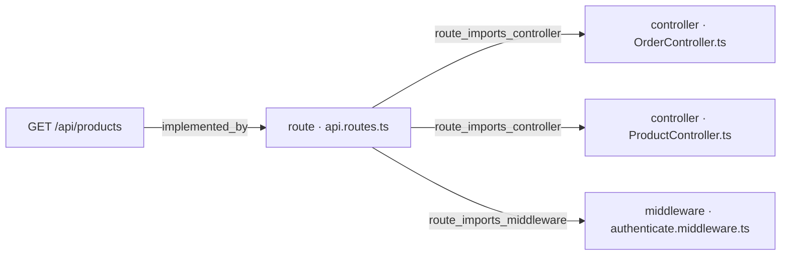
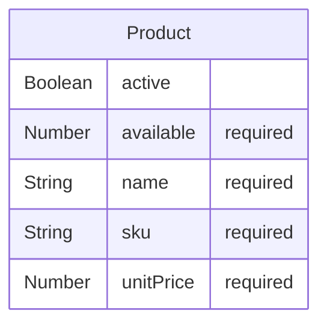

# [Documentation] Products — documento técnico

## Qué pide la spec

El backend de pedidos de GREEN-H2 necesita exponer el catálogo de productos activos para que el frontend pueda componer un pedido nuevo en la pantalla `/orders/new`. El work item WI-ORD-API-008 documenta precisamente ese punto de entrada: [ancla:endpoint GET /api/products], que lista los productos activos con su precio y su disponibilidad [spec:endpoint GET /api/products].

La spec establece que el servidor es el dueño de los precios: el cliente nunca los envía [spec:business_rule RN-05], de modo que el catálogo es la fuente autoritativa de `unitPrice` en el momento de crear el pedido. El endpoint exige autenticación JWT [spec:endpoint GET /api/products]; sin un token válido cualquier endpoint, incluido este, responde `401 UNAUTHORIZED` [spec:business_rule RN-06]. La query se valida en el servidor y se rechazan campos desconocidos [spec:error VALIDATION_ERROR].

El criterio de aceptación que rige este endpoint es [spec:acceptance_criteria AC-06]: cuando el cliente solicita `GET /api/products`, el sistema debe devolver los productos activos con su precio y su disponibilidad. El criterio [spec:acceptance_criteria AC-07] aplica igualmente: sin token válido, `401 UNAUTHORIZED`.

La entidad central es [spec:entidad Product], con los campos `_id`, `sku`, `name`, `unitPrice`, `available` y `active`. Solo los productos con `active = true` son visibles en el catálogo [ancla:entity Product].

El resto de endpoints de la spec ([spec:endpoint POST /api/orders], [spec:endpoint GET /api/orders], [spec:endpoint GET /api/orders/:id], [spec:endpoint POST /api/orders/:id/confirm]) son objeto de los work items [wi:WI-ORD-API-005] y [wi:WI-ORD-API-006], y no se describen aquí.

---

## El trabajo y su historia

| work item | qué | tipo | estado | asignado a |
|---|---|---|---|---|
| WI-ORD-API-001 | [Backend] Orders — implementar endpoints | Backend | Cancelado | sin asignar |
| WI-ORD-API-002 | [Documentation] Orders — documento técnico | Documentación | Cancelado | sin asignar |
| WI-ORD-API-003 | [Backend] Products — implementar endpoints | Backend | Cancelado | Jorge Developer |
| WI-ORD-API-004 | [Documentation] Products — documento técnico | Documentación | Cancelado | sin asignar |
| WI-ORD-API-005 | [Backend] Orders — implementar endpoints | Backend | Cerrado | Jorge Developer |
| WI-ORD-API-006 | [Documentation] Orders — documento técnico | Documentación | Cerrado | Jorge Developer |
| WI-ORD-API-007 | [Backend] Products — implementar endpoints | Backend | Cerrado | Jorge Developer |
| WI-ORD-API-008 | [Documentation] Products — documento técnico | Documentación | Retrabajo | Jorge Developer |
| WI-ORD-API-009 | [Backend] Products — implementar endpoints | Backend | Cancelado | sin asignar |
| WI-ORD-API-010 | [Backend] Products — implementar endpoints · evolución a la v9 | Backend | Validado | Jorge Developer |

| fecha y hora (UTC) | work item | qué pasó | quién | motivo |
|---|---|---|---|---|
| 2026-10-12 20:05 | WI-ORD-API-001 | nace en «Generado» | Administrador Global | nacimiento del work item |
| 2026-10-12 20:05 | WI-ORD-API-002 | nace en «Generado» | Administrador Global | nacimiento del work item |
| 2026-10-12 20:05 | WI-ORD-API-003 | nace en «Generado» | Administrador Global | nacimiento del work item |
| 2026-10-12 20:05 | WI-ORD-API-004 | nace en «Generado» | Administrador Global | nacimiento del work item |
| 2026-10-12 20:07 | WI-ORD-API-003 | «Generado» → «Contexto Listo» | Administrador Global | context pack preparado |
| 2026-10-12 20:07 | WI-ORD-API-003 | «Contexto Listo» → «Aprobado» | Administrador Global | Pack revisado (v3, 10.245 tokens): contratos, modelo de datos, contexto técnico, constitución y convenciones incluidos. Ola 7 · H3. |
| 2026-10-12 20:07 | WI-ORD-API-003 | «Aprobado» → «Asignado» | Administrador Global | asignación de work item |
| 2026-10-12 20:07 | WI-ORD-API-003 | «Asignado» → «En Progreso» | Administrador Global | Run autónomo 71f7f431-e151-48a8-90d0-f8bdad9293f7 (agente developer) |
| 2026-10-12 20:22 | WI-ORD-API-003 | «En Progreso» → «Bloqueado» | Administrador Global | El run 71f7f431-e151-48a8-90d0-f8bdad9293f7 del agente developer murió sin terminar: No se publica: el work item no cumple sus puertas — gate_sin_cumplir: confirmar un pedido y comprobar que GET /api/orders y GET /api/orders/:id lo devuelven confirmed en la siguiente petición — el informe no la declara cumplida (RN-01) · gate_sin_cumplir: GET y POST confirm sobre un pedido de otro cliente responden 403 ORDER_FORBIDDEN — el informe no la declara cumplida (RN-02) |
| 2026-10-12 23:06 | WI-ORD-API-004 | «Generado» → «Contexto Listo» | Administrador Global | context pack preparado |
| 2026-10-12 23:06 | WI-ORD-API-002 | «Generado» → «Contexto Listo» | Administrador Global | context pack preparado |
| 2026-10-12 23:06 | WI-ORD-API-001 | «Generado» → «Contexto Listo» | Administrador Global | context pack preparado |
| 2026-10-12 23:08 | WI-ORD-API-001 | «Contexto Listo» → «Cancelado» | Administrador Global | Generado antes de arreglar el reparto de entidades por recurso: llevaba «Migración de esquema — Product, Order» y la entidad ajena en su pack. Se regenera desde el agrupador con el descomponedor corregido (H0 de plan_ux_llenar_bien_la_spec). |
| 2026-10-12 23:08 | WI-ORD-API-002 | «Contexto Listo» → «Cancelado» | Administrador Global | Generado antes de arreglar el reparto de entidades por recurso: llevaba «Migración de esquema — Product, Order» y la entidad ajena en su pack. Se regenera desde el agrupador con el descomponedor corregido (H0 de plan_ux_llenar_bien_la_spec). |
| 2026-10-12 23:08 | WI-ORD-API-003 | «Bloqueado» → «Cancelado» | Administrador Global | Generado antes de arreglar el reparto de entidades por recurso: llevaba «Migración de esquema — Product, Order» y la entidad ajena en su pack. Se regenera desde el agrupador con el descomponedor corregido (H0 de plan_ux_llenar_bien_la_spec). |
| 2026-10-12 23:08 | WI-ORD-API-004 | «Contexto Listo» → «Cancelado» | Administrador Global | Generado antes de arreglar el reparto de entidades por recurso: llevaba «Migración de esquema — Product, Order» y la entidad ajena en su pack. Se regenera desde el agrupador con el descomponedor corregido (H0 de plan_ux_llenar_bien_la_spec). |
| 2026-10-12 23:08 | WI-ORD-API-005 | nace en «Generado» | Administrador Global | nacimiento del work item |
| 2026-10-12 23:08 | WI-ORD-API-006 | nace en «Generado» | Administrador Global | nacimiento del work item |
| 2026-10-12 23:08 | WI-ORD-API-007 | nace en «Generado» | Administrador Global | nacimiento del work item |
| 2026-10-12 23:08 | WI-ORD-API-008 | nace en «Generado» | Administrador Global | nacimiento del work item |
| 2026-10-12 23:09 | WI-ORD-API-007 | «Generado» → «Contexto Listo» | Administrador Global | context pack preparado |
| 2026-10-12 23:11 | WI-ORD-API-007 | «Contexto Listo» → «Aprobado» | Administrador Global | — |
| 2026-10-12 23:12 | WI-ORD-API-007 | «Aprobado» → «Asignado» | Administrador Global | asignación de work item |
| 2026-10-12 23:12 | WI-ORD-API-007 | «Asignado» → «En Progreso» | Administrador Global | Run autónomo c31137c4-5217-4056-8565-ca6e597c7d86 (agente developer) |
| 2026-10-12 23:28 | WI-ORD-API-007 | «En Progreso» → «Bloqueado» | Administrador Global | El run c31137c4-5217-4056-8565-ca6e597c7d86 del agente developer murió sin terminar: Alguien canceló el run: el bucle se paró antes de pedir el turno siguiente |
| 2026-10-13 01:15 | WI-ORD-API-007 | «Bloqueado» → «En Progreso» | Administrador Global | Run autónomo db551f0c-fa44-42ce-b55f-f2cb46fc0479 (agente developer) |
| 2026-10-13 01:23 | WI-ORD-API-007 | PR #1 abierto | git | WI-ORD-API-007 · implementación autónoma |
| 2026-10-13 01:57 | WI-ORD-API-007 | «En Progreso» → «MR Abierto · en revisión» | Administrador Global | sugerencia de git aceptada |
| 2026-10-13 02:03 | WI-ORD-API-007 | PR #1 mergeado | git | WI-ORD-API-007 · implementación autónoma |
| 2026-10-13 03:04 | WI-ORD-API-007 | «MR Abierto · en revisión» → «Validado» | Administrador Global | — |
| 2026-10-13 03:05 | WI-ORD-API-007 | «Validado» → «Mergeado» | Administrador Global | sugerencia de git aceptada |
| 2026-10-13 03:05 | WI-ORD-API-007 | «Mergeado» → «Cerrado» | Administrador Global | — |
| 2026-10-13 03:24 | WI-ORD-API-008 | PR #2 abierto | git | WI-ORD-API-008 · documento técnico |
| 2026-10-13 11:38 | WI-ORD-API-008 | «Generado» → «Contexto Listo» | Administrador Global | context pack preparado |
| 2026-10-13 11:38 | WI-ORD-API-008 | «Contexto Listo» → «Aprobado» | Administrador Global | — |
| 2026-10-13 11:39 | WI-ORD-API-008 | «Aprobado» → «Asignado» | Administrador Global | asignación de work item |
| 2026-10-13 11:40 | WI-ORD-API-008 | «Asignado» → «En Progreso» | Administrador Global | Documento compuesto por el Technical Writer |
| 2026-10-13 12:37 | WI-ORD-API-005 | «Generado» → «Contexto Listo» | Administrador Global | context pack preparado |
| 2026-10-13 12:41 | WI-ORD-API-005 | «Contexto Listo» → «Aprobado» | Administrador Global | — |
| 2026-10-13 12:41 | WI-ORD-API-005 | «Aprobado» → «Asignado» | Administrador Global | asignación de work item |
| 2026-10-13 12:42 | WI-ORD-API-005 | «Asignado» → «En Progreso» | Administrador Global | Run autónomo 4e9d9848-26dc-4675-b2bd-981bdbb85fdf (agente developer) |
| 2026-10-13 12:54 | WI-ORD-API-005, WI-ORD-API-009 | PR #3 abierto | git | WI-ORD-API-005 · implementación autónoma |
| 2026-10-13 13:04 | WI-ORD-API-008 | PR #2 mergeado | git | WI-ORD-API-008 · documento técnico |
| 2026-10-13 19:11 | WI-ORD-API-006 | «Generado» → «Contexto Listo» | Administrador Global | context pack preparado |
| 2026-10-13 19:21 | WI-ORD-API-005 | «En Progreso» → «MR Abierto · en revisión» | Administrador Global | sugerencia de git aceptada |
| 2026-10-13 19:23 | WI-ORD-API-005 | «MR Abierto · en revisión» → «Retrabajo» | Administrador Global | PR jcobo2020/proyectoGreen#3 no mergeable. La confirmación no comprueba el estado del pedido dentro de la transacción (puede descontar dos veces) y convierte todo WriteConflict en 409. OrderService lee ProductModel. La transacción va sin readConcern, writeConcern ni maxCommitTimeMS. Los servicios se crean en el router y no en createApp(). TransactionContext no es opaco. Falta el evento stock_insufficient. Faltan las pruebas de 500, de E11000 y de la doble confirmación concurrente. Rehacer contra |
| 2026-10-13 19:24 | WI-ORD-API-008 | «En Progreso» → «MR Abierto · en revisión» | Administrador Global | — |
| 2026-10-13 19:24 | WI-ORD-API-008 | «MR Abierto · en revisión» → «Retrabajo» | Administrador Global | PR jcobo2020/proyectoGreen#3 no mergeable. La confirmación no comprueba el estado del pedido dentro de la transacción (puede descontar dos veces) y convierte todo WriteConflict en 409. OrderService lee ProductModel. La transacción va sin readConcern, writeConcern ni maxCommitTimeMS. Los servicios se crean en el router y no en createApp(). TransactionContext no es opaco. Falta el evento stock_insufficient. Faltan las pruebas de 500, de E11000 y de la doble confirmación concurrente. Rehacer contra |
| 2026-10-13 19:27 | WI-ORD-API-005 | «Retrabajo» → «En Progreso» | Administrador Global | Run autónomo 4ffc0128-c5c6-4c52-9487-dae4865388b1 (agente developer) |
| 2026-10-13 19:27 | WI-ORD-API-005 | «En Progreso» → «Bloqueado» | Administrador Global | AEP_REPO_AVANZO: La rama main está en f1711e6c7093 y el pack describe e5a5753ef4fb: el repositorio avanzó desde el snapshot. Cambiaron 1 fichero(s): docs/WI-ORD-API-008/README.md. No se sabe si tocan el trabajo: sus anclas no tienen fichero en el snapshot (p. ej. un endpoint que aún no existe). Hacen falta DOS pasos, en este orden: (1) toma un snapshot del proyecto, para que el commit nuevo exista en el control plane; (2) vuelve a preparar el contexto del work item («Preparar contexto» en su ficha), que es lo único que reescribe el commit base del pack. Con el snapshot solo NO basta: el pack conserva el suyo hasta que se recompila. Después, relanza el agente desde aquí mismo. |
| 2026-10-13 19:29 | WI-ORD-API-005 | «Bloqueado» → «En Progreso» | Administrador Global | Run autónomo 88fb5f11-a21e-4a83-b109-208d4f429e44 (agente developer) |
| 2026-10-13 19:44 | WI-ORD-API-005 | «En Progreso» → «Bloqueado» | Administrador Global | Se superó el techo de dinero de ESTE run (`llmBudget.maxCostPerRunUsd`). Este bucle gastó 2.01 USD. Es llmBudget.maxCostPerRunUsd, con override por proyecto en Parámetros → Presupuesto LLM. |
| 2026-10-13 19:55 | WI-ORD-API-005 | «Bloqueado» → «En Progreso» | Administrador Global | Run autónomo 5f717520-a7bb-44d6-b020-91d06f37e764 (agente developer) |
| 2026-10-13 23:10 | WI-ORD-API-005 | «En Progreso» → «MR Abierto · en revisión» | Administrador Global | sugerencia de git aceptada |
| 2026-10-13 23:11 | WI-ORD-API-005 | «MR Abierto · en revisión» → «Retrabajo» | Administrador Global | PR #3 no mergeable (revisión del run 5f717520): los tests «500» comprueban 404/400; faltan las pruebas de 500 en los 4 endpoints y la de E11000 (1 + 3 reintentos, 500 al cuarto fallo); falta el evento stock_insufficient; OrderService llama a unwrapSession (solo la infraestructura); IUnitOfWork cuenta llamadas a withTransaction, no intentos de fn; GET /:id y confirm no rechazan query desconocida; el router conserva un else que instancia servicios; el informe dice met:true con desviaciones falsas. |
| 2026-10-13 23:12 | WI-ORD-API-005 | «Retrabajo» → «En Progreso» | Administrador Global | Run autónomo 5584ea21-65e5-4fcd-a000-58a390048276 (agente developer) |
| 2026-10-13 23:24 | WI-ORD-API-005 | «En Progreso» → «Bloqueado» | Administrador Global | Se para antes de cruzar el techo del run: quedan 0.1244 USD y el último turno costó 0.2280. Pedir otro lo rebasaría, y un turno no se puede devolver. Este bucle gastó 1.88 USD. Es llmBudget.maxCostPerRunUsd, con override por proyecto en Parámetros → Presupuesto LLM. |
| 2026-10-13 23:29 | WI-ORD-API-005 | «Bloqueado» → «En Progreso» | Administrador Global | Run autónomo 7ed6ef66-ad2f-4512-8014-a818c0a4128f (agente developer) |
| 2026-10-13 23:31 | WI-ORD-API-005 | «En Progreso» → «Bloqueado» | Administrador Global | El run 7ed6ef66-ad2f-4512-8014-a818c0a4128f del agente developer murió sin terminar: Alguien canceló el run: el bucle se paró antes de pedir el turno siguiente |
| 2026-10-14 00:05 | WI-ORD-API-005 | «Bloqueado» → «En Progreso» | Administrador Global | Run autónomo bf0ffb39-cf4a-4369-b2d1-394900b8cc01 (agente developer) |
| 2026-10-14 01:29 | WI-ORD-API-005 | «En Progreso» → «MR Abierto · en revisión» | Administrador Global | sugerencia de git aceptada |
| 2026-10-14 01:29 | WI-ORD-API-005 | «MR Abierto · en revisión» → «Retrabajo» | Administrador Global | Revisión del run bf0ffb39: E11000 hace 3 intentos y deben ser 4 (1+3 reintentos); la prueba «cuatro colisiones» afirma 3 y falta 3 colisiones+éxito→201. OrderService sigue aplicando la sesión con withTx: persistencia a un adaptador de infraestructura o clarificationRequest. Faltan pruebas de MongoUnitOfWork, del 500 por caída de la transacción y del evento stock_insufficient. POST no rechaza query desconocida; items:[null] da 500. migration.log pisa el de WI-007. Informe met:true falso. |
| 2026-10-14 01:29 | WI-ORD-API-005 | «Retrabajo» → «En Progreso» | Administrador Global | Run autónomo 13a5c8f4-32b1-45ac-af7b-8ba99b8c604c (agente developer) |
| 2026-10-14 01:41 | WI-ORD-API-005 | «En Progreso» → «Bloqueado» | Administrador Global | Se para antes de cruzar el techo del run: quedan 0.0375 USD y el último turno costó 0.0384. Pedir otro lo rebasaría, y un turno no se puede devolver. Este bucle gastó 0.21 USD. Es llmBudget.maxCostPerRunUsd, con override por proyecto en Parámetros → Presupuesto LLM. |
| 2026-10-14 02:19 | WI-ORD-API-005 | «Bloqueado» → «En Progreso» | Administrador Global | Run autónomo 02440b15-f5a5-499d-8fbf-79876e0c34c0 (agente developer) |
| 2026-10-14 03:18 | WI-ORD-API-005 | «En Progreso» → «MR Abierto · en revisión» | Administrador Global | sugerencia de git aceptada |
| 2026-10-14 03:18 | WI-ORD-API-005 | «MR Abierto · en revisión» → «Retrabajo» | Administrador Global | Revisión del run 02440b15: OrderService no puede usar withTx ni OrderModel; la persistencia de pedidos va a un repositorio de infraestructura que recibe el TransactionContext (aclaración respondida: se exige el adaptador). Faltan, como pide §4: el 500 de cada endpoint forzando la caída de la transacción (no un servicio falso) y las unitarias de OrderService con dobles de sus puertos (total, código y cada rama de confirm); borra las que no afirman nada. Informe met:true falso. |
| 2026-10-14 03:18 | WI-ORD-API-005 | «Retrabajo» → «En Progreso» | Administrador Global | Run autónomo f658378c-d9b2-45e0-8709-b0f8916eb1d2 (agente developer) |
| 2026-10-14 03:18 | WI-ORD-API-005 | «En Progreso» → «Bloqueado» | Administrador Global | Presupuesto mensual del proyecto excedido: $20.04 de $20.00 — ajustable en Configuración → llm_budget Este bucle gastó 0.08 USD. Es llmBudget.maxMonthlyCostPerProjectUsd (el gasto de TODO el proyecto en el mes, no solo de este run), con override por proyecto en Parámetros → Presupuesto LLM. |
| 2026-10-14 03:19 | WI-ORD-API-005 | «Bloqueado» → «En Progreso» | Administrador Global | Run autónomo 391fc401-9a2c-4dab-91d3-122e8d75fc9d (agente developer) |
| 2026-10-14 03:49 | WI-ORD-API-005 | «En Progreso» → «MR Abierto · en revisión» | Administrador Global | sugerencia de git aceptada |
| 2026-10-14 03:50 | WI-ORD-API-005 | «MR Abierto · en revisión» → «Retrabajo» | Administrador Global | Revisión del run 391fc401: el 500 de confirm se provoca antes de abrir la transacción (falla findById en la comprobación previa). Falta una prueba HTTP con el fallo DENTRO de la transacción tras una escritura, que afirme 500 INTERNAL_ERROR, el pedido en pending_confirmation y el stock intacto. Borra lib/withSession.ts (sin uso). GET /orders: ?pageSize=0x10 salta el máximo y ?page=0x1 da 500 (Number frente a parseInt). Informe: una sola cifra de cobertura y met acorde. |
| 2026-10-14 03:50 | WI-ORD-API-005 | «Retrabajo» → «En Progreso» | Administrador Global | Run autónomo b7507420-bd98-42e0-9cf0-2620ff46cbf7 (agente developer) |
| 2026-10-14 04:50 | WI-ORD-API-005, WI-ORD-API-009 | PR #3 mergeado | git | WI-ORD-API-005 · implementación autónoma |
| 2026-10-14 05:18 | WI-ORD-API-005 | «En Progreso» → «MR Abierto · en revisión» | Administrador Global | — |
| 2026-10-14 05:18 | WI-ORD-API-005 | «MR Abierto · en revisión» → «Validado» | Administrador Global | — |
| 2026-10-14 05:18 | WI-ORD-API-005 | «Validado» → «Mergeado» | Administrador Global | sugerencia de git aceptada |
| 2026-10-14 05:19 | WI-ORD-API-005 | «Mergeado» → «Cerrado» | Administrador Global | — |
| 2026-10-14 05:19 | WI-ORD-API-006 | «Contexto Listo» → «Aprobado» | Administrador Global | — |
| 2026-10-14 05:20 | WI-ORD-API-006 | «Aprobado» → «Asignado» | Administrador Global | asignación de work item |
| 2026-10-14 05:22 | WI-ORD-API-006 | PR #4 abierto | git | WI-ORD-API-006 · documento técnico |
| 2026-10-14 05:22 | WI-ORD-API-006 | «Asignado» → «En Progreso» | Administrador Global | Documento compuesto por el Technical Writer |
| 2026-10-14 11:23 | WI-ORD-API-006 | PR #4 mergeado | git | WI-ORD-API-006 · documento técnico |
| 2026-10-14 12:03 | WI-ORD-API-009 | nace en «Generado» | Administrador Global | nacimiento del work item |
| 2026-10-14 12:05 | WI-ORD-API-009 | «Generado» → «Cancelado» | Administrador Global | Nació con el paquete WP-ORD-API-001 (el de Orders, rama ya mergeada) por un defecto de numeración de paquetes que este mismo hito arregla (LOS-PAQUETES-REPITEN-CODIGO-Y-RAMA-001). Se vuelve a crear desde la spec con un paquete nuevo. |
| 2026-10-14 12:05 | WI-ORD-API-010 | nace en «Generado» | Administrador Global | nacimiento del work item |
| 2026-10-14 12:25 | WI-ORD-API-006 | «En Progreso» → «MR Abierto · en revisión» | Administrador Global | — |
| 2026-10-14 12:30 | WI-ORD-API-006 | «MR Abierto · en revisión» → «Validado» | Administrador Global | Validado con excepción de las puertas: PR jcobo2020/proyectoGreen#4 revisado y mergeado por Jorge; sus afirmaciones se contrastaron con el código de main (IProductCatalog, transacción snapshot/majority, JWT, parseInt, log de migración). El Technical Writer no entrega informe de finalización, por eso la puerta no puede cumplirse sola. |
| 2026-10-14 12:37 | WI-ORD-API-006 | «Validado» → «Mergeado» | Administrador Global | Validado con excepción de las puertas: El PR jcobo2020/proyectoGreen#4 ya está mergeado en GitHub (lo confirma la sugerencia de git de esta ficha). La puerta no puede cumplirse porque el Technical Writer no entrega informe de finalización |
| 2026-10-14 12:38 | WI-ORD-API-006 | «Mergeado» → «Cerrado» | Administrador Global | — |
| 2026-10-14 12:40 | WI-ORD-API-010 | «Generado» → «Contexto Listo» | Administrador Global | context pack preparado |
| 2026-10-14 12:40 | WI-ORD-API-010 | «Contexto Listo» → «Aprobado» | Administrador Global | — |
| 2026-10-14 12:40 | WI-ORD-API-010 | «Aprobado» → «Asignado» | Administrador Global | asignación de work item |
| 2026-10-14 12:41 | WI-ORD-API-010 | «Asignado» → «En Progreso» | Administrador Global | Run autónomo e434c28e-146f-4ee5-95be-7bf684905903 (agente developer) |
| 2026-10-14 12:41 | WI-ORD-API-010 | «En Progreso» → «Bloqueado» | Administrador Global | AEP_REPO_AVANZO: La rama main está en 039b606de5e4 y el pack describe f1711e6c7093: el repositorio avanzó desde el snapshot. Cambiaron 21 fichero(s): .sdd/completion-report-WI-ORD-API-005.json, .sdd/evidence/migration-WI-ORD-API-005.log, .sdd/evidence/test-results.txt, api/src/__tests__/migration.spec.ts, api/src/__tests__/mongoUnitOfWork.spec.ts, api/src/__tests__/orderService.unit.spec.ts, api/src/__tests__/orders.spec.ts, api/src/app.ts, api/src/controllers/OrderController.ts, api/src/lib/MongoOrderRepository.ts y 11 más. 1 toca(n) el alcance de este work item: api/src/routes/api.routes.ts. Revisa el cambio antes de relanzar. Hacen falta DOS pasos, en este orden: (1) toma un snapshot del proyecto, para que el commit nuevo exista en el control plane; (2) vuelve a preparar el contexto del work item («Preparar contexto» en su ficha), que es lo único que reescribe el commit base del pack. Con el snapshot solo NO basta: el pack conserva el suyo hasta que se recompila. Después, relanza el agente desde aquí mismo. |
| 2026-10-14 12:42 | WI-ORD-API-010 | «Bloqueado» → «En Progreso» | Administrador Global | Run autónomo fd8761c8-d336-481f-b18c-7f483cab0656 (agente developer) |
| 2026-10-14 12:56 | WI-ORD-API-010 | PR #5 abierto | git | WI-ORD-API-010 · implementación autónoma |
| 2026-10-14 13:00 | WI-ORD-API-010 | «En Progreso» → «MR Abierto · en revisión» | Administrador Global | sugerencia de git aceptada: PR jcobo2020/proyectoGreen#5 abierto |
| 2026-10-14 13:16 | WI-ORD-API-010 | PR #5 mergeado | git | WI-ORD-API-010 · implementación autónoma |
| 2026-10-14 13:31 | WI-ORD-API-010 | «MR Abierto · en revisión» → «Validado» | Administrador Global | Puertas cumplidas y revisión independiente del PR jcobo2020/proyectoGreen#5: el validador rechaza query desconocida con 400 VALIDATION_ERROR y dos pruebas lo provocan. La objeción restante del revisor es del informe (cobertura de services/, que el WI no toca). |

El trabajo relacionado con este endpoint atravesó tres generaciones de work items antes de estabilizarse.

**Primera generación (cancelada).** Los work items [wi:WI-ORD-API-003] y [wi:WI-ORD-API-004] nacieron el 2026-10-12 junto con [wi:WI-ORD-API-001] y [wi:WI-ORD-API-002]. WI-ORD-API-003 llegó a ejecutarse ([estado:WI-ORD-API-003]: pasó por «Aprobado», «Asignado» y «En Progreso») pero quedó bloqueado porque el informe no declaraba cumplidas las puertas de RN-01 y RN-02. Poco después, el Administrador Global canceló toda esta generación: los packs incluían entidades ajenas por recurso y el descomponedor debía corregirse [estado:WI-ORD-API-003].

**Segunda generación — backend (WI-ORD-API-007, cerrado).** El 2026-10-12 23:08 nacieron los work items de la segunda generación, entre ellos [wi:WI-ORD-API-007] (backend de Products) y [wi:WI-ORD-API-008] (este documento). WI-ORD-API-007 sufrió también una interrupción: su primer run autónomo fue cancelado externamente [estado:WI-ORD-API-007]. El segundo run (db551f0c) sí llegó a término: abrió [git:PR #1] el 2026-10-13 01:23, que fue mergeado el 2026-10-13 02:03 [estado:WI-ORD-API-007]. Validado y cerrado el 2026-10-13 03:05 [estado:WI-ORD-API-007].

**WI-ORD-API-008 (este work item, en retrabajo).** WI-ORD-API-008 abrió [git:PR #2] el 2026-10-13 03:24 y lo mergeó el 2026-10-13 13:04, antes de que su contexto fuera aprobado formalmente [estado:WI-ORD-API-008]. Pasó a «MR Abierto · en revisión» y luego a «Retrabajo» el 2026-10-13 19:24, arrastrado por los mismos defectos detectados en el PR #3 de [wi:WI-ORD-API-005] (confirmación sin comprobación de estado dentro de la transacción, WriteConflict convertido en 409, servicios instanciados en el router, etc.) [estado:WI-ORD-API-008]. La cronología muestra que WI-ORD-API-008 permanece en «Retrabajo» a la fecha del presente doc-pack.

**Tercera generación — evolución a la v9 (WI-ORD-API-010, validado).** Tras el cierre de [wi:WI-ORD-API-005] (que aportó los endpoints de pedidos con el PR #3 mergeado el 2026-10-14 04:50 [estado:WI-ORD-API-005]), el Administrador detectó que `api/src/routes/api.routes.ts` había cambiado y afectaba al alcance de Products. Nació [wi:WI-ORD-API-009], cancelado de inmediato por un defecto de numeración de paquetes [estado:WI-ORD-API-009], y acto seguido [wi:WI-ORD-API-010], que recibió contexto actualizado, ejecutó el run fd8761c8 y abrió [git:PR #5] el 2026-10-14 12:56 [estado:WI-ORD-API-010]. El PR fue mergeado el 2026-10-14 13:16 y el work item validado el 2026-10-14 13:31 [estado:WI-ORD-API-010].

---

## Lo que se tocó

### WI-ORD-API-007 · Backend · «Cerrado»
- Informe de finalización [informe:WI-ORD-API-007], 2026-10-13 01:23 UTC, commit 9d2c4e8: 1 de 1 criterios cubiertos.
  - Lo que dijo al entregarlo: Run autónomo db551f0c-fa44-42ce-b55f-f2cb46fc0479 (agente developer): El build TypeScript pasa sin errores. Todo está en verde. Resumen de implementación — WI-ORD-API-007: Qué se implementó: Endpoint `GET /api/products` — catálogo de productos activos con precio y disponibilidad, paginado y ordenado por `name`/`sku`. Proyecto completamente greenfield (solo existía `README.md`). Se construyó la estructura completa del backend siguiendo la plantilla del stack: Ficheros creados:
  - Criterios y sus pruebas:
    - AC-06 (cubierto): GET /api/products devuelve los productos activos con precio y disponibilidad. Verificado con tests de integración que comprueban: lista vacía, solo activos, orden por name/sku, paginación, formato de unitPrice (2 decimales) y campo available ≥ 0.
  - Decisiones:
    - desviación: La spec (§4) declara explícitamente: 'Excepción declarada a la plantilla: no hay attachAuthenticatedUser ni requireAdmin, porque no hay colección de usuarios ni roles (la identidad es externa)'. La spec manda sobre la plantilla según §4-bis.
    - desviación: Necesario para que los tests (que fijan las variables de entorno antes de crear la app) funcionen correctamente sin reiniciar el módulo. La seguridad no se ve afectada: en producción las variables se cargan antes del arranque del servidor.
  - Evidencias:
    - test_results `workflow_artifacts/092a1d4d-6634-48ef-8cbd-78c26fa2fda7` (corroborada): Salida real del comando, ejecutado en el contenedor efímero
    - test_results `workflow_artifacts/84352be5-ef30-4488-9ca2-555a8e845a94` (corroborada): Salida real del comando, ejecutado en el contenedor efímero
    - coverage_report `workflow_artifacts/092a1d4d-6634-48ef-8cbd-78c26fa2fda7` (corroborada): Informe de cobertura dentro de la salida de las pruebas, en el contenedor efímero
    - test_results `.sdd/evidence/test-results.txt` (corroborada): 30 tests passing: 29 en products.spec.ts (integración + unitarios) y 1 en migration.spec.ts
    - migration_log `.sdd/evidence/migration.log` (corroborada): Log generado por migration.spec.ts: colección products creada con índices sku (único) y {active, name, sku} compuesto. Verificado en MongoDB in-memory.
    - coverage_report `api/coverage/lcov-report/index.html`: Cobertura medida en la corrida: 90.51% de líneas en los 11 ficheros tocados (exigida ≥ 80%). Resumen en api/coverage/coverage-summary.json.
    - api_docs `api/src/controllers/*.ts` (corroborada): —
- Contratos del código: [codigo:GET /api/products], [codigo:model:Product]

### Ficheros del PR #1, mergeado el 2026-10-13 02:03 UTC: 25 ficheros, +7911 −0
| fichero | cambio | + | − |
|---|---|---|---|
| `api/package-lock.json` | añadido | 6499 | 0 |
| `api/src/__tests__/products.spec.ts` | añadido | 489 | 0 |
| `api/src/__tests__/migration.spec.ts` | añadido | 103 | 0 |
| `api/src/controllers/ProductController.ts` | añadido | 89 | 0 |
| `api/src/middlewares/authenticate.middleware.ts` | añadido | 75 | 0 |
| `api/src/config/swagger.ts` | añadido | 72 | 0 |
| `.sdd/completion-report-WI-ORD-API-007.json` | añadido | 60 | 0 |
| `api/src/services/ProductService.ts` | añadido | 54 | 0 |
| `api/src/models/product.ts` | añadido | 50 | 0 |
| `.sdd/evidence/test-results.txt` | añadido | 48 | 0 |
| `api/src/lib/errors.ts` | añadido | 48 | 0 |
| `api/src/middlewares/errorHandler.middleware.ts` | añadido | 43 | 0 |
| `api/package.json` | añadido | 37 | 0 |
| `api/src/validators/product.validator.ts` | añadido | 31 | 0 |
| `api/src/app.ts` | añadido | 29 | 0 |
| `api/jest.config.js` | añadido | 28 | 0 |
| `api/src/middlewares/requestLogger.middleware.ts` | añadido | 27 | 0 |
| `api/src/config/env.ts` | añadido | 26 | 0 |
| `api/src/routes/api.routes.ts` | añadido | 24 | 0 |
| `api/tsconfig.json` | añadido | 19 | 0 |
| `api/src/server.ts` | añadido | 18 | 0 |
| `.sdd/evidence/migration.log` | añadido | 11 | 0 |
| `api/.env.example` | añadido | 11 | 0 |
| `api/src/config/connectDB.ts` | añadido | 11 | 0 |
| `api/src/lib/obfuscate.ts` | añadido | 9 | 0 |

El package de WI-ORD-API-008 se apoya íntegramente en lo que entregó [wi:WI-ORD-API-007], cuyo informe de finalización declaró 1 de 1 criterios cubiertos [informe:WI-ORD-API-007].

El [git:PR #1] (mergeado 2026-10-13 02:03, 25 ficheros, +7 911 −0) construyó el backend desde cero, pues el repositorio estaba vacío [informe:WI-ORD-API-007]. Los ficheros más relevantes para este work item son:

- `api/src/controllers/ProductController.ts` — lógica de presentación del catálogo [informe:WI-ORD-API-007].
- `api/src/services/ProductService.ts` — lógica de negocio que filtra los productos activos [informe:WI-ORD-API-007].
- `api/src/models/product.ts` — esquema Mongoose que materializa [spec:entidad Product] [codigo:model:Product].
- `api/src/validators/product.validator.ts` — validación de la query; rechaza campos desconocidos [informe:WI-ORD-API-007].
- `api/src/middlewares/authenticate.middleware.ts` — verificación JWT para todos los endpoints [informe:WI-ORD-API-007].
- `api/src/routes/api.routes.ts` — registro de la ruta [codigo:GET /api/products].
- `api/src/__tests__/products.spec.ts` y `api/src/__tests__/migration.spec.ts` — suite de integración y prueba de migración [informe:WI-ORD-API-007].
- `api/.env.example` — documenta las variables de entorno sin exponer valores reales [informe:WI-ORD-API-007].

El informe declaró que la cobertura medida fue del 90,51 % de líneas en los 11 ficheros tocados, superando el mínimo del 80 % [informe:WI-ORD-API-007]. Las evidencias de test en `.sdd/evidence/test-results.txt` registraron 30 tests passing (29 en `products.spec.ts` y 1 en `migration.spec.ts`) [informe:WI-ORD-API-007].

El [git:PR #5] de [wi:WI-ORD-API-010] modificó posteriormente `api/src/routes/api.routes.ts` para alinearla con los cambios introducidos por el PR #3 de [wi:WI-ORD-API-005] [estado:WI-ORD-API-010].

---

## Cómo está construido

El siguiente diagrama, derivado del grafo de conocimiento, muestra cómo el endpoint [ancla:endpoint GET /api/products] se conecta con los componentes del backend:

La ruta [ancla:endpoint GET /api/products] está registrada en `api.routes.ts` [arista:GET /api/products→route · api.routes.ts]. Ese módulo importa el middleware de autenticación [arista:route · api.routes.ts→middleware · authenticate.middleware.ts], que verifica el token JWT antes de dejar pasar la petición, y el `ProductController` [arista:route · api.routes.ts→controller · ProductController.ts], que maneja la lógica de presentación del catálogo.

El diagrama también muestra que `api.routes.ts` importa `OrderController` [arista:route · api.routes.ts→controller · OrderController.ts], lo que refleja que el fichero de rutas registra todos los endpoints de la API en un único punto, tanto los de productos como los de pedidos (estos últimos documentados en [wi:WI-ORD-API-006]).

El modelo de datos que materializa [spec:entidad Product] en la base de datos es el siguiente:

El campo `active` controla la visibilidad: solo los productos con `active = true` aparecen en la respuesta [spec:acceptance_criteria AC-06]. Los campos `sku`, `name`, `unitPrice` y `available` son requeridos según el contrato ORM [codigo:model:Product]. El informe declaró que la migración creó el índice único sobre `sku` y el índice compuesto `{active, name, sku}` para las consultas del catálogo [informe:WI-ORD-API-007].

---

## Reglas de negocio

Las reglas que afectan directamente a [ancla:endpoint GET /api/products] son:

- **RN-05** [spec:business_rule RN-05]: Los precios los calcula el servidor. El catálogo expone `unitPrice` tal como está en la base de datos; el cliente nunca envía ni modifica precios.
- **RN-06** [spec:business_rule RN-06]: Sin un token JWT válido la respuesta es `401 UNAUTHORIZED` [spec:error UNAUTHORIZED]. El middleware de autenticación se aplica a este endpoint igual que al resto.

Las reglas RN-01 a RN-04 ([spec:business_rule RN-01], [spec:business_rule RN-02], [spec:business_rule RN-03], [spec:business_rule RN-04]) afectan a la creación y confirmación de pedidos; no tienen efecto directo sobre el catálogo de productos pero sí determinan por qué el catálogo **no reserva** stock: la única operación que modifica `available` es la confirmación de un pedido, documentada en [wi:WI-ORD-API-005].

Las restricciones de seguridad establecen además que la query se valida en el servidor y se rechazan campos desconocidos con `400 VALIDATION_ERROR` [spec:error VALIDATION_ERROR]; [wi:WI-ORD-API-010] añadió explícitamente esa validación sobre `GET /api/products` [estado:WI-ORD-API-010].

---

## Cómo verificarlo

El informe de [wi:WI-ORD-API-007] declaró las siguientes verificaciones [informe:WI-ORD-API-007]:

- **AC-06** [spec:acceptance_criteria AC-06] — cubierto. La suite `products.spec.ts` comprueba: lista vacía cuando no hay productos activos, que solo devuelve los activos (los inactivos no aparecen), ordenación por `name`/`sku`, paginación, formato de `unitPrice` a dos decimales y que `available` es mayor o igual a cero.
- **AC-07** [spec:acceptance_criteria AC-07] — La autenticación JWT se verifica en el middleware `authenticate.middleware.ts`; un JWT sin `sub` o sin `exp` produce `401 UNAUTHORIZED` [spec:error UNAUTHORIZED] [informe:WI-ORD-API-007].

La suite de migración (`migration.spec.ts`) verificó que la colección `products` se crea con los índices correctos sobre un MongoDB in-memory en modo réplica [informe:WI-ORD-API-007].

[wi:WI-ORD-API-010] añadió pruebas que comprueban que una query con campos desconocidos en `GET /api/products` devuelve `400 VALIDATION_ERROR` [estado:WI-ORD-API-010].

Los criterios [spec:acceptance_criteria AC-01], [spec:acceptance_criteria AC-02], [spec:acceptance_criteria AC-03], [spec:acceptance_criteria AC-04], [spec:acceptance_criteria AC-05] y [spec:acceptance_criteria AC-08] corresponden a los endpoints de pedidos y son objeto de [wi:WI-ORD-API-005].

---

## Notas para el mantenedor

1. **WI-ORD-API-008 está en «Retrabajo».** El presente documento se emite desde ese estado [estado:WI-ORD-API-008]. La revisión que lo devolvió a retrabajo (2026-10-13 19:24) citó defectos del PR #3 de [wi:WI-ORD-API-005], no del contenido de este documento en sí; sin embargo, el work item no ha sido cerrado.

2. **PR #2 mergeado antes de aprobación formal.** [git:PR #2] se mergeó el 2026-10-13 13:04 pero el contexto de WI-ORD-API-008 no fue aprobado hasta el 2026-10-13 11:38 [estado:WI-ORD-API-008]. La cronología refleja esa anomalía.

3. **Evolución de `api.routes.ts` por WI-ORD-API-010.** La incorporación de los endpoints de pedidos ([wi:WI-ORD-API-005], PR #3) modificó el fichero de rutas compartido. [wi:WI-ORD-API-010] actualizó ese fichero para productos (PR #5) [estado:WI-ORD-API-010]. Cualquier cambio futuro en `api/src/routes/api.routes.ts` afecta simultáneamente a productos y pedidos.

4. **La desviación del middleware de usuarios es intencional.** El informe de [wi:WI-ORD-API-007] declaró explícitamente que no existe `attachAuthenticatedUser` ni `requireAdmin` porque la identidad es externa; la spec lo autoriza expresamente [informe:WI-ORD-API-007].

5. **`migration.log` de WI-ORD-API-007 podría solaparse con el de WI-ORD-API-005.** La revisión del run bf0ffb39 de [wi:WI-ORD-API-005] advirtió que `migration.log` pisaba el de WI-007 [estado:WI-ORD-API-005]. El mantenedor debe verificar que `.sdd/evidence/migration-WI-ORD-API-005.log` y `.sdd/evidence/migration.log` (de WI-007) coexisten correctamente tras los merges.

6. **Ausencia de informe de finalización propio.** El Technical Writer no entrega informe de finalización; la misma salvedad se registró para [wi:WI-ORD-API-006] [estado:WI-ORD-API-006]. Las puertas de este work item no pueden cerrarse automáticamente por esa razón.

7. **El doc-pack no incluye información** sobre el comportamiento de paginación (parámetros de página y tamaño de página) más allá de lo que el informe menciona al pasar; el contrato de query de `GET /api/products` no está detallado en la spec.