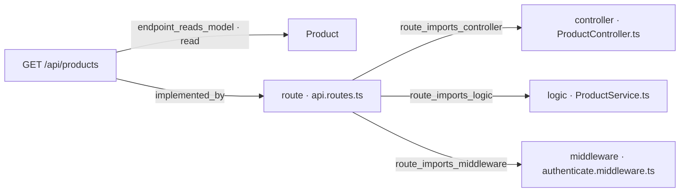
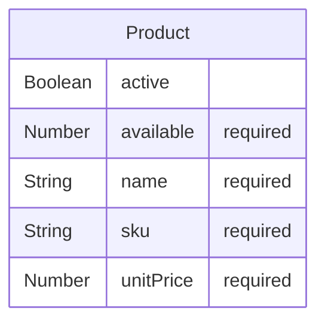

# [Documentation] Products — documento técnico

## Qué pide la spec

El endpoint [ancla:endpoint GET /api/products] sirve el catálogo de productos activos con su precio y su disponibilidad [spec:endpoint GET /api/products]. Su propósito es que el frontend de GREEN-ORD-UX-001 (pantalla `/orders/new`) pueda presentar al cliente qué productos puede pedir y en qué cantidad antes de componer un pedido [spec:acceptance_criteria AC-06].

La spec delimita el alcance de este endpoint con precisión: proporciona datos de lectura pura sobre la entidad [ancla:entity Product] [spec:entidad Product] — campos `_id`, `sku`, `name`, `unitPrice`, `available` y `active` — sin que el cliente pueda influir en ninguno de esos valores. Los precios los calcula siempre el servidor [spec:business_rule RN-05]; el catálogo y su gestión están fuera de alcance de esta API (son responsabilidad de otro sistema). La disponibilidad que devuelve este endpoint es informativa: la comprobación vinculante ocurre en el momento de crear y confirmar el pedido [spec:business_rule RN-03] [spec:business_rule RN-04].

El acceso requiere un JWT válido en todos los endpoints sin excepción [spec:business_rule RN-06], y este no es distinto [spec:acceptance_criteria AC-07]. Sin token, o con un token sin `sub` o sin `exp`, la respuesta es 401 [spec:error UNAUTHORIZED].

Los endpoints de pedidos (POST /api/orders, GET /api/orders, GET /api/orders/:id, POST /api/orders/:id/confirm) y su documentación son responsabilidad de [wi:WI-ORD-API-005] y [wi:WI-ORD-API-006] respectivamente; no se describen aquí.

---

## El trabajo y su historia

| work item | qué | tipo | estado | asignado a |
|---|---|---|---|---|
| WI-ORD-API-001 | [Backend] Orders — implementar endpoints | Backend | Cancelado | sin asignar |
| WI-ORD-API-002 | [Documentation] Orders — documento técnico | Documentación | Cancelado | sin asignar |
| WI-ORD-API-003 | [Backend] Products — implementar endpoints | Backend | Cancelado | Jorge Developer |
| WI-ORD-API-004 | [Documentation] Products — documento técnico | Documentación | Cancelado | sin asignar |
| WI-ORD-API-005 | [Backend] Orders — implementar endpoints | Backend | Generado | sin asignar |
| WI-ORD-API-006 | [Documentation] Orders — documento técnico | Documentación | Generado | sin asignar |
| WI-ORD-API-007 | [Backend] Products — implementar endpoints | Backend | Cerrado | Jorge Developer |
| WI-ORD-API-008 | [Documentation] Products — documento técnico | Documentación | Asignado | Jorge Developer |

| fecha y hora (UTC) | work item | qué pasó | quién | motivo |
|---|---|---|---|---|
| 2026-10-12 20:05 | WI-ORD-API-001 | nace en «Generado» | Administrador Global | nacimiento del work item |
| 2026-10-12 20:05 | WI-ORD-API-002 | nace en «Generado» | Administrador Global | nacimiento del work item |
| 2026-10-12 20:05 | WI-ORD-API-003 | nace en «Generado» | Administrador Global | nacimiento del work item |
| 2026-10-12 20:05 | WI-ORD-API-004 | nace en «Generado» | Administrador Global | nacimiento del work item |
| 2026-10-12 20:07 | WI-ORD-API-003 | «Generado» → «Contexto Listo» | Administrador Global | context pack preparado |
| 2026-10-12 20:07 | WI-ORD-API-003 | «Contexto Listo» → «Aprobado» | Administrador Global | Pack revisado (v3, 10.245 tokens): contratos, modelo de datos, contexto técnico, constitución y convenciones incluidos. Ola 7 · H3. |
| 2026-10-12 20:07 | WI-ORD-API-003 | «Aprobado» → «Asignado» | Administrador Global | asignación de work item |
| 2026-10-12 20:07 | WI-ORD-API-003 | «Asignado» → «En Progreso» | Administrador Global | Run autónomo 71f7f431-e151-48a8-90d0-f8bdad9293f7 (agente developer) |
| 2026-10-12 20:22 | WI-ORD-API-003 | «En Progreso» → «Bloqueado» | Administrador Global | El run 71f7f431-e151-48a8-90d0-f8bdad9293f7 del agente developer murió sin terminar: No se publica: el work item no cumple sus puertas — gate_sin_cumplir: confirmar un pedido y comprobar que GET /api/orders y GET /api/orders/:id lo devuelven confirmed en la siguiente petición — el informe no la declara cumplida (RN-01) · gate_sin_cumplir: GET y POST confirm sobre un pedido de otro cliente responden 403 ORDER_FORBIDDEN — el informe no la declara cumplida (RN-02) |
| 2026-10-12 23:06 | WI-ORD-API-004 | «Generado» → «Contexto Listo» | Administrador Global | context pack preparado |
| 2026-10-12 23:06 | WI-ORD-API-002 | «Generado» → «Contexto Listo» | Administrador Global | context pack preparado |
| 2026-10-12 23:06 | WI-ORD-API-001 | «Generado» → «Contexto Listo» | Administrador Global | context pack preparado |
| 2026-10-12 23:08 | WI-ORD-API-001 | «Contexto Listo» → «Cancelado» | Administrador Global | Generado antes de arreglar el reparto de entidades por recurso: llevaba «Migración de esquema — Product, Order» y la entidad ajena en su pack. Se regenera desde el agrupador con el descomponedor corregido (H0 de plan_ux_llenar_bien_la_spec). |
| 2026-10-12 23:08 | WI-ORD-API-002 | «Contexto Listo» → «Cancelado» | Administrador Global | Generado antes de arreglar el reparto de entidades por recurso: llevaba «Migración de esquema — Product, Order» y la entidad ajena en su pack. Se regenera desde el agrupador con el descomponedor corregido (H0 de plan_ux_llenar_bien_la_spec). |
| 2026-10-12 23:08 | WI-ORD-API-003 | «Bloqueado» → «Cancelado» | Administrador Global | Generado antes de arreglar el reparto de entidades por recurso: llevaba «Migración de esquema — Product, Order» y la entidad ajena en su pack. Se regenera desde el agrupador con el descomponedor corregido (H0 de plan_ux_llenar_bien_la_spec). |
| 2026-10-12 23:08 | WI-ORD-API-004 | «Contexto Listo» → «Cancelado» | Administrador Global | Generado antes de arreglar el reparto de entidades por recurso: llevaba «Migración de esquema — Product, Order» y la entidad ajena en su pack. Se regenera desde el agrupador con el descomponedor corregido (H0 de plan_ux_llenar_bien_la_spec). |
| 2026-10-12 23:08 | WI-ORD-API-005 | nace en «Generado» | Administrador Global | nacimiento del work item |
| 2026-10-12 23:08 | WI-ORD-API-006 | nace en «Generado» | Administrador Global | nacimiento del work item |
| 2026-10-12 23:08 | WI-ORD-API-007 | nace en «Generado» | Administrador Global | nacimiento del work item |
| 2026-10-12 23:08 | WI-ORD-API-008 | nace en «Generado» | Administrador Global | nacimiento del work item |
| 2026-10-12 23:09 | WI-ORD-API-007 | «Generado» → «Contexto Listo» | Administrador Global | context pack preparado |
| 2026-10-12 23:11 | WI-ORD-API-007 | «Contexto Listo» → «Aprobado» | Administrador Global | — |
| 2026-10-12 23:12 | WI-ORD-API-007 | «Aprobado» → «Asignado» | Administrador Global | asignación de work item |
| 2026-10-12 23:12 | WI-ORD-API-007 | «Asignado» → «En Progreso» | Administrador Global | Run autónomo c31137c4-5217-4056-8565-ca6e597c7d86 (agente developer) |
| 2026-10-12 23:28 | WI-ORD-API-007 | «En Progreso» → «Bloqueado» | Administrador Global | El run c31137c4-5217-4056-8565-ca6e597c7d86 del agente developer murió sin terminar: Alguien canceló el run: el bucle se paró antes de pedir el turno siguiente |
| 2026-10-13 01:15 | WI-ORD-API-007 | «Bloqueado» → «En Progreso» | Administrador Global | Run autónomo db551f0c-fa44-42ce-b55f-f2cb46fc0479 (agente developer) |
| 2026-10-13 01:23 | WI-ORD-API-007 | PR #1 abierto | git | WI-ORD-API-007 · implementación autónoma |
| 2026-10-13 01:57 | WI-ORD-API-007 | «En Progreso» → «MR Abierto · en revisión» | Administrador Global | sugerencia de git aceptada |
| 2026-10-13 02:03 | WI-ORD-API-007 | PR #1 mergeado | git | WI-ORD-API-007 · implementación autónoma |
| 2026-10-13 03:04 | WI-ORD-API-007 | «MR Abierto · en revisión» → «Validado» | Administrador Global | — |
| 2026-10-13 03:05 | WI-ORD-API-007 | «Validado» → «Mergeado» | Administrador Global | sugerencia de git aceptada |
| 2026-10-13 03:05 | WI-ORD-API-007 | «Mergeado» → «Cerrado» | Administrador Global | — |
| 2026-10-13 11:38 | WI-ORD-API-008 | «Generado» → «Contexto Listo» | Administrador Global | context pack preparado |
| 2026-10-13 11:38 | WI-ORD-API-008 | «Contexto Listo» → «Aprobado» | Administrador Global | — |
| 2026-10-13 11:39 | WI-ORD-API-008 | «Aprobado» → «Asignado» | Administrador Global | asignación de work item |

La historia de este work item comienza con una reorganización del reparto. El 12 de octubre de 2026 nacieron cuatro work items iniciales [estado:WI-ORD-API-001] [estado:WI-ORD-API-002] [estado:WI-ORD-API-003] [estado:WI-ORD-API-004]. El backend de productos, [wi:WI-ORD-API-003], llegó a ejecutarse pero quedó bloqueado porque el informe de finalización no declaraba cubiertas las puertas de RN-01 y RN-02 [estado:WI-ORD-API-003]. A las 23:08 UTC del mismo día, los cuatro work items originales fueron cancelados porque habían sido generados antes de que se corrigiera el descomponedor de entidades por recurso: el pack de contexto mezclaba entidades ajenas [estado:WI-ORD-API-001] [estado:WI-ORD-API-002] [estado:WI-ORD-API-003] [estado:WI-ORD-API-004].

En ese mismo momento nacieron los cuatro work items de la segunda generación [estado:WI-ORD-API-005] [estado:WI-ORD-API-006] [estado:WI-ORD-API-007] [estado:WI-ORD-API-008]. El backend [wi:WI-ORD-API-007] arrancó a las 23:09 UTC, sufrió una segunda interrupción por cancelación externa del run [estado:WI-ORD-API-007], se retomó a las 01:15 UTC del 13 de octubre, abrió [git:PR #1] a las 01:23 UTC y lo vio mergeado a las 02:03 UTC. El estado «Cerrado» se alcanzó a las 03:05 UTC [estado:WI-ORD-API-007].

El presente work item de documentación, WI-ORD-API-008, nació a las 23:08 UTC del 12 de octubre y permaneció en «Generado» hasta el 13 de octubre a las 11:38 UTC, cuando el contexto quedó listo y fue aprobado y asignado en sucesión [estado:WI-ORD-API-008].

---

## Lo que se tocó

### WI-ORD-API-007 · Backend · «Cerrado»
- Informe de finalización [informe:WI-ORD-API-007], 2026-10-13 01:23 UTC, commit 9d2c4e8: 1 de 1 criterios cubiertos.
  - Lo que dijo al entregarlo: Run autónomo db551f0c-fa44-42ce-b55f-f2cb46fc0479 (agente developer): El build TypeScript pasa sin errores. Todo está en verde. Resumen de implementación — WI-ORD-API-007: Qué se implementó: Endpoint `GET /api/products` — catálogo de productos activos con precio y disponibilidad, paginado y ordenado por `name`/`sku`. Proyecto completamente greenfield (solo existía `README.md`). Se construyó la estructura completa del backend siguiendo la plantilla del stack: Ficheros creados:
  - Criterios y sus pruebas:
    - AC-06 (cubierto): GET /api/products devuelve los productos activos con precio y disponibilidad. Verificado con tests de integración que comprueban: lista vacía, solo activos, orden por name/sku, paginación, formato de unitPrice (2 decimales) y campo available ≥ 0.
  - Decisiones:
    - desviación: La spec (§4) declara explícitamente: 'Excepción declarada a la plantilla: no hay attachAuthenticatedUser ni requireAdmin, porque no hay colección de usuarios ni roles (la identidad es externa)'. La spec manda sobre la plantilla según §4-bis.
    - desviación: Necesario para que los tests (que fijan las variables de entorno antes de crear la app) funcionen correctamente sin reiniciar el módulo. La seguridad no se ve afectada: en producción las variables se cargan antes del arranque del servidor.
  - Evidencias:
    - test_results `workflow_artifacts/092a1d4d-6634-48ef-8cbd-78c26fa2fda7` (corroborada): Salida real del comando, ejecutado en el contenedor efímero
    - test_results `workflow_artifacts/84352be5-ef30-4488-9ca2-555a8e845a94` (corroborada): Salida real del comando, ejecutado en el contenedor efímero
    - coverage_report `workflow_artifacts/092a1d4d-6634-48ef-8cbd-78c26fa2fda7` (corroborada): Informe de cobertura dentro de la salida de las pruebas, en el contenedor efímero
    - test_results `.sdd/evidence/test-results.txt` (corroborada): 30 tests passing: 29 en products.spec.ts (integración + unitarios) y 1 en migration.spec.ts
    - migration_log `.sdd/evidence/migration.log` (corroborada): Log generado por migration.spec.ts: colección products creada con índices sku (único) y {active, name, sku} compuesto. Verificado en MongoDB in-memory.
    - coverage_report `api/coverage/lcov-report/index.html`: Cobertura medida en la corrida: 90.51% de líneas en los 11 ficheros tocados (exigida ≥ 80%). Resumen en api/coverage/coverage-summary.json.
    - api_docs `api/src/controllers/*.ts` (corroborada): —
- Contratos del código: [codigo:GET /api/products], [codigo:model:Product]

### Ficheros del PR #1, mergeado el 2026-10-13 02:03 UTC: 25 ficheros, +7911 −0
| fichero | cambio | + | − |
|---|---|---|---|
| `api/package-lock.json` | añadido | 6499 | 0 |
| `api/src/__tests__/products.spec.ts` | añadido | 489 | 0 |
| `api/src/__tests__/migration.spec.ts` | añadido | 103 | 0 |
| `api/src/controllers/ProductController.ts` | añadido | 89 | 0 |
| `api/src/middlewares/authenticate.middleware.ts` | añadido | 75 | 0 |
| `api/src/config/swagger.ts` | añadido | 72 | 0 |
| `.sdd/completion-report-WI-ORD-API-007.json` | añadido | 60 | 0 |
| `api/src/services/ProductService.ts` | añadido | 54 | 0 |
| `api/src/models/product.ts` | añadido | 50 | 0 |
| `.sdd/evidence/test-results.txt` | añadido | 48 | 0 |
| `api/src/lib/errors.ts` | añadido | 48 | 0 |
| `api/src/middlewares/errorHandler.middleware.ts` | añadido | 43 | 0 |
| `api/package.json` | añadido | 37 | 0 |
| `api/src/validators/product.validator.ts` | añadido | 31 | 0 |
| `api/src/app.ts` | añadido | 29 | 0 |
| `api/jest.config.js` | añadido | 28 | 0 |
| `api/src/middlewares/requestLogger.middleware.ts` | añadido | 27 | 0 |
| `api/src/config/env.ts` | añadido | 26 | 0 |
| `api/src/routes/api.routes.ts` | añadido | 24 | 0 |
| `api/tsconfig.json` | añadido | 19 | 0 |
| `api/src/server.ts` | añadido | 18 | 0 |
| `.sdd/evidence/migration.log` | añadido | 11 | 0 |
| `api/.env.example` | añadido | 11 | 0 |
| `api/src/config/connectDB.ts` | añadido | 11 | 0 |
| `api/src/lib/obfuscate.ts` | añadido | 9 | 0 |

El PR [git:PR #1] construyó el backend desde cero (el repositorio solo contenía `README.md` antes de este trabajo [informe:WI-ORD-API-007]). Los 25 ficheros añadidos con +7911 líneas representan la estructura completa de la capa backend siguiendo la plantilla del stack.

Los contratos del código que acredita el package son [codigo:GET /api/products] y [codigo:model:Product]. El informe [informe:WI-ORD-API-007] declara un único criterio cubierto — AC-06 — y enumera las evidencias que lo respaldan: 30 tests en verde (29 en `products.spec.ts` y 1 en `migration.spec.ts`), cobertura del 90,51 % de líneas sobre los 11 ficheros tocados (umbral exigido: 80 %) y el log de migración que acredita la creación de los índices.

El informe [informe:WI-ORD-API-007] recoge además dos desviaciones declaradas: la ausencia de `attachAuthenticatedUser` y `requireAdmin`, justificada por la excepción explícita de la spec (la identidad es externa, no hay colección de usuarios ni roles); y una decisión de orden de carga de variables de entorno para que los tests puedan fijarlas antes de crear la app.

---

## Cómo está construido

El siguiente diagrama refleja la arquitectura derivada del grafo de conocimiento del repositorio:

La petición entra por [arista:GET /api/products→route · api.routes.ts]. El router `api.routes.ts` compone tres piezas [arista:route · api.routes.ts→middleware · authenticate.middleware.ts] [arista:route · api.routes.ts→controller · ProductController.ts] [arista:route · api.routes.ts→logic · ProductService.ts]:

1. **`authenticate.middleware.ts`** — verifica el JWT antes de dejar pasar la petición [spec:business_rule RN-06]. Cualquier petición sin token válido termina aquí con 401 [spec:error UNAUTHORIZED].
2. **`ProductController.ts`** — recibe la petición ya autenticada, delega en el servicio y serializa la respuesta.
3. **`ProductService.ts`** — ejecuta la consulta contra la colección `products`, filtrando por `active: true` y ordenando por `name`/`sku` [informe:WI-ORD-API-007], y devuelve la lista al controlador.

El endpoint [arista:GET /api/products→Product] lee el modelo `Product` [ancla:entity Product]; ninguna otra colección se toca en esta ruta.

El modelo de datos real, extraído del contrato ORM [codigo:model:Product]:

El campo `active` es el que controla la visibilidad en el catálogo: solo los productos con `active: true` aparecen en la respuesta [spec:acceptance_criteria AC-06]. El campo `_id` está presente en la colección pero no se modela explícitamente en el diagrama ER; `sku` tiene índice único y la combinación `{active, name, sku}` tiene índice compuesto para la consulta del catálogo [informe:WI-ORD-API-007]. Los precios se entregan con dos decimales fijos [informe:WI-ORD-API-007].

El resto de la infraestructura transversal creada por [wi:WI-ORD-API-007] — `app.ts`, `server.ts`, `connectDB.ts`, `errors.ts`, `errorHandler.middleware.ts`, `requestLogger.middleware.ts`, `obfuscate.ts`, `env.ts`, `swagger.ts` y los ficheros de configuración de proyecto — es la base sobre la que [wi:WI-ORD-API-005] construirá los endpoints de pedidos; no se detalla aquí.

---

## Reglas de negocio

Las reglas que afectan directamente a [ancla:endpoint GET /api/products] son:

- **RN-05** [spec:business_rule RN-05]: los precios y el total los calcula el servidor con el precio del catálogo. El cliente nunca envía precios; el catálogo es la fuente de verdad para cualquier cálculo posterior.
- **RN-06** [spec:business_rule RN-06]: sin token válido el endpoint responde 401 [spec:error UNAUTHORIZED]. El JWT debe usar HS256, incluir `exp` (con tolerancia de reloj de 30 s) y `sub` no vacío; durante una rotación también se acepta `JWT_SECRET_PREVIOUS`.

Las reglas RN-01 a RN-04 [spec:business_rule RN-01] [spec:business_rule RN-02] [spec:business_rule RN-03] [spec:business_rule RN-04] rigen la creación y confirmación de pedidos y son responsabilidad de [wi:WI-ORD-API-005].

---

## Cómo verificarlo

El informe [informe:WI-ORD-API-007] declara **AC-06** cubierto [spec:acceptance_criteria AC-06]: el test de integración en `api/src/__tests__/products.spec.ts` (489 líneas) verifica los siguientes casos:

- **Lista vacía** cuando no hay productos en la colección.
- **Solo productos activos**: los inactivos no aparecen en la respuesta.
- **Orden por `name`/`sku`**: la lista llega ordenada.
- **Paginación**: el informe la menciona como caso verificado; el doc-pack no detalla los parámetros de paginación más allá de esto.
- **Formato de `unitPrice`**: devuelto con dos decimales.
- **`available` ≥ 0**: nunca se devuelve un valor negativo.

El criterio **AC-07** [spec:acceptance_criteria AC-07] (401 sin token válido) está cubierto por `authenticate.middleware.ts` y sus pruebas asociadas dentro del mismo fichero de spec. El informe menciona expresamente que un JWT sin `sub` o sin `exp` da 401 [informe:WI-ORD-API-007].

El fichero `api/src/__tests__/migration.spec.ts` (103 líneas, 1 test) verifica que la migración crea la colección `products` con los índices `sku` (único) y `{active, name, sku}` compuesto en MongoDB en memoria [informe:WI-ORD-API-007].

La cobertura medida sobre los 11 ficheros del package es del **90,51 %** de líneas, por encima del 80 % exigido por la spec.

Los criterios AC-01 a AC-05 y AC-08 [spec:acceptance_criteria AC-01] [spec:acceptance_criteria AC-02] [spec:acceptance_criteria AC-03] [spec:acceptance_criteria AC-04] [spec:acceptance_criteria AC-05] [spec:acceptance_criteria AC-08] son responsabilidad de [wi:WI-ORD-API-005].

---

## Notas para el mantenedor

**Primera generación cancelada.** Los work items [wi:WI-ORD-API-003] y [wi:WI-ORD-API-004] (cancelados) tenían en su pack de contexto entidades mezcladas entre recursos. El agente de [wi:WI-ORD-API-003] llegó a ejecutarse y fue bloqueado por no declarar cubiertas RN-01 y RN-02 en su informe [estado:WI-ORD-API-003]; esas reglas no pertenecen al endpoint de productos sino al flujo de pedidos, lo que confirma que el descomponedor original estaba mal configurado [estado:WI-ORD-API-001].

**Interrupción del run de [wi:WI-ORD-API-007].** El primer run autónomo sobre el work item de backend de segunda generación fue cancelado externamente antes de completarse [estado:WI-ORD-API-007]; el segundo run completó la implementación sin incidencias. El mantenedor no necesita actuar sobre esto, pero el historial de estados refleja ese hueco entre las 23:28 y las 01:15 UTC [estado:WI-ORD-API-007].

**Paginación.** El informe [informe:WI-ORD-API-007] menciona la paginación como caso verificado en los tests, pero la spec [spec:endpoint GET /api/products] no describe parámetros de paginación en su contrato. El doc-pack no incluye información sobre los parámetros concretos (página, límite, cursor…) ni sobre el formato de la respuesta paginada. Quien mantenga este endpoint debe consultar el contrato del código [codigo:GET /api/products] para conocer el comportamiento real.

**Ausencia de `attachAuthenticatedUser` y `requireAdmin`.** La desviación respecto a la plantilla está declarada y justificada en el informe [informe:WI-ORD-API-007]: la identidad es externa y no existe colección de usuarios ni roles. La spec prevalece sobre la plantilla en este punto.

**Orden de carga de variables de entorno.** El informe [informe:WI-ORD-API-007] advierte que `env.ts` se diseñó para que los tests puedan fijar las variables antes de crear la aplicación. Cualquier refactor de la inicialización debe preservar ese contrato o los tests de integración fallarán.

**Secretos.** `MONGODB_URI`, `JWT_SECRET` y `JWT_SECRET_PREVIOUS` solo se suministran por entorno; el fichero `api/.env.example` existe sin valores reales [informe:WI-ORD-API-007]. No deben aparecer en el repositorio.

**Work items de pedidos pendientes.** [wi:WI-ORD-API-005] (backend de pedidos) está en estado «Generado» y [wi:WI-ORD-API-006] (su documentación) también [estado:WI-ORD-API-005] [estado:WI-ORD-API-006]. La infraestructura creada por [wi:WI-ORD-API-007] — errores, middleware de autenticación, logger, conexión a base de datos — está diseñada para ser compartida por ambos; cualquier cambio en esos ficheros transversales puede afectar a los endpoints de pedidos cuando se implementen.